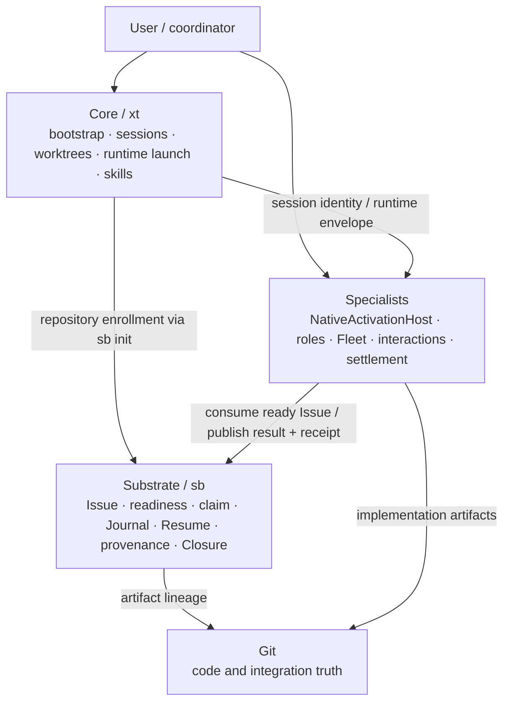

# XTRM

XTRM is an agentic engineering system built around three primary pieces:
**Specialists** for scoped agent execution, **Substrate** for durable work
authority, and **Core / `xt`** for machine, session, worktree, runtime and skill
orchestration.

This repository owns Substrate plus a set of first-party XTRM utilities and UI
workspaces. Specialists and Core are sibling repositories; they are part of the
same system but are not pretend-local packages here.

## System map



The arrows are ownership boundaries, not a claim that every package imports
every other package.

## 1. Specialists / `sp`

Repository: [`xtrm-dev/specialists`](https://github.com/xtrm-dev/specialists)

Specialists is the scoped agent-execution runtime. The current XTRM path is the
in-process **NativeActivationHost** over Pi `AgentSession`: a coordinator
selects a Specialist definition, dispatches it against a READY Substrate Issue
(or a validated inline contract), supervises asks/resume/retry, and consumes a
validated settled result.

The native execution model is designed to keep one long coordinator context
from becoming every role at once. Explorer, executor, debugger, reviewer,
test-engineer, researcher and domain Specialists run with scoped cognition,
tools, policies and output contracts. The coordinator remains the executive;
Specialist results are evidence, not self-certifying decisions.

Current native frontends include Pi and the `specialists` Claude Code plugin.
The Fleet exposes activation state, pending interactions, resume/retry and
settlement. A native activation binds to a Substrate Issue revision/hash and its
settlement publishes a bounded Journal `result` plus WorkReceipt/provenance.

The useful `sp` CLI UX remains available, but its older RPC/Supervisor/Beads job
backend is **transitional legacy** while XTRM-93 converges surviving CLI
capabilities onto the same native execution core. Do not read that legacy
backend as the target architecture.

## 2. Substrate / `sb`

Package: [`packages/substrate`](packages/substrate) · current docs:
[`packages/substrate/docs`](packages/substrate/docs/README.md)

Substrate is XTRM's durable work authority. A READY Issue revision is the
executable work contract; the Journal records what happened; the Resume Capsule
reconstructs continuation; provenance binds executions to receipts and
artifacts; Closure records why work became terminal.

Normal repository onboarding is one command:

```bash
cd <git-repository>
sb init
sb issue list
```

One global `~/.xtrm/state.db` can contain many Projects. Repository identity,
not database cardinality, chooses project context. Worktrees share their Git
repository's Project; an uninitialized repository fails closed with `sb init`
guidance.

The human CLI is terminal-native: `sb issue list` is an active-board view by
default, supports status/search/tree filtering, `sb issue show` renders the
contract as terminal Markdown with readiness/claim/Journal/provenance context,
and `sb issue browse` is a read-first tmux-style navigator. Machine `--json`
continues to expose the stable service-oriented contract.

Substrate ships first-party Pi and Claude integrations over the same typed
services. Provider tool names intentionally differ; authority semantics do not.

Install the Claude Code plugin from this repository's marketplace (read access to
the repository is required):

```bash
claude plugin marketplace add xtrm-dev/xtrm
claude plugin install substrate@substrate
```

Updates follow the version in `plugin.json`; see
[Distribution and updates](packages/substrate/docs/claude.md#distribution-and-updates).

## 3. Core / `xt`

Repository: [`xtrm-dev/core`](https://github.com/xtrm-dev/core)

Core owns XTRM machine/bootstrap and runtime integration: `xt init`, runtime
launch, worktree/session lifecycle, tmux/session identity, managed skills,
provider integration and maintenance/update flows. `xt pi`, `xt claude` and
`xt codex` are runtime/session entry points; `--role` is an interactive role
consumer with a narrow boundary to Specialists, not a second Specialist runtime.

Core does **not** invent Substrate Project identity. Current `xt init` delegates
repository enrollment to `sb init --json`, and Core propagates stable
`XTRM_SESSION_ID` / `XTRM_SESSION_NAME` into downstream execution context.

## Packages in this repository

The inventory below reflects the actual `packages/` tree.

| Package | Status | Role |
|---|---|---|
| [`packages/substrate`](packages/substrate) | primary / current | Durable work authority: Issues, readiness, claims, Journal, Resume, provenance, Closure, `sb`, Pi and Claude integrations. |
| [`packages/mcpq`](packages/mcpq) | active | Lightweight live MCP discovery/call CLI for host or Docker-network-only servers without loading every schema into every agent session. |
| [`packages/service-knowledge`](packages/service-knowledge) | active | Repo-specific operational service knowledge, drift detection, deterministic claim verification, FTS5 evidence index and read-only MCP serving. |
| [`packages/service-knowledge-ext`](packages/service-knowledge-ext) | active | Self-gating Pi extension that surfaces service-knowledge registry/drift context only when the canonical registry exists. |
| [`packages/xtprompt`](packages/xtprompt) | active | Small prompt structuring/refinement CLI using models and credentials already configured for Pi. |
| [`packages/xts`](packages/xts) | active | Minimal terminal shell assistant and guarded command helper built on Pi. |
| [`packages/xtrm-tui`](packages/xtrm-tui) | product workspace | First-party terminal agent workspace. Canonical interaction unit is `Frame` / `InteractionFrame`; implementation is still evolving. |
| [`packages/xtrm-app`](packages/xtrm-app) | product workspace | Linux-first desktop agent workspace over the same Frame concept; design/starter implementation, not a build-complete application. |
| [`packages/board-audit`](packages/board-audit) | support / migration | Beads-era board export/audit tooling retained for consumers that still need historical/fleet export surfaces; not XTRM work authority. |
| [`packages/arena-top`](packages/arena-top) | utility | Terminal view of current Arena AI leaderboard snapshots and model reference data. |

`apps/` currently contains no active application package; the GUI/TUI workspaces
live under `packages/xtrm-app` and `packages/xtrm-tui`.

## Where to start

| Intent | Start here |
|---|---|
| Track or resume durable work | [`packages/substrate/README.md`](packages/substrate/README.md) |
| Understand Issue / Journal / provenance / Closure | [`packages/substrate/docs/concepts.md`](packages/substrate/docs/concepts.md) |
| Use the `sb` terminal interface | [`packages/substrate/docs/cli.md`](packages/substrate/docs/cli.md) |
| Integrate Substrate with Pi | [`packages/substrate/docs/pi.md`](packages/substrate/docs/pi.md) |
| Integrate Substrate with Claude | [`packages/substrate/docs/claude.md`](packages/substrate/docs/claude.md) |
| Understand Specialist ↔ Substrate ownership | [`packages/substrate/docs/specialists.md`](packages/substrate/docs/specialists.md) |
| Read Substrate ADRs / migration evidence | [`docs/substrate/README.md`](docs/substrate/README.md) |
| Query MCP servers without session schema tax | [`packages/mcpq/README.md`](packages/mcpq/README.md) |
| Build operational service knowledge | [`packages/service-knowledge/README.md`](packages/service-knowledge/README.md) |
| Work on terminal/desktop XTRM UI | [`packages/xtrm-tui`](packages/xtrm-tui) / [`packages/xtrm-app`](packages/xtrm-app) |

## Documentation status

Current product/operator documentation should say what the source ships today.
Historical ADRs and migration records are preserved, but must be clearly marked
as architecture/history rather than silently reused as current instructions.
Where an inventory can be derived from source—CLI verbs, provider tools, Journal
kinds, Closure outcomes, package directories—CI should check it rather than
trust another hand-maintained copy.

## Contributing

See [`CONTRIBUTING.md`](CONTRIBUTING.md) for repository workflow and
[`SECURITY.md`](SECURITY.md) for security policy.
