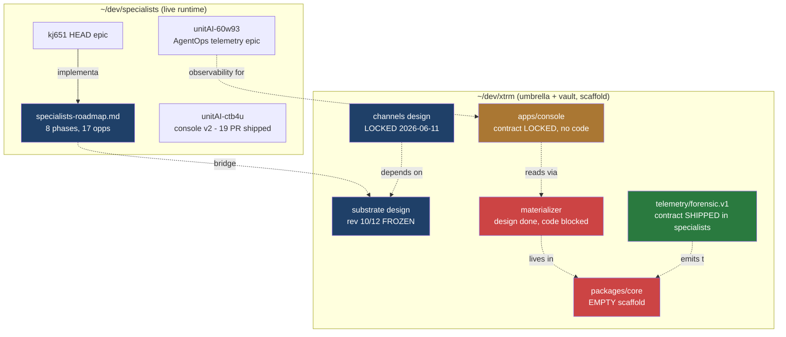
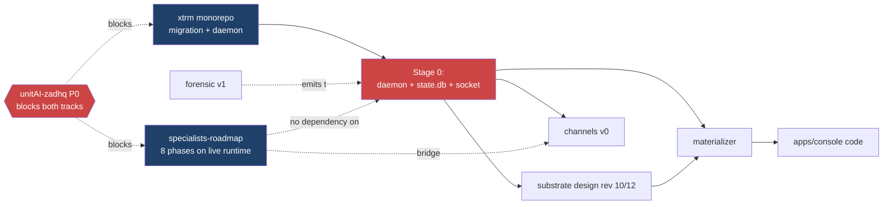
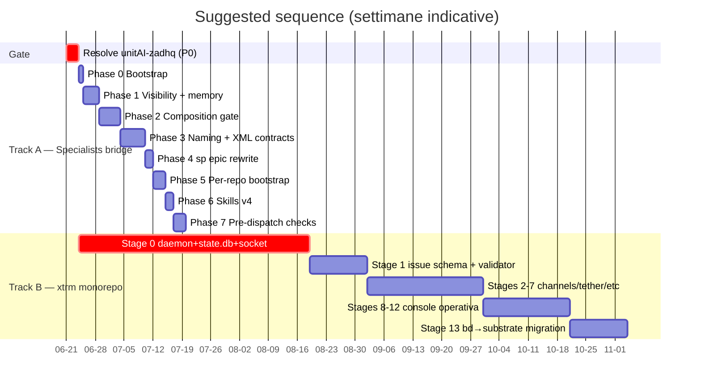

# Design Reconciliation — xtrm × specialists

> **Snapshot date:** 2026-06-21 — bootstrap dopo ~10 giorni di lavoro intenso di design.
> **Scopo:** chiarire cosa è definito, cosa è ancora aperto, quale sia la sequenza reale di lavoro, e quali decisioni bloccano l'inizio dell'implementazione.
> **Repos:** `~/dev/xtrm` (umbrella + vault), `~/dev/specialists` (runtime live).

---

## 0. TL;DR

- **Channels (xtrm)** — design **LOCKED & AUDITED** (2026-06-11). Tutte le 11 open questions risolte. 2 modifiche uncommitted al working tree (`next_seq` + narrative cursor). Pronto per implementazione runtime appena substrate Stage 0 esiste.
- **Substrate (xtrm)** — design **FROZEN** a livello architetturale (rev 10/12 post-premortem fold R2/R3/R5/R7/R9). 5 questioni minori deliberatamente deferrate. Stage 0 (daemon + state.db + socket) è il **gating critical path** di tutto il monorepo.
- **Specialists roadmap** — `specialists-roadmap.md` è canonical (1145 linee, 2026-06-03). 8 fasi (P0–P7), **nessuna avviata**. È **lavoro di bridge** sul runtime corrente (no monorepo migration richiesta).
- **Materializer / state.db** — design completo (collocazione: `packages/core/materializer/`, two-tier, three-face API). **Codice bloccato da Stage 0**. Realisticamente Stage 13.
- **Console** — product contract LOCKED. `apps/console` **non ancora scaffolded**; preflight guidance pronta. Dipende da materializer.
- **Forensic v1** — contratto **SHIPPED** nel runtime specialists. Bead `60w93.1` (xtrm) ancora `IN_PROGRESS` per work nominale.
- **Drift / stale**: `CLAUDE.md` cita `xtrm-h9hqg P0 IN_PROGRESS` ma il bead non esiste in beads (chiuso il 2026-05-27 per D25).
- **Roadmap canonicità — RISOLTA per ispezione (vedi §2.1)**: i due file roadmap sono ~99% identici. `xtrm/docs/temp_roadmap.md` è `specialists-roadmap.md` + 885 righe di garbage paste (metriche Grafana duplicate ×2) + appendice premortem §A.1–§A.5 (44 righe utili). L'unica differenza reale di contenuto è Opp 18 che in xtrm/temp è **stale** ("to-do") mentre in specialists è "shipped". **Action**: portare §A in specialists-roadmap, cancellare il temp_roadmap, chiudere `unitAI-sc03v`.

### Blocking decisions (le 3 vere)

1. **`unitAI-zadhq` (P0)** — xtrm monorepo architecture decisions (daemon ownership, state tiers). Blocca P0 della specialists-roadmap.
2. **Stage 0 cronograma** — chi/quando inizia daemon + state.db + Unix socket protocol? Tutto downstream aspetta.
3. **Sequenza specialists-roadmap vs xtrm-monorepo** — le 8 fasi di specialists girano sul runtime *corrente* (no monorepo). Vanno prima/dopo/in parallelo al lavoro xtrm?

---

## 1. Workstreams map



**Legenda colori:** verde = shipped, blu = design definito, ambra = scaffold/preflight pronto, rosso = bloccato dipendenza.

---

## 2. Stato area per area

### 2.1 Specialists roadmap (priorità 1 secondo l'operatore)

**Canonical:** `~/dev/specialists/docs/design/roadmap/specialists-roadmap.md` (1145 linee, 2026-06-03)

**Risoluzione del conflitto apparente** (bead `unitAI-sc03v`): l'altro file (`~/dev/xtrm/docs/temp_roadmap.md`, 2099 linee, 2026-06-13) sembrava più recente e ricco, ma diff approfondito mostra che è **A + alterazioni meccaniche**:

| Pezzo di B | Linee B | Cosa è | Action |
|---|---|---|---|
| Corpo `§0` + spina §1–§13.7 | 1–99 + 987–2054 | **Identico** ad A (66 sezioni condivise, stessi titoli, stessi D-numbers, stesse Opp 1–16+18, stesse fasi 0–7) | nessuna |
| Front-matter Obsidian | 1–6 | rumore vault | innocuo |
| Metrics dump CPU/Memory Grafana | **100–986** | **garbage paste** (`mmd-timescaledb`, `ext-newsletters`, `xtrm-tools-runner`), **duplicato ×2** (100–553 e 554–986 identici) | **scartare** |
| Appendice §A.1–§A.5 "Bridge cost/retirement framework" | 2055–2098 | additiva, premortem R3, 2026-06-13 | **portare in A** |
| Opp 18 status | 138, 497–513 | **stale** ("to-do, ~1.5 E-D-E") vs A che la dichiara shipped | A vince |

→ **Action concreta**: appendere §A.1–§A.5 a `specialists-roadmap.md` come `## §A. Bridge cost/retirement framework`, eliminare `xtrm/docs/temp_roadmap.md`, chiudere `unitAI-sc03v` con riferimento a questo doc.

**Index:** `~/dev/specialists/docs/design/roadmap/README.md`
**HEAD epic:** `unitAI-kj651` (decomposizione Pass-1 di tutti gli Opp)

**8 fasi**, totale effort ~23 giorni:

| Phase | Scope | Effort | Status |
|---|---|---|---|
| **0** | Bootstrap: install 13 chain-templates, planner-spec, planning-skill, config/mandatory-rules (D26/D23) | 1 g | non avviato |
| **1** | Visibility & memory pull: kill auto-inject bd-prime, memory-recall mandatory (Opp 11), error-event logging, independent test-pass gate (D2), forensic envelope 5-layer identity (Opp 18) | 4 g | non avviato |
| **2** | Composition gate (`sp chain review/approve/insert`) + persisted resolved-shape + `sp chain <bead>` timeline + `step_completed` event (Opp 8) | 5 g | non avviato |
| **3** | Naming (chain-derived branch/worktree) + step-bead `kind:step` tag + XML-structured contracts (Opp 12/D30) + contract-discipline rule (D29) | 5.5 g | non avviato |
| **4** | `sp epic` decoration rewrite + drop ~500 LOC managed-by-tooling | 2 g | non avviato |
| **5** | Per-repo bootstrap split | TBD | non avviato |
| **6** | Skills revamp `using-specialists-v4` canonical (D28) — XML semantic, contract examples, issue-relationship-graph navigation | 2 g | non avviato |
| **7** | Generalize gate pre-dispatch checks (R1–R7 reviewer friction) | 3 g | non avviato |

**Decisioni chiave (D23–D30):** vedi roadmap §0.
**Bridge verso substrate:** Opp 8 (`step_completed`) sarà subsumed da channels v0 (`kind=verdict`) quando ship.

**Beads correlate (17 directly roadmap-driven, da 50 open + 12 in_progress):**

| ID | Status | P | Rolo |
|---|---|---|---|
| **unitAI-kj651** | OPEN | P1 | HEAD epic (parent di Opp 1–17) |
| **unitAI-zadhq** | OPEN | **P0** | **BLOCKER**: handoff 2026-06-06 telemetry consolidation + xtrm monorepo arch decisions |
| **unitAI-sc03v** | OPEN | P2 | reconcile canonical roadmap (risolto: specialists-roadmap.md vince, xtrm/temp_roadmap.md è obsoleto) |
| unitAI-xqg76 | OPEN | P1 | propagate D29/D30/Opp 12 XML decisions a substrate.md |
| unitAI-3l0ac | OPEN | P1 | Opp 16 SCRUTINY enforcement (in-flight child of kj651) |
| unitAI-92waq | OPEN | P1 | FLAG: re-eval Opp 1/4/8 vs `bd merge-slot`/`gate`/`swarm` (possibile -2/-3 E-D-E) |
| unitAI-lyh1b | OPEN | P1 | sp merge / epic merge / finalize rework (replaces Phase 5 dirty-index-diagnostic) |
| unitAI-1p0s5 | OPEN | P2 | Opp 13: `sp stop --all` + `sp chain stop` |
| unitAI-60w93 | OPEN | P2 | HEAD epic AgentOps telemetry |
| unitAI-gp7nq | OPEN | P2 | global user config expansion |
| unitAI-e3w1n | OPEN | P2 | substrate rev12 round-3 → `substrate_design_en.md` |
| unitAI-4zask | IN_PROGRESS | P1 | service-skills drift sync as script-specialist |
| unitAI-q5t29 | IN_PROGRESS | P2 | script observability fixes v2 |
| unitAI-51ppz/7and7/cssbp/reu7q/zu928 | IN_PROGRESS | P2 | phase-1/2/3 smoke tests |

**Ultimi 10 giorni (PR merged):** 19 PR su epic `unitAI-ctb4u` (console v2) + materializer observability + TUI. Zero roadmap-phase implementation. Phase 0 *non ancora avviato*.

### 2.2 Channels (xtrm) — design LOCKED

**Canonical:** `~/dev/xtrm/docs/channels/channels.md`
**Audit:** 2026-06-11 (commit `efb644a`), tutte 11 open questions §12 risolte.
**Working tree:** 2 modifiche staged (`M`) — `next_seq INTEGER NOT NULL DEFAULT 1` a tabella channels + narrative cursor refinement.

```mermaid
graph LR
    subgraph CH["channels.md (§5 Architecture)"]
        S1[5.1 Storage<br/>id PK + seq display]
        S2[5.2 Lifecycle<br/>open→draining→closed]
        S3[5.3 Message Kinds<br/>work/control/system/runtime]
        S4[5.4 Subscription<br/>audience + wakes_on]
        S5[5.5 Runtime Integration<br/>reducer + after-hook]
        S6[5.6 Topologies<br/>reactive/turns/freeform]
        S7[5.7 Stop Conditions<br/>list evaluator]
        S8[5.8 Edge Derivation<br/>dispatch table]
        S9[5.9 Progress Projection<br/>container_progress]
        S10[5.10 Opportunistic Attention<br/>attention_policy]
    end

    CH --> SQ["§11 Sequencing<br/>0.1 → 0.2"]
    SQ --> P01["0.1: Autonomous chains<br/>9 seams built, dormant branches OK"]
    SQ --> P02["0.2: Freeform/self-managed nodes<br/>activate dormant, no rewire"]
```



**Seam 0.1 (9 punti, tutti built):**
1. Storage model con monotonic SQLite id + per-channel `next_seq`
2. Scheduler indirection (chain 1:1, ma node-supervisor lo richiede)
3. Participant-level addressing (L3 `participant_id`, non `job_id`)
4. Stop-condition list evaluator + `consensus:N` parser
5. Edge-deriver dispatch table (keyed by kind/proposal_class/verdict)
6. Progress projection recomputable cache
7. Opportunistic-attention contract definito, loops dormant
8. Permission/epoch swap state machine (0.2 usa, 0.1 wires)
9. Authority decision via structured `decision_schema`

**Cosa serve per partire con codice:** substrate Stage 0 (daemon+state.db). Channels è schema sopra a quello.

### 2.3 Substrate (xtrm) — design FROZEN

**Canonical:** `~/dev/xtrm/docs/substrate/substrate_design_it.md` (rev 10/12, 2106 linee, 288 KB)
**EN:** `substrate_design_en.md` (out-of-date secondo `unitAI-e3w1n`)
**Premortem:** `~/dev/xtrm/docs/premortem-substrate/` (27 file, 9 findings R1–R9, deep-dives out-01..09)

**Fissato a livello di architettura:**
- 5 container kinds permanenti: seed, chain, epic, wave, node
- Tre assi per container: membership (`parent_id`), provenance (`opened_by` immutabile), ownership (`owned_by` mutabile)
- Ciclo: `open → working → converging → ready → closed` + `escalated`
- Chain coordinator come participant di prima classe (rev 10 §4.3)
- Memory come capability interrogata (no curator dedicato, rev 10 §10.2)
- 6 default chain_templates distribuiti
- Workflows → chain_templates (rev 9), ogni dispatch è step-issue-backed

**Risolti via premortem fold (commit `978d9b0`):** R2/R3/R5/R7/R9 → canonical doc.

**Aperti (deliberatamente deferrati, decidibili a run-time):**
- #8 cross-container pulse conventions (protocol detail)
- #10 memory tuning (pruning, promotion predicates)
- #11 node nesting depth cap (soft-cap 2, valore esatto)
- #12 `dispatch_mode` predicate (binary deciso, ricchezza futura aperta)
- DB engine choice (SQLite v0; Dolt vs plain sqlite vs dolt+sqlite per versioning)

### 2.4 Core / materializer / state.db

```mermaid
graph TB
    subgraph TIER1["Tier 1: locale autoritativo"]
        D[xt daemon<br/>~/.xtrm/state.sock]
        DB[(state.db<br/>SQLite WAL)]
        SC[StateClient<br/>Unix socket protocol]
        D --- DB
        SC -->|talks to| D
    end

    subgraph TIER2["Tier 2: remoto (future)"]
        SUPA[Supabase projection<br/>team/company setup]
    end

    subgraph PKGS["Package ownership"]
        CORE_PKG["packages/core/<br/>daemon + state.db + materializer<br/>+ schema registry"]
        SUB_PKG["packages/substrate/<br/>containers/issues/plans"]
        CH_PKG["packages/channels/<br/>channel_* tables"]
        SP_PKG["packages/specialists/<br/>jobs + forensic events"]
        APP_C["apps/console/<br/>reads via API stable"]
    end

    CORE_PKG -.owns.-> D
    SUB_PKG -->|@xtrm/core| SC
    CH_PKG -->|@xtrm/core| SC
    SP_PKG -->|@xtrm/core| SC
    APP_C -->|API stable| CORE_PKG
    DB -.future projection.-> SUPA

    style CORE_PKG fill:#cc4444,color:#fff
    style D fill:#cc4444,color:#fff
    style DB fill:#cc4444,color:#fff
```

**Design completo:**
- Two-tier store (locale autoritativo + remoto futuro) — `state-store-options.md` §1–3
- Materializer collocato in `packages/core/materializer/` (cross-domain) — `monorepo-migration.md` §3.0–3.1
- Three-face API: query / changesSince / command — `substrate_design_it.md` §17
- Bias verso **read live + join nel reader** (no copia locale); cache client-side piccola per resilienza restart daemon

**Stato codice:**
- `packages/`, `apps/`, `data/` **vuoti** (verificato in CLAUDE.md, confermato dai report)
- Migrazione `git filter-repo` da gitboard in corso, non completata
- **Stage 0** = daemon + state.db + socket + schema registry → ~8 settimane stimato; gating per tutto

**Materializer specifico:**
- È **Stage 13** (finale) — è il traduttore bd→substrate, non il kernel
- Non in critical path fino a settimana 12–16
- Design OK; codice ha senso solo dopo Stage 0 stabile

### 2.5 Console

**Canonical:** `~/dev/xtrm/docs/console/console-product-contract.md` (LOCKED, 2026-06-02 → 2026-06-09)
**Scaffold guidance:** `~/dev/xtrm/docs/console/architecture/apps-console-scaffold-preflight.md`
**Code:** `apps/console/` **non ancora creato**

**Cos'è:** gitboard descendant → **professional systems console** unica (issues + specialist chains + evidence + GitHub + observability + memory). Single operational surface con stable interaction contracts. UI legge dall'API materializer.

**Dipendenze:**
- Console → API gitboard/materializer (read-only)
- Console → substrate (future, normalized read model)
- Console → forensic events (via `GET /jobs/:job_id/feed-events`)
- Console **non** dipende da channels direttamente (le osserva via forensic dual-write)

**Open (3, deliberatamente deferrate):**
1. `Session` come first-class Substrate kind o materialized view?
2. Artifact storage path canonical (per screenshots + verification files)
3. Soglia UX su inline diff (prima di handoff a GitHub/git)

### 2.6 Forensic v1

**Canonical:** `~/dev/xtrm/docs/telemetry/forensic-event-contract.md`
**Status:** SHIPPED nel runtime specialists (`src/specialist/forensic-events.ts`, `FORENSIC_SCHEMA_VERSION`, tabella `specialist_forensic_events`)
**CLI live:** `sp forensic <job-id> --json`, `GET /jobs/:job_id/feed-events`, `sp metrics --prometheus`
**Bead xtrm:** `60w93.1` ancora IN_PROGRESS (lavoro nominale; deliverable già SSOT)

```json
{
  "schema_version": "xtrm.forensic.v1",
  "timestamp": "RFC3339",
  "severity": "debug|info|warn|error|critical",
  "event_family": "job|tool|pulse|service_skills|control|...",
  "event_name": "family.action",
  "event_version": 1,
  "resource": { "participant_kind", "participant_role" },
  "correlation": { "job_id", "chain_id", "issue_id", "trace_id", "span_id" },
  "body": { /* event-specific */ },
  "redaction": { "status": "clean|redacted" }
}
```

---

## 3. Dipendenze cross-area



**Insight chiave:** specialists-roadmap e xtrm-monorepo sono **due tracce parallele**. La specialists-roadmap è bridge work sul runtime *corrente* — non aspetta Stage 0. L'unica vera dipendenza è `unitAI-zadhq` (P0) che le blocca entrambe perché contiene le decisioni di architettura del monorepo che entrambe le tracce devono rispettare.

---

## 4. Sequence proposta

Due tracce in parallelo, con un gate iniziale.



**Note:**
- Gate `unitAI-zadhq` è la **prima cosa** in assoluto. Senza, nessuna delle due tracce dovrebbe partire.
- Track A è ~23 giorni effort, su runtime esistente.
- Track B è ~16 settimane stimato. Stage 0 da solo è 8 settimane.
- Le tracce convergono al Stage 13 (materializer bd→substrate) quando entrambe sono pronte.

---

## 5. Cosa manca da definire prima di partire

In ordine di priorità (cose vere, non nice-to-have):

### P0 — bloccanti reali

1. **Decisioni di `unitAI-zadhq`**: daemon ownership (`packages/core` proprietà — sì? quale tier?), state tiers (Tier 1 locale + Tier 2 remoto: chi triggera projection? quando?), pre-migration arch. → senza, neanche partire.
2. **Sequencing decision operatore**: Track A e B in parallelo o sequenziali? Se parallelo, chi lavora su cosa (operatore + 1 collaboratore = 2 stream effettivi).

### P1 — da definire ma non bloccante immediato

3. **Stage 0 detail spec**: socket protocol wire format, schema registry shape, project registration flow. Spec esiste a livello di prosa in `substrate_design_it.md` §17; serve un design doc di Stage 0 a sé (forse `~/dev/xtrm/docs/substrate/stage-0-spec.md`).
4. **`unitAI-92waq` flag re-eval**: Opp 1/4/8 della specialists-roadmap potrebbero ridursi sostanzialmente se reusano `bd merge-slot`/`gate`/`swarm`. Decisione di scope -2/-3 E-D-E.
5. **`unitAI-xqg76`**: propagazione D29/D30 (XML contracts) a `substrate_design_it.md`. Coerenza tra runtime e domain.

### P2 — drift housekeeping

6. **CLAUDE.md update**: rimuovere/aggiornare riferimento a `xtrm-h9hqg P0 IN_PROGRESS` (bead non esiste / chiuso 2026-05-27 per D25). Aggiornare "Active work" con stato reale.
7. **MOC drift**: §7 cita duplicati repo↔vault in risoluzione. Decidere e committare il fix.
8. **`unitAI-sc03v`** ancora open con conflitto reale (vedi §0/§2.1) — non auto-risolvibile, richiede decisione operatore.
9. **`substrate_design_en.md`**: out-of-sync rispetto a rev 10/12 (lavoro: `unitAI-e3w1n`).

### P3 — deferrabili dichiarati (no action)

10. Substrate aperti #8/#10/#11/#12 — deliberatamente run-time decisions.
11. Console aperti (3) — UX validation in mock testing.
12. Forensic AWS agentcore-observability — DOPO E2E v1.

---

## 6. Drift / inconsistenze trovate

| Drift | Riferimento | Verità | Action |
|---|---|---|---|
| `xtrm-h9hqg P0 IN_PROGRESS` | `CLAUDE.md:55` | Bead non esiste; chiuso 2026-05-27 (D25 in specialists-roadmap) | aggiornare CLAUDE.md |
| Due roadmap apparentemente canonical | `xtrm/docs/temp_roadmap.md` vs `specialists/.../specialists-roadmap.md` | B = A + garbage paste Grafana ×2 + appendice §A premortem; Opp 18 stale in B | Portare §A in A, cancellare B, chiudere `unitAI-sc03v` |
| `unitAI-60w93.1 IN_PROGRESS` | `CLAUDE.md:57` | Contratto forensic già SHIPPED; ID di bead conferma ancora work | verificare con `bd show` |
| MOC §7 duplicati repo↔vault | `docs/xtrm-MOC.md:§7` | "in risoluzione (note di relocation applicate, commit/push deferred)" | committare la risoluzione |
| `substrate_design_en.md` stale | `unitAI-e3w1n` | EN out-of-sync rispetto a IT rev 10/12 | sync (P2) |

---

## 7. File chiave per orientamento

| Tema | File |
|---|---|
| Specialists roadmap canonical | `~/dev/specialists/docs/design/roadmap/specialists-roadmap.md` |
| Chain templates | `~/dev/specialists/docs/design/roadmap/chain-templates/` (13 `.formula.json`) |
| Substrate design | `~/dev/xtrm/docs/substrate/substrate_design_it.md` |
| Substrate premortem | `~/dev/xtrm/docs/premortem-substrate/synthesis.md` + R1–R9 |
| Channels | `~/dev/xtrm/docs/channels/channels.md` |
| Materializer placement | `~/dev/xtrm/docs/monorepo-migration.md` §3.0–3.1 |
| Store options | `~/dev/xtrm/docs/state-store-options.md` |
| Console product contract | `~/dev/xtrm/docs/console/console-product-contract.md` |
| Console scaffold preflight | `~/dev/xtrm/docs/console/architecture/apps-console-scaffold-preflight.md` |
| Forensic envelope | `~/dev/xtrm/docs/telemetry/forensic-event-contract.md` |
| Design surface map | `~/dev/xtrm/docs/xtrm-MOC.md` |

---

## 8. Next step proposto

1. **Operatore**: leggere §0 + §3 + §4. Confermare/rivedere la sequence.
2. **Operatore**: dare seguito a `unitAI-zadhq` (P0) — è il gate reale. O delegarlo a un agente di design.
3. **Subito dopo**: scegliere se aprire Track A (specialists Phase 0) e Track B (Stage 0 detail spec) in parallelo, o sequenziale.
4. **Housekeeping in parallelo**: §6 drift items (10 min di lavoro totale).
5. **Dopo l'allineamento**: convertire questo `.md` in artifact HTML (interattivo, con i diagrammi rendered side-by-side e link cliccabili ai file).

---

*Doc generato 2026-06-21 da Claude (Opus 4.7) tramite 4 Explore subagent paralleli su xtrm + specialists. Vedi commit log per snapshot delle fonti.*
