# Channels spiegato semplice

> Questa pagina spiega `channels.md` in italiano semplice.
> Non sostituisce la specifica tecnica: serve a capire il progetto, discuterlo e orientarsi.

## 1. In una frase

Un **channel** è uno spazio ordinato dove agenti, giudici e operatori si scambiano messaggi brevi e strutturati, così un lavoro può avanzare senza che una persona debba ogni volta copiare risultati da un agente all'altro.

In pratica: invece di avere mille conversazioni scollegate, ogni container di lavoro ha il suo canale interno, con regole chiare su chi può leggere, chi può agire, chi può svegliare chi, e cosa viene registrato per audit.

## 2. Perché serve

Oggi molti passaggi sono mediati manualmente:

- un reviewer trova un problema, ma l'executor lo vede solo se qualcuno lo sveglia;
- il coordinator spesso fa da postino invece che da giudice;
- l'operatore può mandare istruzioni a un job, ma non a un contesto di lavoro intero;
- la memoria del node conserva conclusioni, ma non conserva bene ordine, destinatari, autorizzazioni e causalità.

`channels` risolve questo creando una primitiva unica: un canale per la comunicazione dentro un container.

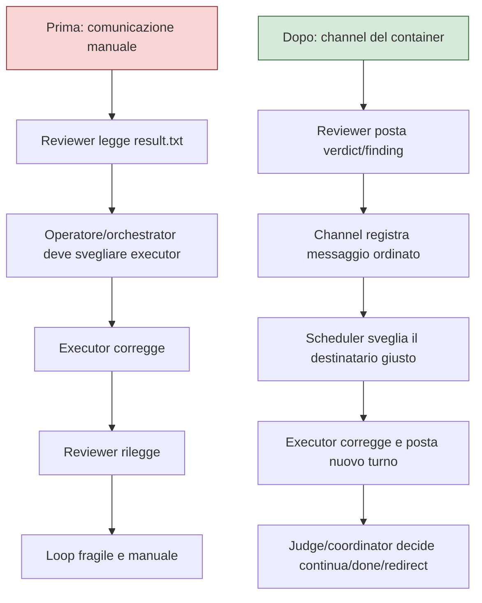

## 3. Le parole importanti

| Termine | Significato semplice |
| --- | --- |
| **Container** | Il perimetro di un lavoro: una chain, un node, una pair-talk. |
| **Channel** | Il canale di messaggi dentro quel container. |
| **Participant** | Chi partecipa: executor, reviewer, judge, coordinator, operatore, sistema. |
| **Message** | Un messaggio breve, strutturato, con tipo e destinatari. |
| **Subscription** | La regola che dice quali messaggi un participant riceve automaticamente. |
| **Audience** | Chi può sapere che un messaggio esiste e chi deve agire. |
| **Visibility** | Chi può vedere il pointer/card del messaggio. Non concede potere. |
| **Evidence** | Il contenuto importante e durevole: risultati, verdict, finding, log, prove. |
| **Forensic event** | Traccia di audit: cosa è successo, quando, con quali ID. |
| **Scheduler** | Il componente che decide se e quando svegliare un participant. |
| **Judge** | Un participant speciale che decide `done`, `continue`, `redirect`, e in 0.2 anche `swap`. |

## 4. Il principio più importante

Il channel **consegna messaggi**, ma non decide la verità del sistema.

La separazione è questa:

- **channels**: consegna, ordine, destinatari, messaggi;
- **substrate**: stato autorevole, identità, work graph, proiezioni, grant evidence;
- **forensics**: audit e drilldown, non autorizzazione;
- **metrics**: aggregati a bassa cardinalità, non dettagli per-job.

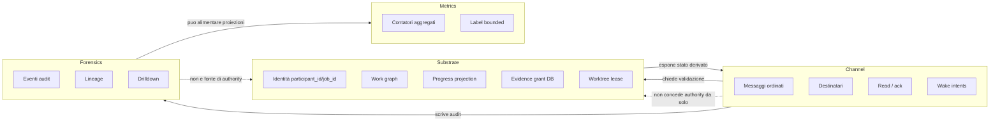

## 5. Cosa contiene un channel

Un channel ha tre cose principali:

1. una riga `channels`, che descrive il canale;
2. tante righe `channel_messages`, una per messaggio;
3. una riga `channel_subscriptions` per ogni participant, che dice fino a quale messaggio ha processato.

Il punto delicato: ci sono due numeri.

- `id`: numero globale del messaggio nella tabella. È il **vero cursore** per read/ack/replay.
- `seq`: numero leggibile dentro quel channel. Serve a `sp tail`, non alla correttezza.

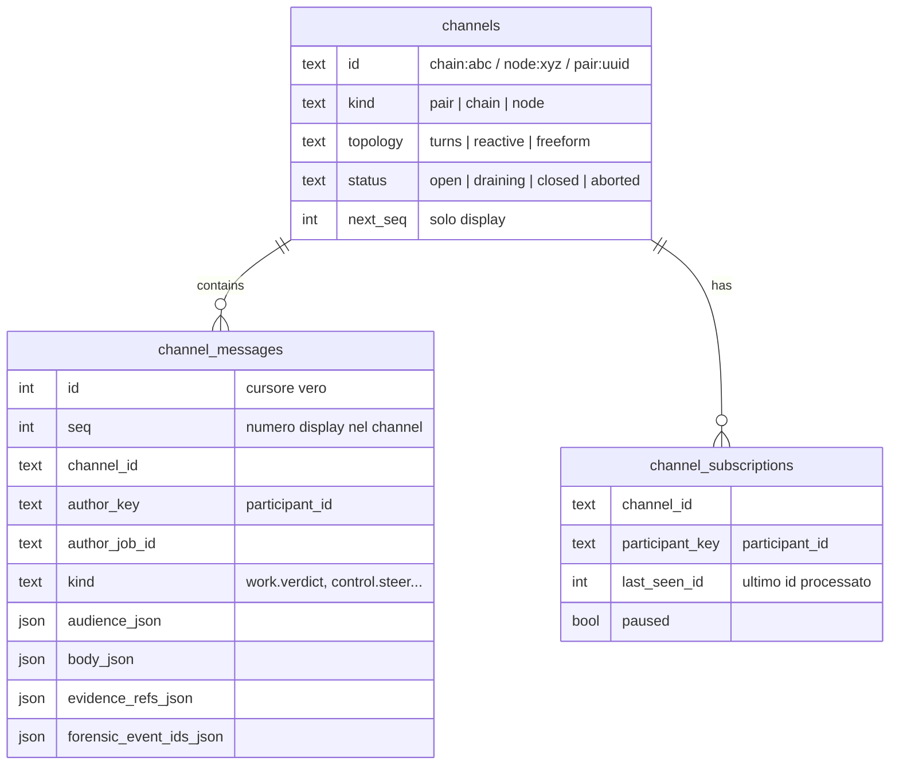

## 6. Vita di un channel

Un channel nasce, si apre, poi quando il lavoro è finito entra in drain e infine si chiude.

`draining` significa: il canale non accetta più nuovi messaggi azionabili, ma lascia leggere e confermare i messaggi rimasti.

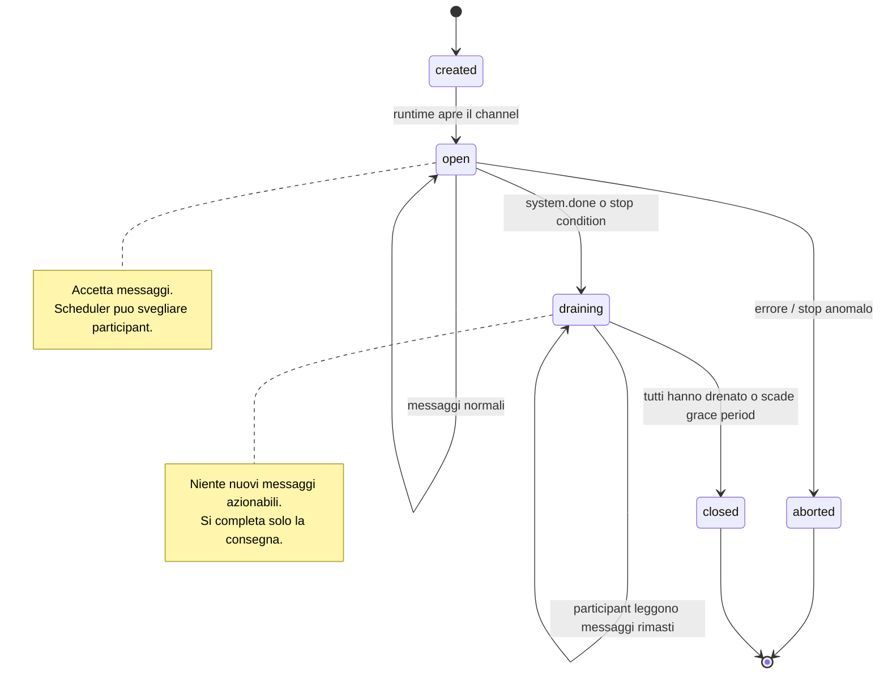

## 7. Tipi di messaggi

I messaggi non sono testo libero. Ogni messaggio ha una famiglia e una forma precisa.

| Famiglia | Esempi | A cosa serve |
| --- | --- | --- |
| `work.*` | `work.turn`, `work.finding`, `work.verdict`, `work.proposal` | Lavoro reale e risultati. |
| `control.*` | `control.steer`, `control.attention_requested`, `control.escalation` | Istruzioni, richieste di attenzione, escalation. |
| `system.*` | `system.done`, `system.redirect`, `system.swap`, `system.epoch_bump` | Decisioni del runtime/judge. |
| `runtime.*` | `runtime.message_rejected`, `runtime.delivery_failed`, `runtime.participant_died`, `runtime.gate_unresponsive`, `runtime.worktree_diverged`, `runtime.evidence_ref_broken`, `runtime.pulse_delivery_failed`, `runtime.budget_exhausted_mid_step`, `runtime.recursion_cap` | Meccanica e errori del channel + failure meccanici intra-run osservati dal reducer (vedi nota sotto). |
| `chain.incident.*` | `chain.incident.opened`, `chain.incident.resolved` | Wake esplicito del chain coordinator quando recovery deterministica del reducer esaurisce o la failure è judgment-shaped (substrate §4.3 ruolo 5). |
| `note` | testo innocuo | Messaggio preservato ma non azionabile. |

> **Failure meccanici intra-run (added 2026-06-13, xtrm-1jp).** Il reducer osserva continuamente lo stato meccanico del container e registra ogni anomalia come messaggio `runtime.*`:
> - `runtime.participant_died` — un participant non ha emesso `agent_end` entro il budget dello step.
> - `runtime.gate_unresponsive` — un gate è stato dispatched ma non ha emesso `verdict` entro T.
> - `runtime.worktree_diverged` — la base del worktree è stata spostata; il branch non è più fast-forwardabile.
> - `runtime.evidence_ref_broken` — un file o event referenziato da un evidence pointer non esiste più.
> - `runtime.pulse_delivery_failed` — cross-chain hygiene (§4.3 ruolo 3) ha esaurito i retry per un pulse.
> - `runtime.budget_exhausted_mid_step` — la chain ha superato la wall/dollar budget prima del completamento dello step corrente.
> - `runtime.recursion_cap` — un loop coordinator-restitch ha raggiunto l'hard_cap di §5.10.
>
> Su classi deterministiche il reducer tenta recovery automatica (idempotency-keyed retry, requeue, respawn-via-journal §5.9) prima di coinvolgere il coordinator. Quando recovery esaurisce o la failure è judgment-shaped, l'after-hook emette `chain.incident.opened` con idempotency key — il coordinator vede solo questo wake esplicito, non ogni `runtime.*` notice. La purezza del reducer richiesta da §11 è preservata: detection nel reducer, wake intent nell'after-hook. Il chain non può fallire per runtime fallthrough (substrate §3.1 invariante 2026-06-13): `closed:failed` è sempre un coordinator verdict.

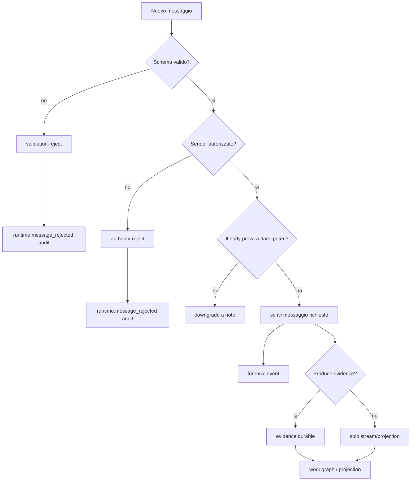

## 8. Audience: chi vede e chi agisce

Ogni messaggio ha un `audience_json`.

Contiene:

- `visibility`: chi può sapere che il messaggio esiste;
- `action_targets`: chi deve agire;
- `suggested_watchers`: chi potrebbe essere interessato, ma non viene forzato ad agire;
- `scope_refs`: a quali file, issue, package o contract si riferisce;
- `urgency`: quanto può diventare urgente.

La regola semplice:

**vedere non significa poter agire; poter notare non significa essere autorizzati.**

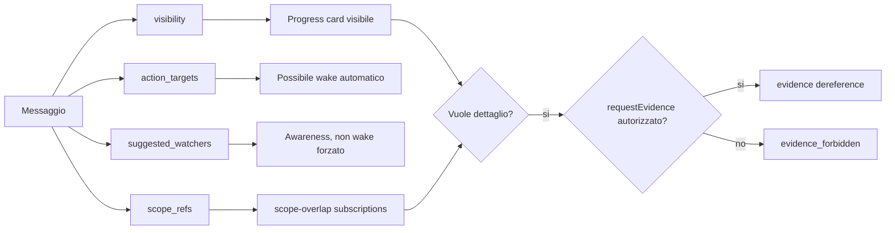

## 9. `scope_refs` in parole semplici

`scope_refs` risponde alla domanda: "questo messaggio riguarda anche il mio lavoro?"

In 0.1 sono ammessi:

- `file`: un file o una directory;
- `package`: un package/workspace;
- `contract`: un contratto di lavoro;
- `issue`: un issue.

In 0.2 arriva:

- `symbol`: funzione/classe/simbolo, con supporto GitNexus.

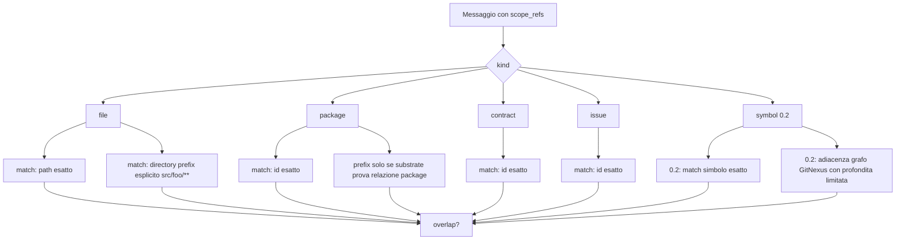

## 10. Read e ack: leggere non sposta il cursore

Il sistema separa lettura e conferma.

1. `readSince` legge messaggi nuovi.
2. Il participant prova a processarli.
3. Solo se gli effetti necessari riescono, `markSeen` avanza il cursore.

Questo evita un bug grave: segnare come letto un messaggio che non ha davvero svegliato nessuno.

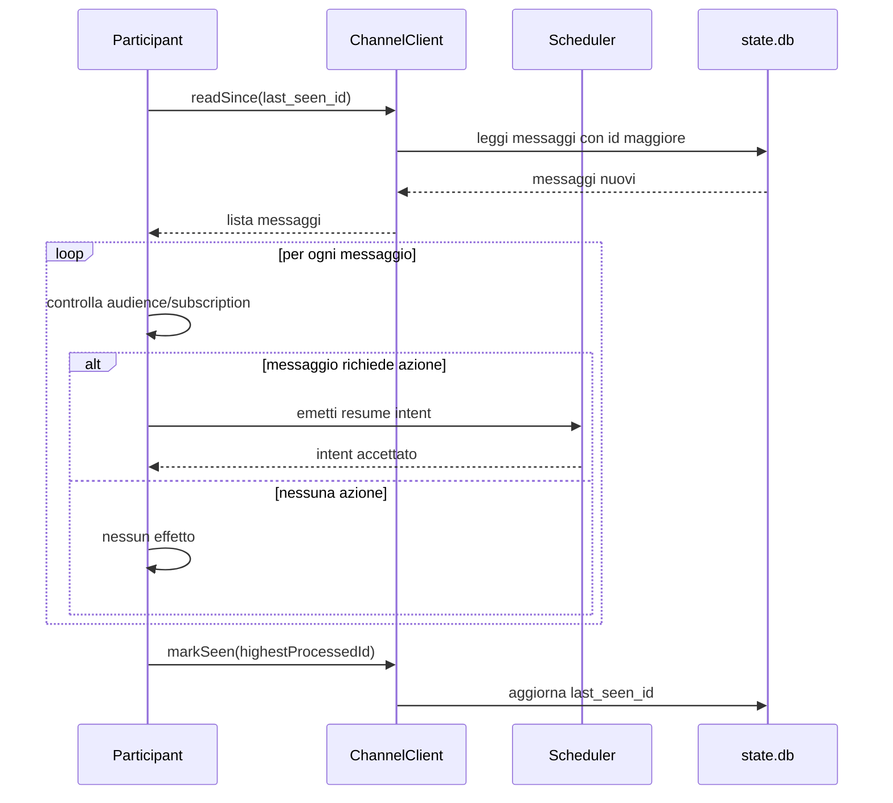

## 11. Reducer e after-hook

Ogni ciclo ha due parti:

- **reducer**: ricalcola stato, senza effetti esterni;
- **after-hook**: fa effetti reali, ma con chiavi di idempotenza.

Idempotenza significa: se il sistema ripete il passaggio dopo un crash, non crea due wake, due evidence o due edge uguali.

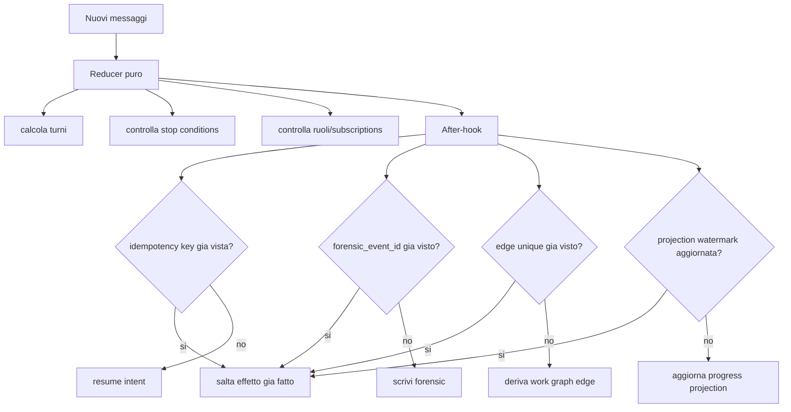

## 12. Scheduler: il channel non sveglia direttamente i job

Il channel produce un'intenzione: "questo participant dovrebbe essere svegliato".

Poi decide lo scheduler:

- nelle chain è quasi 1:1, semplice;
- nei node decide `node-supervisor`, per evitare split-brain.

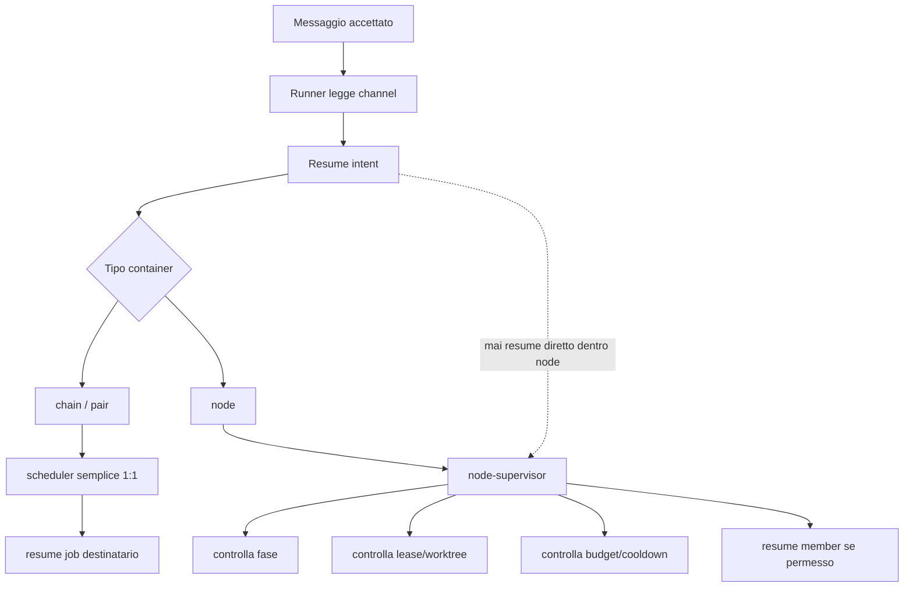

## 13. Work graph e progress card

Il channel è lo stream operativo. Il substrate crea due superfici derivate:

- **work graph**: spiega relazioni durevoli tra issue e risultati;
- **progress projection**: mostra lo stato compatto del container.

Il messaggio non è la verità finale: è la sorgente da cui si derivano evidence, edge e proiezioni.

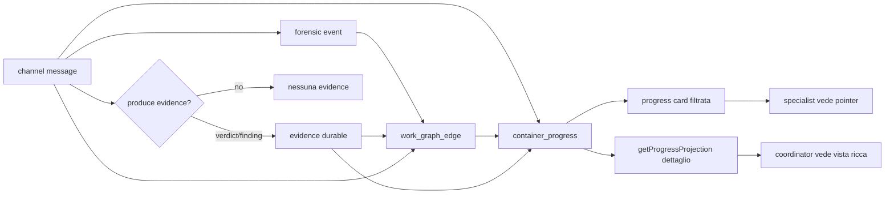

## 14. Evidence: vedere un pointer non basta

Un participant può vedere che esiste una prova, ma non può sempre aprirla.

Per aprire evidence fuori dal proprio step contract serve un grant durevole nel DB substrate.

Forensics registra l'audit, ma non autorizza.

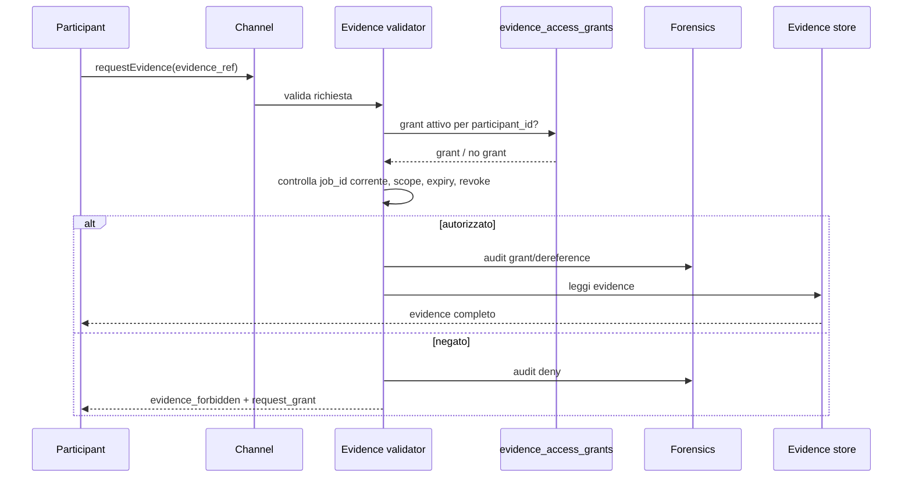

La riga di grant contiene:

- chi riceve il grant (`subject_participant_id`);
- quale activation era corrente (`subject_job_id_at_grant`);
- chi l'ha concesso;
- quale evidence o scope copre;
- quando scade;
- se è stato revocato;
- se è override operatore.

## 15. Attenzione opportunistica

Un participant può notare qualcosa anche se il messaggio non era indirizzato a lui.

Ma può solo chiedere:

- rung 1: "vorrei attenzione / contesto";
- rung 2: "propongo di attivarmi".

Non può auto-autorizzarsi.

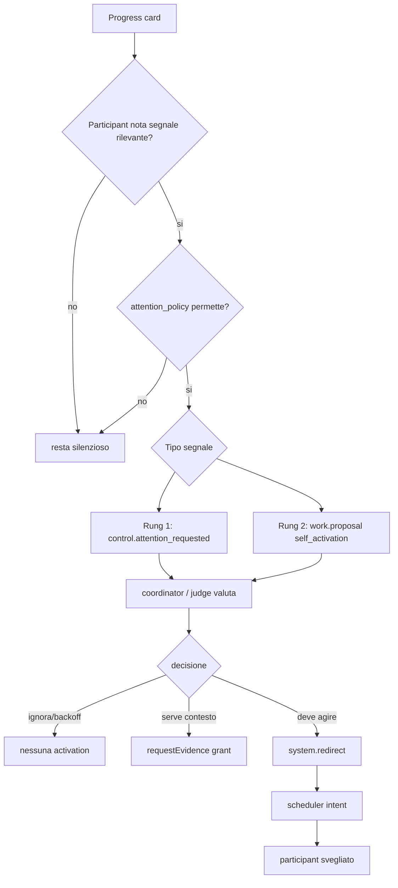

Limiti iniziali:

- massimo 2 richieste di attenzione per epoch;
- massimo 1 proposta di self-activation per epoch;
- cooldown iniziale: 2 event ticks / 1 turn;
- stesso scope nello stesso epoch viene deduplicato.

## 16. Epoch

Un epoch è il periodo in cui membership e capability del channel restano uguali.

Si resetta quando il runtime scrive `system.epoch_bump`, per esempio:

- dopo uno swap completato;
- dopo revoca di capability;
- dopo cambio di authority equivalente.

Non è un timer. Non passa "ogni 10 minuti". È legato a cambiamenti reali nello stato.

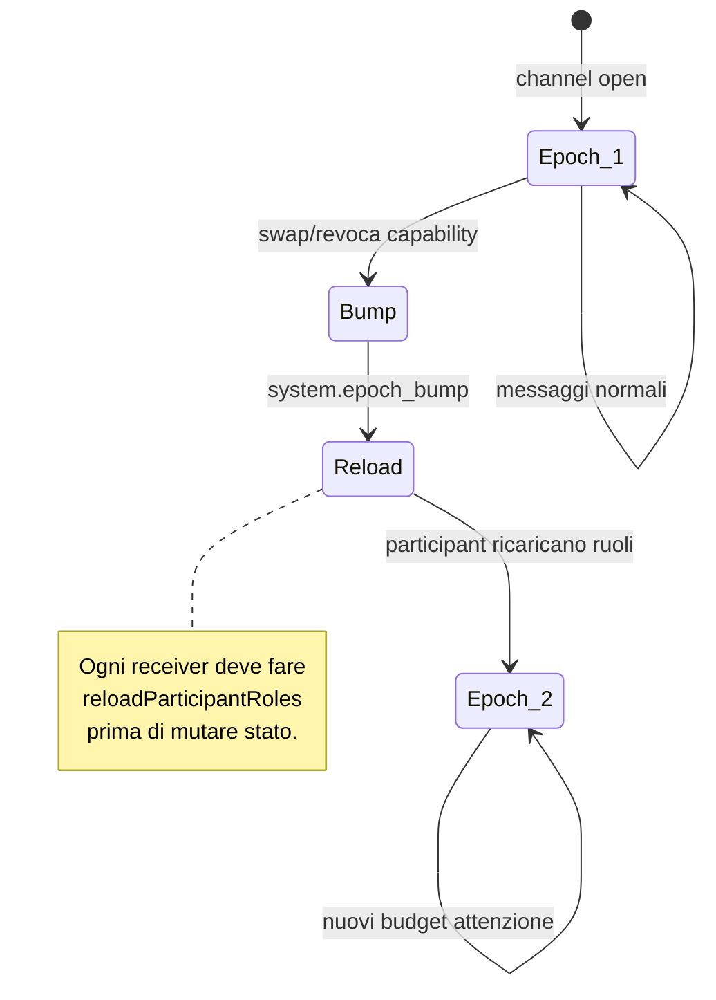

## 17. Swap: sostituire un participant senza uccidere il job

`system.swap` non è un kill.

Vuol dire:

1. fermare nuovi resume verso il participant uscente;
2. aspettare che il job esca o diventi `waiting`;
3. gestire il worktree lease;
4. registrare il participant entrante;
5. solo dopo scrivere `system.epoch_bump`.

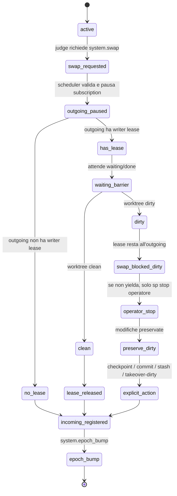

## 18. Fasi di implementazione

Il modulo è un unico design, ma si attiva in due tempi.

### 0.1

Serve a far funzionare bene le chain autonome:

- executor e reviewer si parlano via channel;
- il reviewer sveglia l'executor senza intervento umano;
- il judge readonly può chiudere o redirectare;
- evidence, forensics, work graph e progress card funzionano;
- lo scheduler indirection esiste già, anche se semplice.

### 0.2

Attiva le parti più dinamiche:

- node self-managed;
- topology `freeform`;
- active judge con `swap`;
- `node-supervisor` come scheduler reale;
- `node_memory` derivata;
- consensus multi-author;
- attention/self-activation loop attivo.

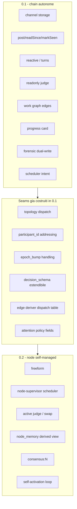

## 19. Cosa NON è un channel

Un channel non è:

- un bus globale;
- un sostituto del pulse;
- un sistema di authority;
- un contenitore di output lunghi;
- un framework multi-agent copiato da fuori;
- un modo per guardare tutti i container da un punto centrale.

La regola: **un channel appartiene a un container**.

Se serve coordinamento tra container, si usa `pulse`.

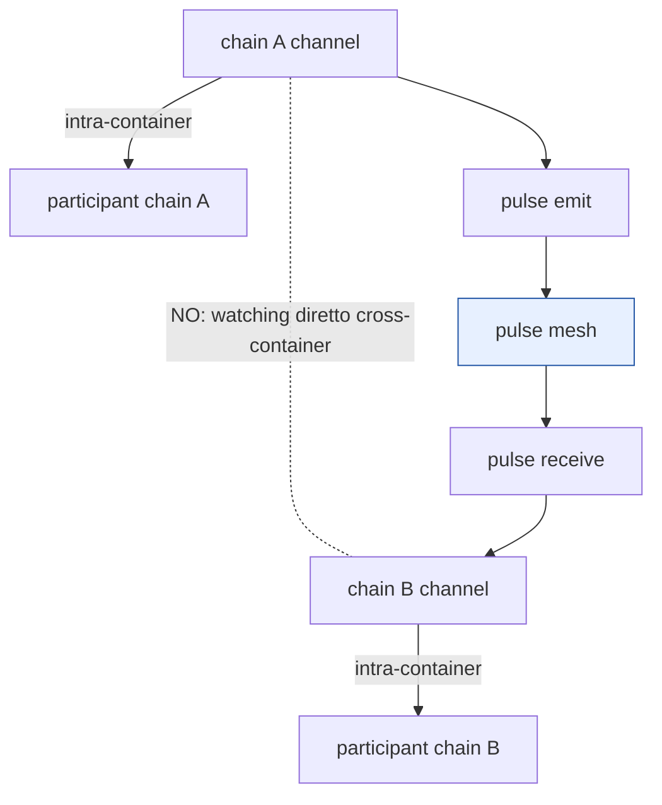

## 20. Le decisioni ormai chiuse

| Tema | Decisione |
| --- | --- |
| Granularità | Channel per chain/pair e channel per node sono entrambi validi. |
| Verdict | Un verdict ha un solo target. N target = N verdict. |
| Swap | Swap sostituisce/unsubscribe, non uccide il job. |
| Judge | Output strutturato con `decision_schema`. |
| Evidence grant | Authority in `evidence_access_grants`, forensics solo audit. |
| `scope_refs` | Typed union, 0.1 senza symbol graph, 0.2 con GitNexus. |
| Epoch/cooldown | Epoch = membership/capability epoch; reset su `system.epoch_bump`. |
| `seq` | Rimane solo per display; `id` è il vero cursore. |
| Dirty worktree swap | Blocca swap automatico; operator action esplicita, mai force-kill. |

## 21. Cosa resta aperto o fuori scope

Resta poco da decidere nel design di `channels`:

- cross-channel watching resta fuori scope; il coordinamento tra container passa da `pulse`;
- multi-user identity resta rimandata finché non esiste davvero il multi-user;
- integrazioni esterne tipo Slack/GitHub comments sono fuori scope;
- i numeri fini della 0.2 si tuneranno su run reali.

## 22. Riassunto operativo

Se devi ricordare solo una cosa:

> Un channel è il diario operativo ordinato di un container. Fa arrivare messaggi e sveglia gli attori giusti, ma non concede autorità da solo. Authority, evidence e graph appartengono al substrate; forensics registra cosa è successo; pulse collega container diversi.

