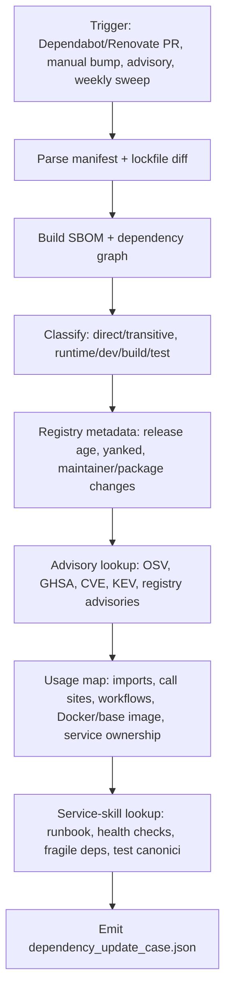
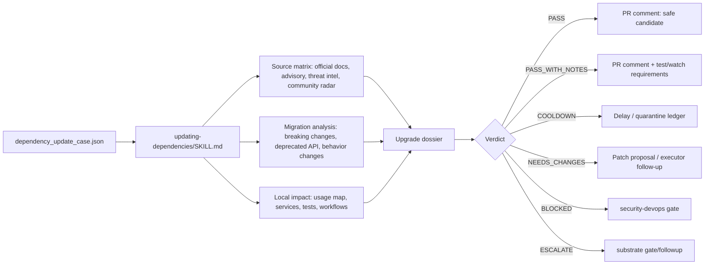
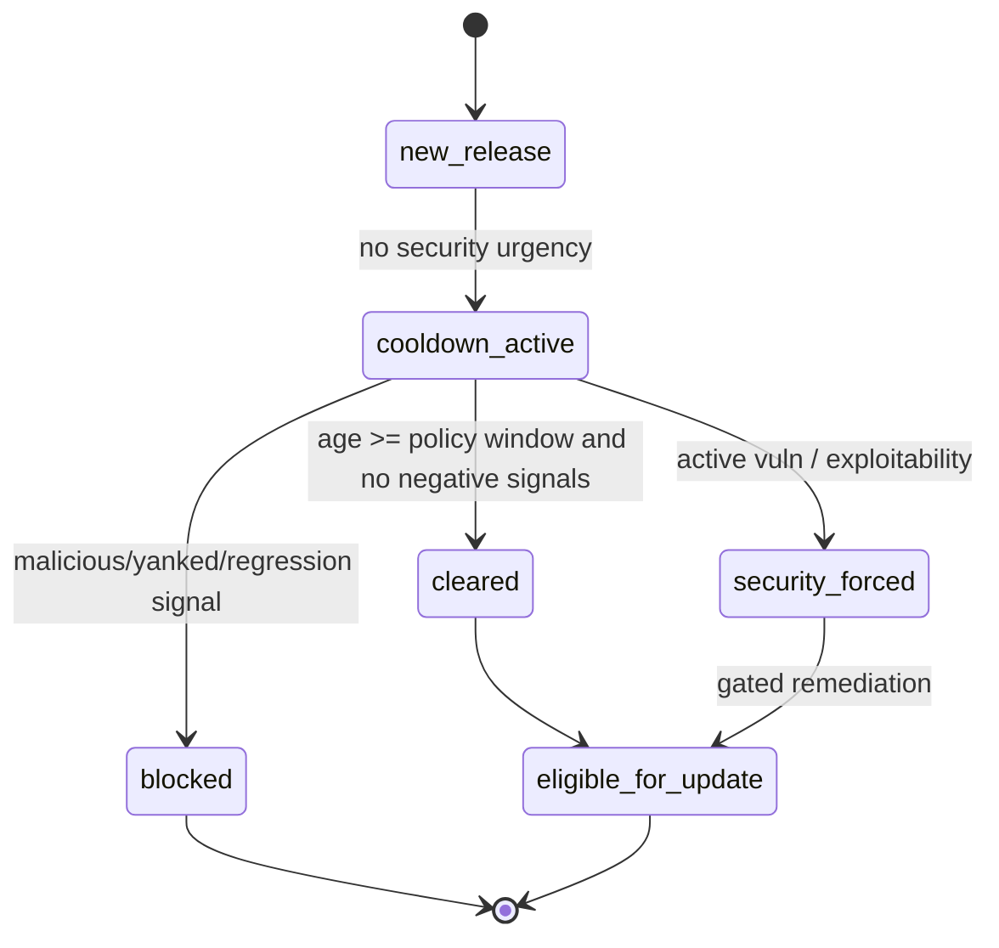
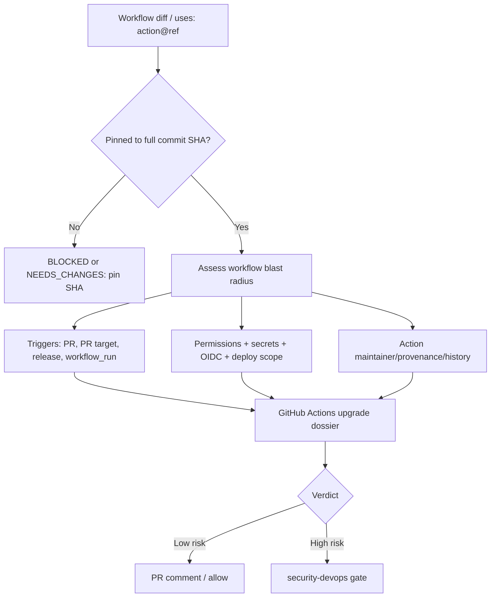
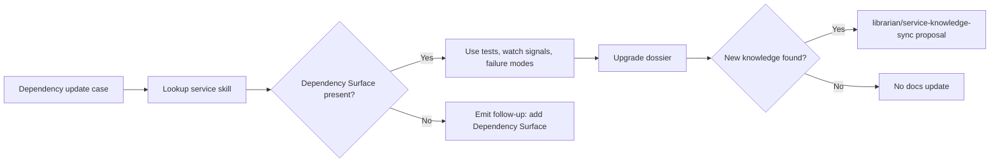
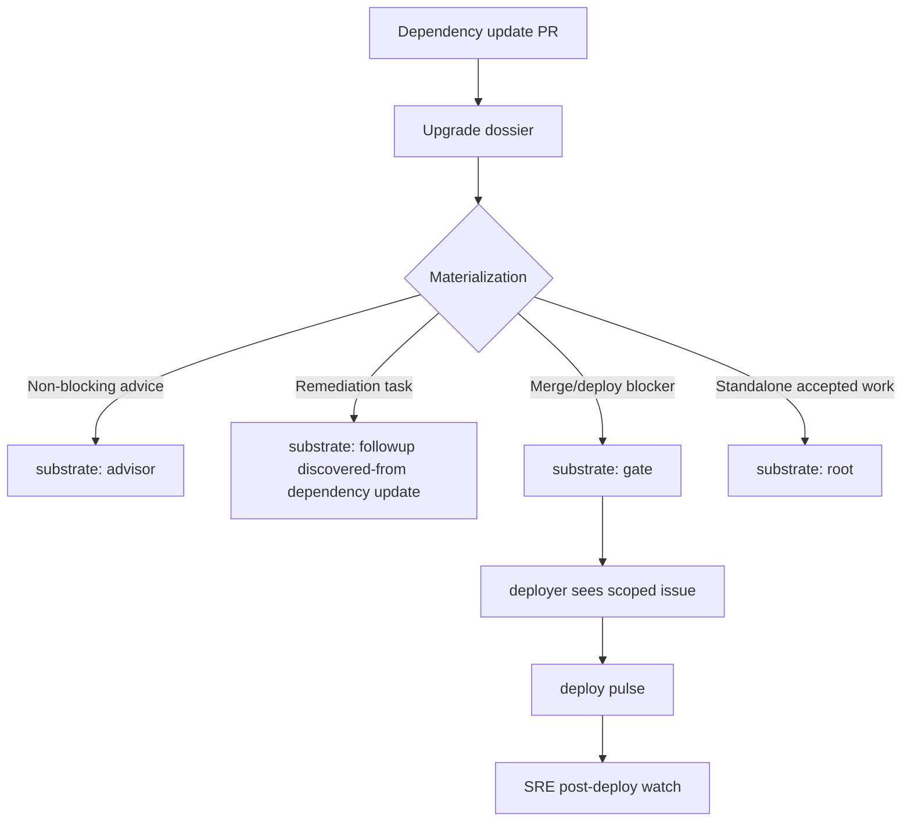
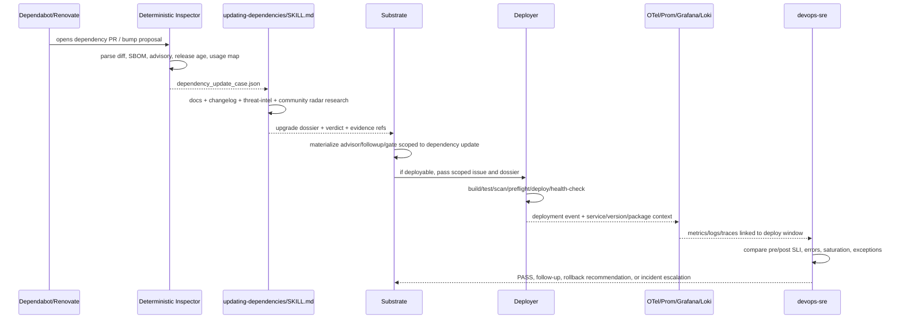
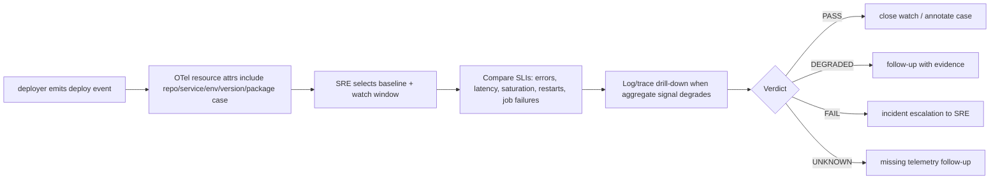
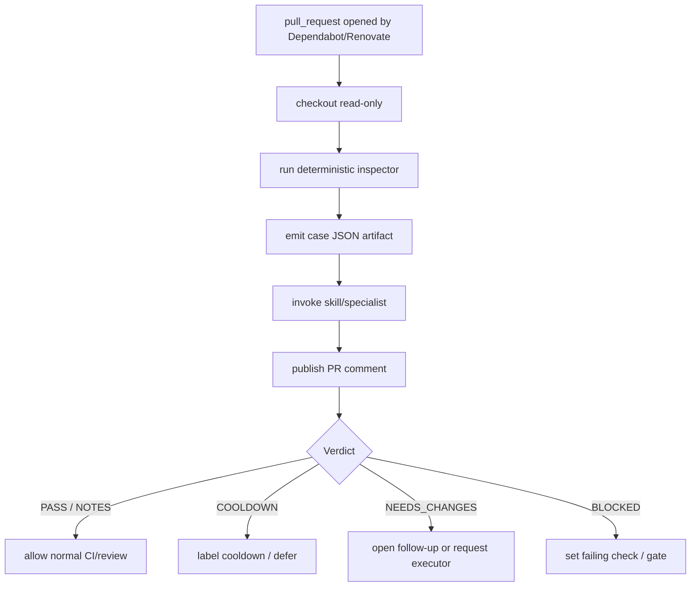

# Updating Dependencies — DevSecOps Skill & Pipeline Design

Questo documento definisce una capability agentica per gestire dependency updates, vulnerabilità, GitHub Actions hardening e regression monitoring dopo bump di dipendenze. La prima versione non deve partire come nuovo prodotto completo né come comando `xt` prematuro. La v0 deve essere una skill strutturata, `updating-dependencies/SKILL.md`, invocabile dagli agenti in modo ripetibile. Il comando `xt`, eventuale, va progettato solo dopo avere osservato casi reali e stabilizzato il primo livello deterministico.

La tesi di fondo è semplice: il problema non è aggiornare pacchetti, ma aggiornare pacchetti senza perdere contesto. Un bump automatico cieco riduce il backlog ma può introdurre breaking change, regressioni o supply-chain risk. Un sistema corretto deve collegare lockfile diff, SBOM, advisory, changelog, release age, usage map, service-knowledge, CI, deploy event e osservabilità post-deploy.

Il sistema non modifica `deployer` e `devops-sre` per adattarli alle dependency updates. La dependency update genera soltanto un issue/case scoped come derivato da un bump. Il deployer continua a fare delivery controllata; SRE continua a fare osservabilità, RCA ed escalation. La specializzazione dependency vive prima del deploy, produce evidenza e passa contesto.

## 1. Motivazione

Le dependency updates stanno in mezzo a due rischi opposti. Restare indietro accumula vulnerabilità, EOL runtime e salti di versione più costosi. Aggiornare troppo rapidamente può importare release compromesse, pacchetti malevoli, Actions compromesse, immagini non affidabili o breaking changes non ancora emersi nella documentazione ufficiale.

La soluzione non è “aggiorna sempre” né “blocca tutto”. La soluzione è una remediation chain evidence-first: aggiornare rapidamente quando esiste rischio reale o exploitability forte, rallentare quando la release è troppo fresca, produrre usage-aware patching quando il bump tocca API reali, e delegare a deployer/SRE la parte di rollout e osservazione.

## 2. Non-obiettivi

Questa capability non sostituisce SCA, SBOM tooling, Dependabot, Renovate, Datadog, Snyk, GitHub Advanced Security, OSV, GHSA o scanner equivalenti. Li consuma.

Non deve diventare un DevOps monolitico che legge CVE, cambia codice, deploya, monitora, decide rollback e chiude incident da solo.

Non deve produrre comandi `xt` troppo presto. Per la v0 è più importante stabilizzare skill, schema, decision contract e casi reali. Il comando è un packaging successivo, non il nucleo del design.

Non deve imporre modifiche specifiche a `deployer` e `devops-sre`. L’integrazione corretta è tramite substrate issue, evidence refs, deploy pulse, OpenTelemetry/metrics/logs/traces e service ownership.

## 3. Principi operativi

La capability segue cinque principi.

Primo: deterministic first. Tutto ciò che può essere calcolato deve essere calcolato da parser, scanner, registry metadata, SBOM, usage graph, advisory lookup e CI. L’LLM non deve inventare se una dipendenza è direct/transitive, production/dev, runtime/build, fresh/yanked o usata in un path critico.

Secondo: research second. La skill usa Context7, DeepWiki, documentazione ufficiale e changelog per migration semantics, ma usa anche threat-intel e community early-warning per supply-chain risk. Le fonti devono essere classificate per autorevolezza e freschezza.

Terzo: service-aware. Una dependency non è un oggetto astratto. Deve essere collegata a repo, servizio, runtime, deploy artifact, GitHub Actions, Docker image, service skill, owner e metriche post-deploy rilevanti.

Quarto: delivery boundary. La dependency capability prepara il caso e può proporre patch/commenti PR. Il deployer decide ed esegue la delivery controllata. SRE osserva il post-deploy e gestisce escalation se emerge regressione.

Quinto: evidence-first materialization. Ogni verdict deve produrre evidenza leggibile da umano e da substrate: cosa è stato osservato, cosa è stato inferito, cosa manca, quale gate è richiesto, quale watch post-deploy è consigliato.

## 4. Ruoli coinvolti

`dependency-update-skill` è la v0. È una skill on-demand, non un agente always-on. Viene invocata quando esiste una PR Dependabot/Renovate, una proposta manuale di upgrade, un advisory o un sweep preventivo.

`dependency-upgrade-specialist` è una possibile evoluzione. Interpreta il case deterministico, legge fonti, produce upgrade dossier, commenta la PR, propone patch e apre follow-up se il bump è troppo ampio.

`security-devops` resta il gate di sicurezza. Interviene quando il rischio supera soglia, quando c’è exploitability, quando una GitHub Action è non pinned o quando il package ha segnali di supply-chain compromise.

`deployer` resta responsabile di build, test, scan, publish, deploy, health-check e rollback plan. Non deve conoscere i dettagli interni della dependency skill: riceve un issue/case con evidenza e risk context.

`devops-sre` resta responsabile di runtime observability, regression watch, RCA, mitigation proposal ed escalation. Dopo un dependency bump osserva i segnali OTel/Prometheus/Grafana/Loki collegati al deploy event.

`service-knowledge-sync` e `librarian` mantengono aggiornate le service-knowledge. Il drift non è solo architetturale: anche le dependency surfaces, test canonici e runbook post-update possono driftare.

## 5. Fonte dati e gerarchia di ricerca

La skill distingue quattro classi di fonti.

### 5.1 Fonti authoritative machine-readable

Queste fonti sono preferite per vulnerability identity, advisory, exploitability e matching deterministico: OSV, GitHub Advisory Database, GHSA, CVE/NVD, CISA KEV, registry advisories, vendor advisories, maintainer security advisories, package registry metadata, lockfile, SBOM e provenance metadata.

### 5.2 Fonti ufficiali di migration semantics

Queste fonti spiegano il comportamento atteso della nuova versione: release notes, changelog, migration guide, API reference, docs ufficiali, tag GitHub, commit diff, Context7, DeepWiki, README, upgrade guide, issue ufficiali linkate dalla release.

### 5.3 Fonti research / threat intelligence

Queste fonti possono anticipare la documentazione ufficiale su compromissioni, campagne attive e suspicious packages: OpenSSF, Socket, Datadog Security Labs, Snyk Research, Sonatype, JFrog Security Research, ReversingLabs, Chainguard, Aqua Nautilus, Wiz Research, Unit 42, Mandiant/Google Cloud, Trail of Bits, GitGuardian, StepSecurity, Semgrep research, Checkmarx research, GuardDog datasets e supply-chain malware feeds.

### 5.4 Fonti community early-warning

Queste fonti servono come radar, non come base decisionale definitiva: Hacker News, Reddit netsec/programming, GitHub Issues, GitHub Discussions, maintainer comments, package ecosystem Discord/Slack pubblici, Mastodon/X di security researcher riconosciuti. Un segnale community non deve mai bloccare da solo, ma può alzare il livello di cautela e richiedere verifica.

## 6. Primo livello deterministico

Il primo livello produce un `dependency_update_case.json`. Deve essere affidabile, ripetibile e il più possibile indipendente dal modello.

Input tipici: PR metadata, diff, lockfile, manifest, SBOM, package ecosystem, current version, target version, release timestamp, direct/transitive graph, package metadata, registry metadata, advisory feed, CI result, repo/service ownership, service-skill path, deploy target.

Output obbligatori: package identity, ecosystem, dependency kind, direct/transitive path, production/dev/build/test classification, release age, cooldown status, known advisories, malicious package indicators, usage map, changed API surface if detectable, affected services, affected workflows, test surface, missing signals, risk preliminare e recommended next step.



Il deterministic layer non dà una remediation finale. Produce il terreno. La skill può poi ragionare sopra un oggetto stabile, riducendo hallucination e teatro decisionale.

## 7. `dependency_update_case.json` — schema concettuale

```json
{
  "schema": "xtrm.dependency_update_case.v0",
  "case_id": "opaque-id",
  "trigger": {
    "kind": "dependabot_pr|renovate_pr|manual_bump|advisory|scheduled_sweep",
    "repo": "owner/name",
    "pr": 123,
    "branch": "dependabot/npm_and_yarn/pkg-1.2.3"
  },
  "package": {
    "name": "package-name",
    "ecosystem": "npm|pypi|maven|cargo|go|docker|github-actions|other",
    "from_version": "1.2.2",
    "to_version": "1.2.3",
    "update_kind": "patch|minor|major|digest|sha|unknown",
    "dependency_kind": "direct|transitive",
    "scope": "runtime|dev|build|test|ci|container|unknown"
  },
  "supply_chain": {
    "release_age_hours": 168,
    "cooldown_status": "cleared|active|bypass_security|blocked|unknown",
    "registry_status": "normal|yanked|deprecated|suspicious|unknown",
    "maintainer_change_detected": false,
    "install_script_changed": false,
    "artifact_repo_mismatch": "none|warning|unknown"
  },
  "security": {
    "advisories": [],
    "known_exploited": false,
    "public_exploit_available": false,
    "epss_bucket": "low|medium|high|unknown",
    "malicious_package_signal": "none|weak|strong|unknown"
  },
  "usage": {
    "affected_services": [],
    "affected_files": [],
    "runtime_reachable": "yes|no|unknown",
    "publicly_exposed_path": "yes|no|unknown",
    "github_actions_blast_radius": "low|medium|high|n/a|unknown"
  },
  "tests": {
    "existing_tests_relevant": [],
    "missing_tests": [],
    "recommended_commands": []
  },
  "service_skills": {
    "paths": [],
    "dependency_surface_present": false,
    "health_checks": [],
    "post_update_watch_signals": []
  },
  "preliminary_verdict": {
    "status": "research_required|cooldown|safe_candidate|security_forced|blocked|unknown",
    "reason": "short deterministic reason"
  }
}
```

## 8. Skill v0: `updating-dependencies/SKILL.md`

La skill v0 deve essere rigida. Non deve lasciare all’agente il compito di inventare il processo. Deve specificare input, fonti, metodo, output e soglie di escalation.

Struttura proposta:

```text
updating-dependencies/
  SKILL.md
  templates/
    upgrade-dossier.md
    pr-comment.md
    research-matrix.md
    post-deploy-watch-spec.md
  schemas/
    dependency_update_case.schema.json
    upgrade_dossier.schema.json
```

La skill deve obbligare l’agente a produrre un upgrade dossier con sezioni stabili: summary, trigger, package/version diff, source matrix, security context, supply-chain context, compatibility/migration notes, local usage map, service-skill impact, tests, verdict, required gates, deploy notes, post-deploy watch spec, follow-up tasks.



## 9. Verdict taxonomy

La v0 deve usare una tassonomia piccola e stabile.

`PASS` significa che il bump è piccolo, release age/cooldown è soddisfatto, non ci sono advisory negative, usage impact basso, test rilevanti presenti e non emerge rischio speciale.

`PASS_WITH_NOTES` significa che il bump è accettabile ma richiede attenzione: test specifici, migration note, health-check, post-deploy watch o service-skill update.

`COOLDOWN` significa che non c’è urgenza security e la release è troppo fresca. Il case resta aperto o viene rischedulato.

`SECURITY_FORCED` significa che il cooldown può essere bypassato perché esiste vulnerabilità rilevante, exploitability, KEV, public exploit, active attack signal o rischio operativo superiore.

`NEEDS_CHANGES` significa che il bump richiede modifica codice, test aggiuntivi, aggiornamento config, migration step o modifica workflow.

`BLOCKED` significa che il bump non deve essere mergeato nello stato attuale: package sospetto, release yanked, advisory peggiorativa, GitHub Action non pinnata, breaking change non gestito, CI rotta, mancanza di segnale critico.

`ESCALATE_SECURITY` passa a `security-devops`.

`ESCALATE_DEPLOYER` passa al deployer come delivery gate.

`ESCALATE_SRE` si usa solo dopo deploy o se il bump è già in produzione e i segnali runtime indicano regressione/incidente.

## 10. Cooldown / quarantine ledger

Il cooldown non deve essere una regola piatta. Serve un ledger per package/versione.



Policy iniziale suggerita: default 7 giorni per update ordinari. Bypass solo per security remediation con rischio reale. Estendere il cooldown per package con install script, CI/CD blast radius, binary blobs, maintainer change recente, package appena creato, artifact mismatch, obfuscation o community warning non ancora chiarito.

## 11. GitHub Actions come caso speciale

GitHub Actions non sono semplici librerie. Girano in CI/CD, possono vedere secrets, artifact, token, OIDC e deploy credentials. Il sistema deve trattarle come build infrastructure dependency.

Controlli minimi: pin a full-length commit SHA, non tag mobile; permissions minime; valutazione di `pull_request_target`; secrets exposure; artifact upload/download; workflow trigger; maintainer trust; action ownership; compromised action history; presenza di Dependabot per aggiornamento SHA; StepSecurity/Harden-Runner-like monitoring se appropriato.



## 12. Service-skills integration

Le service-knowledge sono il documentation substrate operativo degli agenti. Per dependency updates serve una sezione standard `Dependency Surface`, mantenuta dal librarian e aggiornata dal dependency workflow quando emergono nuovi dati.

Sezione proposta dentro ogni service skill:

```markdown
## Dependency Surface

### Package Managers & Lockfiles

### Runtime-Critical Dependencies

### Build/Test/CI Dependencies

### GitHub Actions / CI Dependencies

### Container/Base Image Dependencies

### Known Fragile Dependencies

### Historical Migration Notes

### Canonical Tests After Dependency Updates

### Post-Deploy Watch Signals

### Missing Signals / Known Gaps
```

La skill non deve aggiornare le service-knowledge a mano in modo indiscriminato. Deve proporre un patch o follow-up quando trova drift: dipendenza critica non documentata, test canonico mancante, health-check obsoleto, post-deploy watch signal assente, nuova GitHub Action ad alto blast radius.



## 13. Substrate materialization

Una dependency update non crea un flusso DevOps parallelo. Materializza normali artefatti substrate.

Una PR Dependabot ordinaria diventa `class:advisor` o `class:followup`, con evidence refs e upgrade dossier.

Un bump bloccante diventa `class:gate` se blocca la merge/deploy chain.

Una remediation ampia diventa `class:root` solo se l’operatore accetta lavoro standalone.

Una regressione post-deploy derivante da dependency update diventa incident/follow-up scoperto dal deploy pulse, non una modifica allo specialist dependency.



## 14. End-to-end pipeline: PR to post-deploy watch



## 15. OpenTelemetry and regression watch

OTel è centrale dopo il bump, ma non deve gonfiare la dependency skill. La skill produce solo una `post_deploy_watch_spec`; deployer e SRE la consumano.

La watch spec deve contenere: service, repo, environment, deploy event ID, package/versione, expected risk area, pre-window, post-window, metriche da confrontare, log selectors, trace selectors, known failure modes dalla service-skill, soglie di escalation e rollback recommendation conditions.

```json
{
  "schema": "xtrm.dependency.post_deploy_watch_spec.v0",
  "scope": {
    "repo": "owner/name",
    "service": "service-name",
    "environment": "prod|staging|dev"
  },
  "dependency_update": {
    "package": "package-name",
    "from_version": "1.2.2",
    "to_version": "1.2.3",
    "case_id": "opaque-id"
  },
  "windows": {
    "baseline": "24h before deploy or last stable window",
    "watch": "2h|24h|72h depending on risk"
  },
  "signals": {
    "metrics": ["request_error_rate", "latency_p95", "latency_p99", "restart_count", "job_failure_rate", "queue_depth", "memory", "cpu"],
    "logs": ["exception_rate", "new_error_fingerprint", "dependency-specific warnings"],
    "traces": ["span_error_rate", "critical path latency", "downstream call failures"]
  },
  "verdicts": ["PASS", "DEGRADED", "FAIL", "UNKNOWN"],
  "escalation": {
    "on_fail": "devops-sre",
    "on_unknown": "followup_missing_telemetry",
    "rollback_recommendation": "only when thresholds and confidence are strong"
  }
}
```



## 16. GitHub Action wrapper: later, not v0 core

A GitHub Action wrapper is useful after the skill and deterministic case have stabilized. It should run on Dependabot/Renovate PRs, generate the case, invoke the skill or specialist, and comment the PR.

Initial permissions should be read-only plus PR comment. Code modification or automatic commit should remain gated and limited to low-risk mechanical changes.



## 17. Optional `xt` command surface

Il comando `xt` non va progettato in eccesso ora. La futura utility va esplorata quando i casi reali avranno chiarito quali primitive servono davvero. Il comando non deve diventare il design: deve essere solo una shell ergonomica sopra inspector, skill, case store e PR integration.

Possibili primitive future, non vincolanti:

```text
xt dep inspect        # deterministic case generation
xt dep research       # produce source matrix / dossier from case
xt dep comment-pr     # materialize PR comment
xt dep watch-spec     # emit post-deploy watch spec
xt dep service-skill  # propose Dependency Surface updates
```

Per ora questi sono nomi provvisori, non API commitment.

## 18. Rollout proposto

### v0 — skill only

Creare `updating-dependencies/SKILL.md`, template upgrade dossier, source matrix e post-deploy watch spec. Usarla manualmente su alcune PR reali. Nessun comando `xt` obbligatorio.

### v0.1 — deterministic case prototype

Scrivere uno script o harness locale che produce `dependency_update_case.json` da PR/diff/lockfile. Ancora non serve una UX stabile.

### v0.2 — service-skill enrichment

Aggiungere sezione `Dependency Surface` alle service-knowledge più importanti. Il librarian propone aggiornamenti quando una dependency update scopre drift o segnali mancanti.

### v1 — PR comment automation

Aggiungere GitHub Action wrapper con permessi minimi: genera case, produce dossier, commenta PR, applica label/verdict. Nessuna mutazione automatica aggressiva.

### v1.5 — substrate integration

Materializzare advisor/followup/gate da verdict. Il case viene collegato a PR, service-skill, deploy event, owner e telemetry watch.

### v2 — deployer/SRE loop

Il deployer consuma il dossier come scoped dependency update issue. Dopo deploy emette deploy pulse con attributi package/case. SRE esegue post-deploy regression watch con OTel/Grafana/Prometheus/Loki e aggiorna il case.

### v3 — productized agentic DevOps wedge

Solo dopo casi reali: stabilizzare UX, console evidence drawer, multi-repo dependency backlog, risk prioritization, historical migration memory, learned skills e reporting manageriale.

## 19. Product wedge

Il valore non è “trova vulnerabilità”. Quello è già coperto da molti scanner. Il valore è ridurre il costo umano di aggiornare correttamente senza rompere produzione.

La wedge più forte è: dependency PR → usage-aware remediation → deploy safety → runtime evidence → service-knowledge update. Questo chiude il ciclo tra SCA, repo graph, docs, CI/CD, OTel e runbook. Gli strumenti esistenti spesso coprono pezzi separati; il prodotto agentico ha valore se rende la remediation operativa, verificabile e tracciabile.

Il posizionamento corretto è strato agentico sopra strumenti esistenti, non sostituto di Datadog/Snyk/GitHub/Sonatype/Socket/JFrog. Deve comporre scanner, docs, telemetry e service knowledge in un decision loop.

## 20. Open decisions

La soglia di cooldown default è probabilmente 7 giorni, ma deve diventare policy configurabile per ecosystem, package risk e service criticality.

La source matrix deve distinguere tra “bloccante”, “informativa”, “rumor” e “da verificare”. Le fonti community non devono bloccare da sole.

La profondità dell’artifact diff npm/PyPI va esplorata. Per v0 bastano warning euristici; per versioni successive possono servire tarball diff, install script diff, binary/blob detection, obfuscation detection e repo/tag mismatch.

La futura command surface `xt` deve restare subordinata ai casi reali. Prima skill, poi schema, poi automation, poi CLI.

La watch spec OTel deve essere minimalmente portabile: error rate, latency, saturation, restarts, job failures, exception fingerprints, trace errors. Le metriche specifiche servizio arrivano dalle service-knowledge.

## 21. Compact operating contract

Una dependency update è accettabile solo quando esiste un case con evidenza. Il case deve spiegare cosa cambia, dove è usato, quale rischio security/supply-chain esiste, quali test coprono il cambiamento, quale servizio è impattato, quale gate serve, quale watch post-deploy va attivato e quale ruolo deve agire dopo.

La dependency capability prepara il terreno. Il deployer cambia il sistema. SRE osserva il sistema. Substrate mantiene lineage, issue scope, gate e follow-up. Le service-knowledge accumulano memoria operativa.