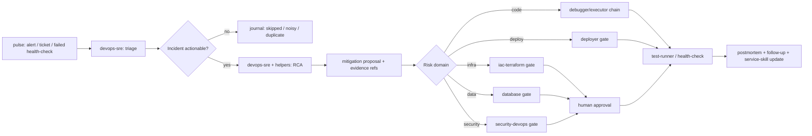
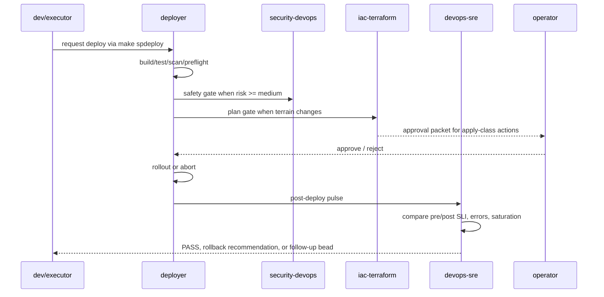
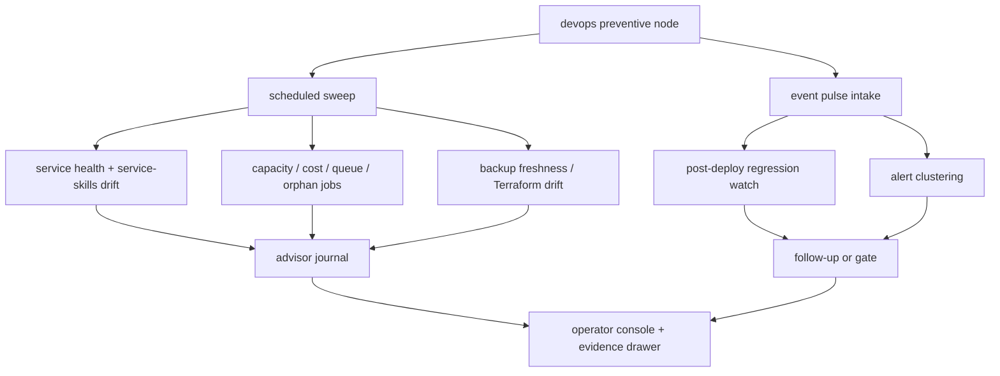

# DevOps System — design canonico (xtrm + Mercury)

> **Documento canonico riconciliato.** Assorbe PRD + research + brief + evidenza AWS +
> query-surfaces (le fonti sono in `../archive/`). **Nessun concetto è stato tralasciato.**
> **Le decisioni aperte restano aperte di proposito** — non le grounddiamo qui; si chiuderanno
> col link al resto del sistema (substrate, telemetry, kj651, console).
> **Il devops module LANDA MOLTO PIÙ AVANTI**, quando substrate/telemetry/console avranno
> concretamente gambe e braccia. Questo doc è il contenitore di visione, non un piano d'esecuzione.
>
> Indice: [[xtrm-MOC]] · substrate: [[substrate_design_it]] · chain primitive: [[chains]] · telemetria: bead `60w93.1`.

> *operators_note: 
> 1. Quando la parte infra e cloud esterno lands, la pagina devops vera e propria dovrà essere estremamente informativa. In modo straordinario e particolare dovrà render delle full view "simil chat" nel viewport principale, con progresso chiaro ed espandibile (una sorta di modifica della versione del progresso della chain nel drawer). Chiaramente visibile il motivo della run, dell'incident, della escalation, creazione della scene di grafana ad hoc (per ora Grafana senza ricreare un sistema da 0, molto complesso). La stessa cosa in realtà vale anche per agentops, è una esperienza a se stante e completa.
> 2. Il devops agent, o comunque l'intera pipeline, è come se fossero una session di orchestrazione a se stante. Se un giorno decidiamo di permettere intereazione all'interno della app (ovvero una vera e propria chat) - allora con chi comunicherà l'utente? siccome devops rimane comunque una chain o un node, allora probabilmente l'user si interfaccia eventualmente direttamente con il coordinator, pertanto le sessioni coordinator likely vanno rese con persistenza di session di Pi, oppure espandendo sp chat in modo tale che la comunicazione e UX sia totalmente smooth e clean.*
---

## 0. Cos'è — e cosa NON è

- **DevOps = sistema/dominio cross-cutting su `xt`+`sp`+`sb`** (+ infra/gitboard). **NON è un 6° package.**
- **Due facce:**
  - **(A) AgentOps interno** — sorvegliare l'ecosistema xtrm stesso (xt, sb, sp, channels, console): job, token, worktree, dolt, LSP, MCP, drift service-skills, processi orfani.
  - **(B) Infra/cloud esterno** — Mercury stack, Prometheus/Grafana/Loki, Terraform, deploy, VPS/AWS.
- **NON è "un agente che lancia comandi Docker".** È uno **strato operativo** che unisce
  topologia dei servizi, telemetria, cronologia deployment, repo, runbook, stato job, costo
  modelli, allarmi — e sa **spiegare cosa succede prima di toccare la produzione**.
- Traceability interna all'ecosistema xt, ma i primitivi sono dominio-neutri → usabili anche
  per stack cloud o qualsiasi altro (la visione connector di substrate §4.5).

## 0.1 Ownership cross-repo (la SoC)

| Repo | Possiede |
|---|---|
| `mercury/infra` | Prometheus, Grafana, Loki, Alertmanager, exporters, Traefik, reti/volumi Docker, Terraform/IaC, l'MCP query server (cresce con la telemetria) |
| `dev/specialists` | runtime telemetry, semantica devops/deployer specialist, substrate orchestration |
| `dev/gitboard` (→ xtrm console) | UX console operativa, pannelli datasource-backed |
| `dev/xtrm-tools` (core `xt`) | machinery service-skills (drift detector, librarian hooks, installer) |

**Regola di design:** il devops **consuma e compone** la telemetria infra; non forka una
definizione di monitoring parallela. Quando manca un segnale, lo **propone nel repo proprietario**
e poi insegna a gitboard come mostrarlo/agirci. La proposta preserva provenance verso la nota
di research che l'ha motivata.

## 0.2 Integrazione substrate — output come materializzazione di class

Il devops **non** crea flat bead quando nota qualcosa. In termini substrate emette
**`proposal`/`escalation`** nel channel del container, con evidenza; substrate/orchestrator
materializza la forma giusta (substrate §0.1, §6.2.1, §6.7):

- **raccomandazione operativa non-bloccante** → `class:followup`, `discovered-from` la root.
- **safety blocker della chain corrente** → `class:gate` insoddisfatto o step inserito.
- **lavoro standalone accettato** → promosso a `class:root`, `type` per contenuto (bug/task/chore/research/spike/design).
- **advice pre-work** → `class:advisor`; **validation post-work** → `class:gate` (stesso ruolo, due classi).

Il modello journal/recommendation di AWS DevOps Agent mappa su channel (note live) + evidence
(recommendations, mitigation plan, trace link, eval) persistita.

---

## 1. Strategia — due tracce (NON conflarle)

- **Track A — Product/SDK (lungo gioco):** usare specialists/substrate come SDK per integrare
  in Mercury; il dogfooding Mercury fa emergere gap/bug/UX → migliora xtrm; xtrm diventa prodotto
  per clienti. *Mercury è il proving ground che trasforma xtrm in piattaforma vendibile.*
- **Track B — Infra/telemetry (azionabile ora, operator-led):** scansionare `mercury/infra`
  per il telemetry mancante; mappare ogni repo Mercury; ricostruire meglio le dashboard Grafana;
  decidere se andare oltre Prometheus/Grafana/OTel.

## 2. Principio — coexist, NON rebuild

Non ricreiamo Grafana nella console. **Facciamo coesistere i sistemi:** importiamo le dashboard
Grafana, costruiamo *sopra* Grafana/Prometheus/OTel/Terraform. gitboard diventa lo **strato
agentico xtrm-native sopra** l'infra standard (via MCP + custom tools), che **surfacia** —
non sostituisce — Prometheus/Grafana. IaC (Terraform-like) è adottato, non reinventato.

> Correzione a un framing precedente: NON è "gitboard vs Grafana". gitboard è la console agentica
> che *integra* Grafana/Prometheus/Terraform e aggiunge lo strato agente.

## 3. Due contesti operativi

A single agent across both becomes unfocused → due contesti (probabile: specialist distinti o
una persona con due skill-pack — **decisione aperta §14**).

- **3a. Platform/internal (lo stack specialists/substrate/core stesso) — azionabile subito:**
  deploy automatico agenti; provisioning server; monitoraggio CPU/RAM/token; worktree & job-runner;
  alerting servizi critici; backup & DR; scalabilità; osservabilità pipeline/MCP/DB; `sp ps`,
  cleanup, processi orfani / serena-lsp / dolt. → mappa su gitboard event-bus + `observability.db`.
- **3b. Cloud/VPS/AWS (la frontiera infra; il gap IaC vive qui):** CI/CD; Kubernetes; AWS/Azure/GCP;
  Terraform; automazione deploy; monitoraggio/alert; affidabilità & costi; sicurezza pipeline;
  supporto delivery.

---

## 4. Reference architecture — AWS DevOps Agent (distillato + grounded COP362/Introducing/Tech-Tales)

AWS DevOps Agent = **frontier agent / always-available operations teammate**. Meccanicamente è
**LLM reasoning su MCP tools, grounded da un topology graph costruito di continuo** — *"there's
nothing special about GitHub Actions... it's an LLM frankly"; "the key unlock is thanks to LLMs
and MCP"*. Abbiamo già i pezzi (specialists=LLM reasoning; MCP; GitNexus=code graph; gitboard
scanner+event-bus). **Manca poco:** un infra topology graph + un MCP query server sulla telemetria
+ una skill che codifica l'RCA loop.

**Non è una chat: è un sistema operativo per incidenti.** Quando arriva alert/ticket, l'agente
non parte da zero — entra in un ambiente dove conosce già la topologia e interroga fonti operative.
→ il devops deve avere **memoria operativa strutturata**: quali repo, container normali, metriche
canoniche, alert rumore, runbook autorizzati, ultimo deploy, rollback possibili.

**Modello operativo da rispecchiare:**
- **Due corsie.** *Reattiva* — alarm/ticket/page → log/metrics/traces → topology → RCA + mitigation
  (prepare→pre-validate→apply→post-validate→rollback) → report. *Proattiva* — scan background di
  incidenti passati → raccomandazioni di posture clusterizzate. → **mappano sul pulse: event-pulse
  guida la reattiva, scheduled-pulse la prevenzione. Il pulse è la spina.**
- **Topology / knowledge graph come substrato di reasoning.** Da risorse account (relazioni
  IAM-visibili) + service map telemetria + entità deployment CI/CD; *limita* lo spazio di ricerca.
  → serve un **infra topology graph** (distinto dal code-graph GitNexus), alimentato da
  UnifiedScanner gitboard + telemetria + deploy events.
- **Agent Space = confine di blast-radius.** IAM-scoped, **read-only di default (get/list/describe)**,
  segmentato per ownership. → mappa su **per-repo/per-source scope + permission tiers**. Uno specialist
  devops per `market-data` non ha automaticamente poteri su `infra`/`treasury-cb`/`darth-feedor`.
- **Trust-first, autonomia a stadi.** GA è recommendation-only; l'azione è roadmap, gated dal
  safe-change envelope + approvazione umana. → il devops parte READ_ONLY/recommend (come
  `security-auditor`), gradua dietro `make spdeploy` + prepare→validate→rollback.
- **Team-member embedding.** Triggerato da alarm/ticket/page; scrive findings su Slack/ServiceNow;
  collabora con altri agenti; escalation umana one-click. → handoff-notes + Dev↔Ops pulse + escalation operator.
- **MCP-centric, BYO MCP.** Built-in (CloudWatch/Dynatrace/Datadog/New Relic/Splunk) + **BYO MCP
  per OSS (Grafana/Prometheus/Loki) e custom**. → **valida coexist-not-rebuild (§2): AWS stesso
  integra Grafana/Prometheus via MCP.**
- **Skills / runbooks / steering.** Skills codificano il *format* triage/RCA; runbook = micro-hint
  ops; steering redirige in-flight. → riuso diretto delle nostre skills + mandatory-rules + steering.
- **CI/CD correlation.** GitHub/GitLab/CloudFormation → deployment mappati come entità → onset
  sintomi correlato al change recente. → valida il **Dev↔Ops post-deploy pulse**.
- **Incident → permanent fix.** Mitigation spec → spec-driven → property-based tests. → devops →
  executor/debugger → test-runner; un incidente spawna un follow-up bead.
- **Investigation = subagent paralleli**, multi-ipotesi, **documenta i path scartati** (trasparenza).
- **Partial-outage interpretation** (vecchi task serviti mentre i nuovi falliscono; deploy stuck) —
  sfumatura che il monitor deve catturare, non solo verde/rosso.

**Benchmark da rispecchiare (eval, lega `unitAI-4urhs`):** 1000+ incidenti, **86% RCA success**;
Commonwealth Bank **5h→15m**; quota agent-space; per-second billing. **I gap che AWS non ha mostrato**
— confidence scoring, costo falsi-positivi, governance dello stage azione — sono esattamente le
R-checks che possederemmo noi.

**Memory/policy model AWS (da copiare come *contract shape*, non come UI):**
- **Agent Instructions** (`AGENTS.md`) — policy always-on, iniettata ogni sessione.
- **Skills** (`SKILL.md`) — moduli on-demand, description-triggered.
- **Learned Skills** — auto-generate: *Agent Space Understanding* (topology, request paths,
  repo→resource map) + *Tool Use Best Practices* (da investigazioni passate, agg. ogni 30).
- **Journal records / Recommendations** — recommendation con `spec` = handoff implementabile.
  Task statuses: PENDING_TRIAGE/LINKED/IN_PROGRESS/PENDING_CUSTOMER_APPROVAL/COMPLETED/FAILED.
  Recommendation statuses: PROPOSED/ACCEPTED/REJECTED/CLOSED/COMPLETED.
- **Incident loop:** detect → triage(Linked/Skipped/Proceed) → investigate → mitigate → summarize →
  escalate → prevent → close-loop (EventBridge).

> **Mapping AWS→xtrm:** Agent Space→scope repo/team/env; AGENTS.md→standing policy; SKILL.md→
> specialist+service skills; Learned Skills→topology/tool-use/incident artifacts; Journal→timeline+
> result+report; Recommendation.spec→bd bead/OpenSpec; EventBridge→pulse/event-bus.

---

## 5. Ruoli & roster

**Delivery vs monitoring — ruoli separabili, uniti al deploy boundary:**
- **`deployer` (delivery / CI-CD / IaC)** — build→test→scan→publish→deploy→health-check. **Per-repo.** Owns CI/CD + Terraform.
- **`devops`/SRE (ops / observability)** — observability runtime, anomaly detection, triage→RCA→mitigation, capacity & cost.
- **`database` specialist** (gap attuale) — schema/migrazioni, backup/restore, replica, query perf, consistenza, recovery runbook.
- **Handoff = il pulse:** deploy event → Ops osserva pre/post performance + error rate → **pushback** a Dev su regressione.

**Deploy-via-specialist (primitivo di governance):** invece di `docker compose up` diretto, un
devops/deployer per-repo invocato via `make spdeploy`; dev agents *istruiti* a usarlo; un **hook+extension
vieta comandi `docker` diretti**. (DX: infra astratta dietro interfacce stabili.)

**Autonomia graduata (read-first → 6 livelli):** 1 solo report → 2 azioni locali reversibili (diagnostica)
→ 3 restart controllato servizio non critico → 4 deploy via comando gated → 5 rollback automatico con
soglie forti → 6 mutazioni infra solo via Terraform plan/apply approvato. *Evita il "sudo randomizzato".*

### 5.1 Shape del team DevOps

Il modulo DevOps è un **team verticale**, non una persona unica. Il coordinamento può essere fatto
da un `devops`/SRE lead o da un futuro node coordinator, ma ogni ruolo conserva confini propri,
tool surface propria e output contract proprio.

| Ruolo | Classe | Permessi iniziali | Input principali | Output |
|---|---|---|---|---|
| `devops-sre` / `monitor` | ops, advisor/gate | READ_ONLY | Prometheus/Grafana/Loki, `sp forensic`, `sp metrics`, service skills, pulse | triage, RCA, mitigazione proposta, follow-up, escalation |
| `deployer` | delivery/root/gate | MEDIUM/HIGH gated | repo, CI, artifact, deploy history, health checks | deploy plan, preflight, rollout, rollback plan, post-deploy report |
| `iac-terraform` | infra/gate | READ_ONLY → gated apply | Terraform/OpenTofu module, state summary, policy, env | `fmt`/`validate`/`plan` summary, risk diff, approval packet |
| `database` | data/gate | READ_ONLY → gated maintenance | schema, migrations, backups, query plans, service skill | migration risk, restore path, perf finding, DB runbook update |
| `security-devops` | safety/gate | READ_ONLY | dependency/image/secrets/IaC scan, exposed service map | PASS/PARTIAL/FAIL, safety blocker, remediation requirement |
| `cost-capacity` | ops/advisor | READ_ONLY | token/model metrics, queue depth, CPU/RAM/disk, retention | capacity recommendation, budget warning, scaling follow-up |
| `service-skills-sync` | knowledge maintenance | MEDIUM docs-only | GitNexus drift, service registry, health check tables | updated service skill, drift evidence, runbook freshness signal |

La regola: **SRE decide cosa sta succedendo; deployer cambia il sistema; IaC descrive il terreno;
security/database/cost diventano gate o advisor quando il rischio li chiama.**

### 5.2 Compartimentalizzazione

Ogni ruolo ha tre confini espliciti:

- **Evidence boundary:** da dove può leggere. Esempio: `devops-sre` legge metriche/log/eventi;
  `deployer` legge build/deploy state; `database` legge solo superfici DB allowlisted.
- **Action boundary:** cosa può fare senza umano. Default: nessuna mutazione prod. Le mutazioni
  diventano possibili solo in chain gated con piano, validazione e rollback.
- **Materialization boundary:** quale artefatto emette. `advisor` per findings live, `followup`
  per raccomandazioni, `gate` per approvazioni/safety blockers, `root` solo quando l'operatore
  accetta lavoro standalone.

### 5.3 Chain reattiva: alert → RCA → mitigazione proposta

Usare una **chain** quando c'è un evento discreto da chiudere: alert, incident, failed deploy,
drift pericoloso, regressione post-release.



Minimum output della chain:

- query window, metric/log selectors, dashboards/panels consultati;
- ipotesi scartate con motivazione;
- root cause o confidence-bounded unknown;
- mitigation spec con rollback;
- owner repo e bead/follow-up proposto;
- evidence refs verso forensic events, metric query, log query, deploy event, service skill.

### 5.4 Chain delivery: deploy controllato

Usare una **chain** per deploy perché ha inizio/fine chiari e una checklist verificabile.



Il deploy non dovrebbe passare da comandi liberi (`docker compose up`, `terraform apply`,
restart manuali). Il percorso canonico è `make spdeploy` o equivalente per-repo, con log,
forensic event e health-check post-deploy.

### 5.5 Node preventivo: operatività continua

Usare un **node** quando il lavoro è di osservazione continua, memoria operativa e prevenzione.
Il node non applica fix: crea pulse, findings e follow-up.



Node cadence iniziale:

- daily posture sweep per AgentOps interno;
- post-deploy watch su ogni deploy event;
- weekly service-skills drift check;
- weekly Terraform drift/readiness summary;
- budget/capacity report quando metriche token/queue/storage superano soglie.

### 5.6 Regole di sequenziamento

- **Prima telemetry, poi specialist.** Il DevOps specialist consuma `xtrm.forensic.v1`,
  Prometheus projection, event catalog e service skills; non inventa un secondo telemetry layer.
- **Prima read-only, poi gated action.** Le prime versioni producono raccomandazioni; ogni mutazione
  richiede chain, gate e approval.
- **Chain per incident/deploy; node per prevenzione.** Se deve chiudersi con un verdict, è chain.
  Se deve svegliarsi e accumulare memoria, è node.
- **Il pulse collega Dev e Ops.** Deploy event, alert, drift, backup stale, queue growth e postmortem
  sono tutti pulse; il pulse decide quale chain o node si sveglia.
- **Evidence-first.** Ogni decisione deve poter drillare a forensic event, metric query, log query,
  service-skill runbook o deploy record.

---

## 6. Knowledge substrate — service skills (gitnexus-enhanced)

Il devops ha bisogno di conoscenza operativa **per-servizio**, non solo metriche grezze. Esiste già:
**service skills** (`.xtrm/skills/.../packs/<pack>/<service>/SKILL.md`) — doc expert-persona per servizio:
**Architecture, Data Flows, Cross-Service Health Check (bash runnable), Failure Modes (symptom/cause/fix),
Troubleshooting**. È l'analogo diretto di **runbook + per-service topology** dell'agente AWS (§4).

- Il **librarian `service-skills-sync`** mantiene questi sync col drift del codice via **gitnexus**
  (`detect_changes`/`impact`/`context`) + Serena, gated da `drift_detector.py` pre-scan e hook
  PostToolUse/pre-commit/post-merge.
- **La machinery (drift detector, post-merge sweep) è un participant deterministico** (substrate
  `script`/`service`, zero token), candidato a emettere telemetria/pulse → primo consumatore concreto
  del forensic contract (`60w93`). **Il librarian resta LLM** (riconciliazione semantica).
- Le health-check commands + failure-mode tables sono esattamente ciò che l'**RCA loop consuma**.
- Bead di riferimento: `xtrm-tkqjn` (default service-skills-set devops-aware + gitnexus-aware) — già
  realizzato dalla catena reliability `0p7bp/jcmub/q7436/lg9km` (oggi su main, non ancora rilasciata).

> Le service skills sono **la documentation e il primitivo del devops system.**

---

## 7. Telemetry & query path

- **Consuma** il forensic contract (`60w93.1`, envelope ecosistema-wide + shared emitter) + la
  proiezione a metrics. Vedi [[xtrm-MOC]] §1.
- **Query surfaces (read-first):** Grafana MCP (superficie top operatore) · Prometheus MCP
  (metriche/target low-level) · Loki/LogQL (log) · Datadog/CloudWatch solo dove source-of-truth.
- **Custom infra-wrapper MCP solo per stato non-telemetrico:** Compose state, Terraform drift,
  backup freshness, DNS/bucket/volume, deployment state, `make spdeploy` gates. Shape: JSON,
  read-only, un tool per domanda, separati per env/repo, **mai exec arbitrario.**
- **Query safety rules:** selettori stretti prima; bound time; bound results; read-only di default;
  separazione per-env; no raw shell.
- **Metriche minime per xtrm/Mercury** (devops deve poter vedere): specialisti attivi; job
  running/waiting/error; durata media job; processi orfani; worktree aperti/vecchi/sporchi; server
  Dolt + backup/sync; LSP attivi/crash/memoria; MCP uptime/errori/latenza; token per modello/repo/workflow;
  costo per job/repo; container restart; stato DB (Timescale/QuestDB/Postgres); backup age; deploy
  timestamp + health post-deploy.
- **L'MCP query server vive in `mercury/infra` e cresce con la telemetria** (mirror del pattern
  AgentCore MCP Gateway, home-rooted in infra). Filed: `infra-bnh`.

### 7.1 Implementazione materializzata in `~/dev/specialists/docs/telemetry`

Il design DevOps non riparte da zero: la prima parte concreta è già materializzata
in `~/dev/specialists`. Questi documenti sono il riferimento implementativo per
la telemetria AgentOps corrente:

| Documento / stato                                                                                      | Ruolo nel design DevOps                                                                                                                                                                                                                                                  |
| ------------------------------------------------------------------------------------------------------ | ------------------------------------------------------------------------------------------------------------------------------------------------------------------------------------------------------------------------------------------------------------------------ |
| `/home/dawid/dev/specialists/docs/telemetry/forensic-event-contract.md` — aggiornato 2026-06-04        | Contract `xtrm.forensic.v1`: eventi forensi ricchi, identity a 5 layer, correlation IDs, redaction, famiglie evento, session/trace/conversation discipline, e status implementativo shipped. È la fonte per journal, evidence drawer, RCA e recommendation traceability. |
| `/home/dawid/dev/specialists/docs/telemetry/prometheus-projection-contract.md` — aggiornato 2026-06-04 | Proiezione aggregate/low-cardinality da forensic/runtime state verso Prometheus. Include `sp metrics --prometheus`, `sp serve` `GET /metrics`, token-first semantics, identity/policy/eval counters, e MCP operation counter pre-wiring.                                 |
| `/home/dawid/dev/specialists/docs/telemetry/prometheus-infra-console-handoff.md` — shipped PR #107     | Handoff operativo: cosa deve fare `mercury/infra`, cosa deve mostrare gitboard/console, come drillare dai pannelli aggregate agli eventi forensi.                                                                                                                        |
| `/home/dawid/dev/specialists/docs/telemetry/agentops-event-catalog.md` — aggiornato 2026-06-04         | Catalogo eventi AgentOps: job, chain/epic, review/gates, tool/command, process/worktree, MCP, service-skills, pulse, identity/policy/eval, token usage, evidence kinds. È l'indice operativo per nuovi emitter.                                                          |

**Superfici specialists già materializzate (status 2026-06-04):**

- persistenza SQLite `specialist_forensic_events`;
- `sp forensic [job-id] --json`;
- `sp feed --json` / `sp log --json` con `forensic_event` additivo;
- redaction prima di storage/output;
- `sp metrics --prometheus` + endpoint read-only `GET /metrics` in `sp serve`;
- parser/CI per validare Prometheus text format;
- token-first runtime/projection: split `input|output|cache_read|cache_creation|reasoning|tool`, `direction=total` solo fallback, `cost_usd` non autorevole finché manca API billing/pricing provenance;
- identity/policy/eval forensic support + proiezioni bounded (`xtrm_identity_operations_total`, `xtrm_policy_decisions_total`, `xtrm_policy_mismatches_total`, `xtrm_eval_runs_total`, `xtrm_eval_score`);
- Pi `session_id` propagato in status/forensic correlation; `conversation_id`, `trace_id`, `span_id`, `parent_span_id` sono optional pass-through;
- MCP forensic normalization/projection **pre-wiring**: `type:"mcp"` timeline events → canonical `mcp.*`, `_meta` trace/MCP/JSON-RPC IDs in correlation, `xtrm_mcp_operations_total` con label bounded.

**Boundary MCP:** non esiste ancora un emitter MCP live in specialists e non esiste ancora propagazione `_meta` cross-process su una chiamata MCP reale. Il follow-up concreto è `unitAI-dl02w` (Implement live MCP forensic telemetry emitter). Il query-MCP infra resta `infra-bnh` / `mercury/infra`.

**Regola di interpretazione:** `devops-system.md` resta il design canonico; i documenti `~/dev/specialists/docs/telemetry/*` sono la parte materializzata del design. Quando il designer aggiorna DevOps/substrate, deve distinguere:

- **shipped now** → forensic envelope, AgentOps event catalog, metric projection, `/metrics`, CLI query, token-first semantics, session correlation;
- **pre-wired but not live** → MCP forensic normalization/projection;
- **future emitters/integrations** → live MCP emitter, service-skills/process-health/pulse native emitters, infra topology graph, DevOps specialist persona, MCP query orchestration, journal/recommendation UX, substrate-native channels/evidence.

### 7.3 DevOps telemetry-query answer contract

Quando `devops-sre` risponde a una domanda operativa ("Dolt è sano?", "perché la coda cresce?",
"questo deploy ha degradato la latenza?"), la risposta non è testo libero. È un **answer packet**
renderizzabile da console, verificabile da infra, e drillabile nei log/eventi.

Ordine delle superfici:

1. **Grafana MCP** — prima scelta per dashboard, datasource, alert, incident, deeplink.
2. **Prometheus MCP / `sp metrics --prometheus` / `/metrics`** — probe preciso su metriche aggregate.
3. **Loki/LogQL via Grafana** — log bounded per finestra e selector.
4. **`sp forensic`, `sp feed/log --json`** — drill-down forense con ID opachi solo nel body/correlation.
5. **infra-wrapper MCP read-only** — solo stato non-telemetrico: Compose, Terraform drift, backup, DNS, deployment gate.
6. **service skill** — runbook/failure-mode table per interpretare il segnale.

Il contratto deve separare ciò che è **osservato**, ciò che è **inferito**, e ciò che è **missing telemetry**.
Una risposta con dati mancanti non può diventare PASS: al massimo `UNKNOWN` + follow-up per aggiungere
il segnale nel repo proprietario.

```json
{
  "schema": "xtrm.devops.query_answer.v1",
  "question": "Is Dolt healthy?",
  "scope": {
    "repo": "specialists",
    "service": "dolt",
    "environment": "local",
    "time_window": {
      "from": "2026-06-07T05:00:00Z",
      "to": "2026-06-07T05:30:00Z"
    }
  },
  "verdict": {
    "status": "PASS|DEGRADED|FAIL|UNKNOWN",
    "confidence": "low|medium|high",
    "summary": "One-paragraph operator-readable answer."
  },
  "evidence": [
    {
      "kind": "metric_query",
      "source": "prometheus|grafana|sp_metrics",
      "query": "xtrm_processes{process_kind=\"dolt\"}",
      "window": "30m",
      "observed": "bounded result summary",
      "link": "dashboard or query deeplink when available"
    },
    {
      "kind": "forensic_event",
      "source": "sp forensic",
      "selector": {
        "event_family": "process",
        "event_name": "process.health.degraded"
      },
      "observed": "event count / latest event summary"
    },
    {
      "kind": "runbook_link",
      "source": "service-skill",
      "path": "service skill or runbook path",
      "observed": "which failure-mode row was used"
    }
  ],
  "missing_telemetry": [
    {
      "signal": "backup_freshness_seconds",
      "owner_repo": "mercury/infra",
      "impact": "Cannot distinguish healthy idle state from missing backup evidence.",
      "followup_kind": "class:followup"
    }
  ],
  "recommended_actions": [
    {
      "class": "advisor|followup|gate|root",
      "action": "Create follow-up bead to add bounded backup freshness metric.",
      "owner_repo": "mercury/infra",
      "requires_approval": false,
      "risk": "low"
    }
  ],
  "correlation": {
    "pulse_id": "opaque; body only",
    "chain_id": "opaque; body only",
    "trace_id": "opaque; body only"
  }
}
```

Field rules:

- `verdict.status=PASS` requires enough positive evidence for the asked scope and no blocking missing signal.
- `DEGRADED` means service still works but one SLI/SLO, queue, process, cost, or freshness signal is outside the normal band.
- `FAIL` means user/operator outcome is broken or safety gate blocks continuation.
- `UNKNOWN` is a first-class answer when the telemetry contract cannot prove health.
- `evidence[].observed` is a bounded summary, not raw log text or raw metric dumps.
- `correlation` may carry `job_id`, `chain_id`, `trace_id`, `mcp_session_id`, etc.; those IDs never become Prometheus labels.
- `recommended_actions[].class` maps directly to substrate materialization: `advisor`, `followup`, `gate`, or `root`.

Query discipline:

- Always include time window, environment, repo/service scope, and selector/query text.
- Prefer aggregate metrics before log/forensic drill-down.
- Use bounded label sets: `service_name`, `repo`, `participant_kind`, `participant_role`, `state`, `result`, `tool_name`, `mcp_server`, `mcp_method`.
- Never group by `job_id`, `bead_id`, `chain_id`, `participant_id`, `trace_id`, raw path, raw command, raw URL, raw error text, prompt text, token, or credential.
- If the agent needs non-telemetry state, use a narrow infra-wrapper question (`terraform_drift_summary`, `compose_service_state`, `backup_freshness`) rather than shell.

Console rendering:

- show `verdict.status`, confidence, one-line summary, and time window first;
- show evidence grouped by kind: metrics, logs, forensic events, runbook, dashboard;
- show missing telemetry as explicit gaps, not hidden caveats;
- provide drill-down links after aggregate panels, preserving opaque IDs outside metric labels;
- show recommended actions with their substrate class and approval requirement.

---

### 7.2 Research refresh `unitAI-eoqxp.1` — findings parked, not execution priority

**Status 2026-06-04.** The mandatory DevOps/platform research refresh is complete and linked to the board, but the module is **not** the next implementation priority. DevOps now has enough design evidence to avoid re-discovery; execution should wait until the more foundational tracks are closed enough: substrate, channels, specialists telemetry, then the specialists roadmap/runtime cleanup.

Linked beads:

| Bead | Finding | Consumed by |
|---|---|---|
| `unitAI-eoqxp.1` | Parent research refresh evidence pack and scope refinements. | This DevOps design; future `eoqxp.2`–`.6`. |
| `unitAI-eoqxp.1.1` | AgentOps telemetry gaps were narrow: session/trace/conversation propagation, MCP semconv, token/cost provenance, identity/policy/eval taxonomy. Most bridge work is now shipped/pre-wired; live MCP emitter remains `unitAI-dl02w`. | `unitAI-eoqxp.5`, `unitAI-dl02w`. |
| `unitAI-eoqxp.1.2` | DevOps loop should be recommendation-first: detect → triage → investigate/RCA → mitigation proposal → human approval → prevention/learned skills. | `unitAI-eoqxp.2`, `unitAI-eoqxp.6`. |
| `unitAI-eoqxp.1.3` | Query path: Grafana MCP first, Prometheus MCP low-level, Loki via Grafana, narrow read-only infra-wrapper MCP for non-telemetry state. No generic shell MCP. | `unitAI-eoqxp.4`, `unitAI-eoqxp.5`. |
| `unitAI-eoqxp.1.4` | Terraform/IaC guardrail pack: Compose remains runtime; Terraform is terrain contract; `fmt`/`validate`/`plan -out`/`show -json`/policy/human approval; no default apply/destroy. | `unitAI-eoqxp.2`, `unitAI-eoqxp.5`. |
| `unitAI-69s6t` | Substrate design already absorbed bridge learnings; added Prometheus projection link, shipped forensic/metrics surfaces, and lineage/evidence drawer semantics. | Substrate/console foundation before DevOps execution. |
| `unitAI-0gdjp` | Added implementation-ready AgentOps event catalog (`docs/telemetry/agentops-event-catalog.md`). | Telemetry bridge completion before DevOps execution. |

Design consequence:

- The DevOps module is now a **vertical over substrate + telemetry**, not a separate runtime package and not a parallel workflow system.
- `devops` / `deployer` role work should not start by inventing new telemetry. It should consume `xtrm.forensic.v1`, the Prometheus projection, and the event catalog; only the narrow gaps above belong in `eoqxp.3`.
- Recommendations materialize as substrate artifacts: `advisor` for live journal/findings, `followup` for recommendations, `gate` for human approval/safety blockers, `root` only after an operator accepts work.
- Infra query is read-first. Writes, Terraform apply, dashboard mutation, DNS changes, service restarts, and production remediation all require explicit approval gates and later capability escalation.

Sequencing decision:

1. Finish the remaining telemetry integration follow-ups: live MCP emitter (`unitAI-dl02w`) and cross-repo handoff/query contracts (`unitAI-eoqxp.4`/`.5`).
2. Close the specialists roadmap/runtime cleanup work that substrate depends on.
3. Continue substrate/channels design and implementation.
4. Return to broader `unitAI-eoqxp.2`/`.6` role and taxonomy work once query/integration contracts stop moving.

This section is a **parking lot with evidence**, not permission to implement DevOps immediately.

## 8. Infrastructure as Code — Terraform

**Terraform = il registro dichiarativo del terreno. Docker Compose = il runtime dei servizi.**
*"Docker Compose descrive cosa gira dentro l'host; Terraform descrive i pezzi del mondo in cui
quell'host e quei servizi esistono."* Non sostituisce Compose, Prometheus, né il devops specialist.

- **Plan-first.** Il momento centrale è `terraform plan` (desiderato vs reale vs state).
- **Mercury cases:** Cloudflare DNS (record da `DEPLOY.md`); reti Docker esterne (verify/own);
  bucket R2 backup; Grafana dashboard/alert (fase 2, rischio drift); prerequisiti espliciti di
  `market-data` (reti/volumi esterni, bind mount host); ambiente staging parametrizzato; drift
  detection pre-deploy (`terraform plan -detailed-exitcode`).
- **Come lo usa il devops:** leggi modulo → `fmt -check` → `validate` → `plan` → sintetizza in
  linguaggio umano → evidenzia distruzioni/sostituzioni/DNS/firewall/volumi → chiedi approvazione →
  applica solo piani allowlisted in fase matura.
- **Regole di sicurezza:** `destroy` vietato agli agenti; `apply` solo con piano salvato + approvazione
  umana; state remoto/protetto, **mai sincronizzato a caso via Syncthing**; nessun segreto in `.tf`/`.tfvars`;
  moduli separati DNS/backup/VPS/Grafana/docker-prereq; prod e staging con state separati; ogni piano
  riassunto dal devops; risorse persistenti con policy di protezione; volumi/DB non distrutti senza
  procedura manuale.
- **MVP:** `infra/terraform/{cloudflare-dns, r2-backups, docker-prereqs}` — plan come controllo drift,
  output leggibili dalla pagina DevOps.

---

## 9. Pulse primitive

Wake on **events** + **scheduled intervals**. **È la spina** (event→reattiva, scheduled→prevenzione).
Substrate `pulse`/`emitter` model (§2.3); adapter su evento esterno (commit/PR/webhook) riusa i
principi telemetry dell'ecosistema.

- **Eventi:** post-deploy; health-check fallito; alert Prometheus; crescita coda/job waiting; aumento
  token; processo orfano; Dolt/LSP/MCP fuori soglia; backup vecchio; drift Terraform; divergenza Git pericolosa.
- **Schedule:** sweep mattutino; controllo post-market; report costo giornaliero; scan drift settimanale;
  verifica backup; prevenzione incidenti.

Prototipo ora come primitivo, davanti a substrate-as-long-running-node. Quando substrate atterra,
espande in long-running node.

---

## 10. UI/UX — pagina DevOps in gitboard / futuro xtrm console

La pagina = console di stato operativo (non complessa nella v1). Pannelli minimi: deploy attivi/ultimi
per repo; health-check falliti; incidenti/investigazioni recenti; code & job; worktree sporchi/vecchi;
token usage per job/repo e cost proxy solo con provenance; stato Dolt/LSP/MCP/DB; pulsanti wakeup manuale; suggerimenti devops; percorso
rollback per servizio. **Superficie condivisa umano↔agente:** ogni dashboard-name/metrica visibile
all'agente è **esattamente la stessa** per l'umano (no rename decorativi).

---

## 11. Foundations / prerequisiti (devono precedere un agente utile)

1. **Telemetry standardization pass** — prima esplorazione su tutti i repo Mercury (start `infra`),
   inventario metriche + contratto di emissione standard. Filed: `infra-bnh`.
2. **Pulse-emitter primitive** — wake event + schedule.
3. **IaC / Terraform literacy** — chiudere il gap operator.
4. **MCP query server + substrate API hooks** — §7.

---

## 12. Roadmap (fasi 0-5) — indicativa, NON impegnata

- **F0 validazione & inventario** — repo/servizi attivi; per-repo: deploy/rollback/health/dashboard/alert/owner; comandi docker permessi vs `make spdeploy`; metriche presenti vs mancanti; confini ruoli.
- **F1 primitivo manuale** — `devops-specialist` read-only; legge SERVICE_HEALTH/Prometheus/Grafana/`docker ps` controllato; pagina DevOps minima; wakeup manuale.
- **F2 metriche & dashboard** — Grafana MCP read-only; Prometheus MCP con allowlist; metriche mancanti; dashboard canoniche.
- **F3 deployment gated** — `make spdeploy`; blocco `docker compose up` diretto; pre/deploy/post/rollback; record deployment.
- **F4 Terraform/IaC MVP** — Cloudflare DNS + R2 + prereq docker; `plan` come drift-check; apply con conferma.
- **F5 nodo substrate lungo-vivente** — promozione a node con memoria operativa; wakeup schedulati+evento; prevenzione su storico; coordinamento devops/database/security.

---

## 13. Responsibilities rubric (operator-authored — scope dei researcher + checklist capability)

**Mission:** DevOps non è feature dev — è *abilitare gli sviluppatori a build/test/deploy/operate/scale
in sicurezza, efficienza, ripetibilità*. DevOps → **Platform Engineering**.
**CI/CD:** Git Push → Validation → Docker Build → Security Scan → Artifact → Deploy → Health. Manual = eccezione.
**Platform & container:** orchestration, service discovery, secrets, network, resource alloc, restart, env, scalabilità.
**Observability (first-class):** health, agent exec, queue depth, resource, token, failure rate, latency, infra state.
**Alerting:** `dolt_servers>expected`, `queue_depth>threshold`, `memory>threshold`, `token>budget`, `failure_rate>threshold`, duplicate infra, MCP fail, DB down.
**Reliability:** restart, health-check, retry, isolation, backup, DR — niente cascata platform-wide.
**Capacity:** quanti specialisti/LSP concorrenti; peak memory; bottleneck; costo marginale; throughput.
**Cost:** token, modello, compute, storage, network, per-servizio → cost proxy per job/user/workflow; USD per-run solo quando esiste API billing/pricing provenance. Visibilità operativa = visibilità finanziaria.
**DX:** ridurre friction; `mercury new-specialist|test|deploy|logs|debug`; infra dietro interfacce stabili.
**Security:** secret mgmt, credential rotation, dep+image scanning, access control, audit log, supply-chain.

---

## 14. DECISIONI APERTE (deliberatamente non risolte — si grounddano col resto del sistema)

> Queste NON si chiudono ora. Restano i punti di link tra devops e substrate/telemetry/kj651/console.

**Ruoli & forma agente**
- Una persona `devops` (delivery+ops skill-pack) **o** due specialist (`deployer`+`devops`)? *(lean: due)*
- Un solo monitor per l'intero stack è troppo poco → **container units chain o node?** (operator-note)
- `node-coordinator` come coordinator devops, **o** devops emette escalation e i due coordinano insieme? (operator-note)
- Subagent helper dedicati (raccolta metriche, leggeri) sotto un devops "alto livello"? (modello subagent AWS)
- Database specialist: **MCP dedicato** o specialist con tool SQL limitati?
- Deployer = **per-repo export** (come security-pipeline) il modello giusto?

**Integrazione & container**
- Wire AWS DevOps Agent: dentro `specialists-service` container **o** container `devops-specialist` dedicato (clone repo + accesso Prometheus)? *(lean: container dedicato dall'inizio; specialists-service resta feeder di pipeline programmatiche)*
- Staging "safe zone" — copia dei servizi su cui l'agente può agire liberamente?
- Il devops può creare/proporre ciò che manca (per-repo + globale) in collaborazione orchestrator+operator?

**Telemetria & osservabilità**
- Oltre Prometheus/Grafana/OTel — integrare Datadog-like? (decidere dopo il telemetry pass)
- Quali metriche specialist/job sono già esposte vs da aggiungere?
- Grafana MCP nel container devops **o** servizio MCP centrale?
- **Infra topology graph** (nuovo primitivo): standalone **o** estendere GitNexus/scanner gitboard? Dove vive, come si tiene fresco?
- MCP query server: dove vive + auth/permission model (scoped, read-only di default)?

**CI/CD & deploy**
- Primo repo candidato per `make spdeploy`?
- `make spdeploy` a **PR-merge to master** o **alla creazione PR come action**? (operator-note)
- Pagina DevOps in gitboard attuale **o** futuro xtrm console?

**IaC / Terraform**
- Scope adozione IaC / IoT.
- Terraform state: locale cifrato, S3/R2, Terraform Cloud, altro backend?
- Chi approva `terraform apply` in produzione?

**Substrate link (quando substrate atterra)**
- Il devops come long-running `node` — quando e con quale autonomy policy.
- Pulse adapter su eventi esterni (commit/PR/Jira/Slack) — sotto il capability model emitter.
- Chain identity esplicita (vedi [[chains]] + `kj651`) — ancora telemetrica del devops.

---

## 15. Provenance

**Doc assorbiti** (ora in `archive/`): [[devops-platform-engineering-prd]] (PRD vivente, tracking `unitAI-ia1xw`),
[[devops-specialists-research]], [[devops-specialists]].
**Research di supporto** (vault `research/`): [[aws-devops-agent-official-docs]], [[devops-query-surfaces-mcp-architecture]],
[[sre-telemetry-patterns-for-mercury]], [[agentops-telemetry-for-specialists]], [[aws-agentcore-observability-official-docs]], [[terraform-first-steps]].
**Substrate:** [[substrate_design_it]] (canonico). **Chain primitive:** [[chains]]. **Indice:** [[xtrm-MOC]].
**Transcript** (`~/second-mind/inbox/transcripts/`): COP362, Introducing, Tech Tales.
**Beads:** epic `unitAI-eoqxp` (+ .1-.6), head telemetry `unitAI-60w93` (+ .1), `infra-bnh` (mercury/infra),
`mercury-market-data-5qts`, `xtrm-tkqjn`, research epic `unitAI-544sf`.
