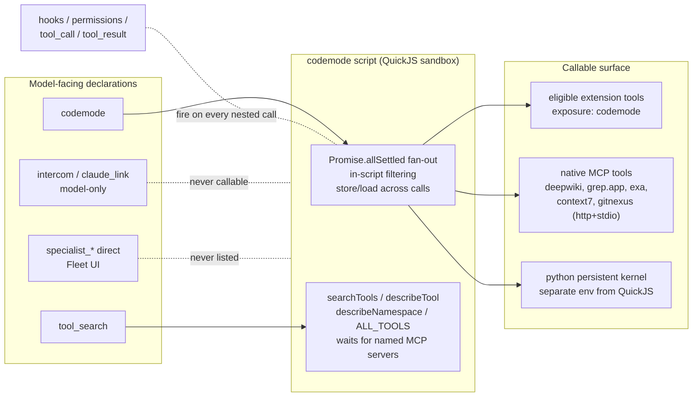
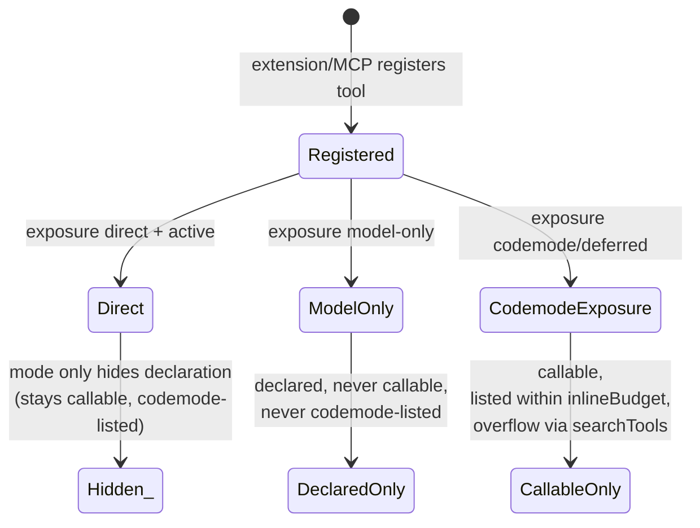
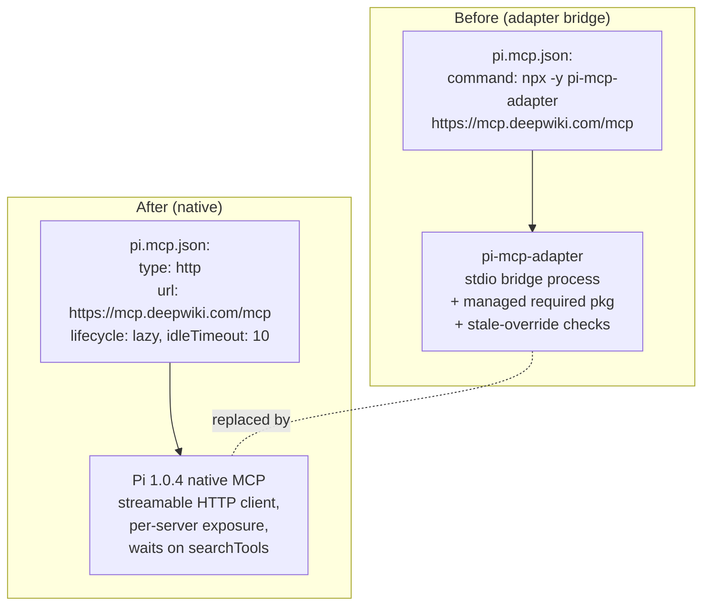
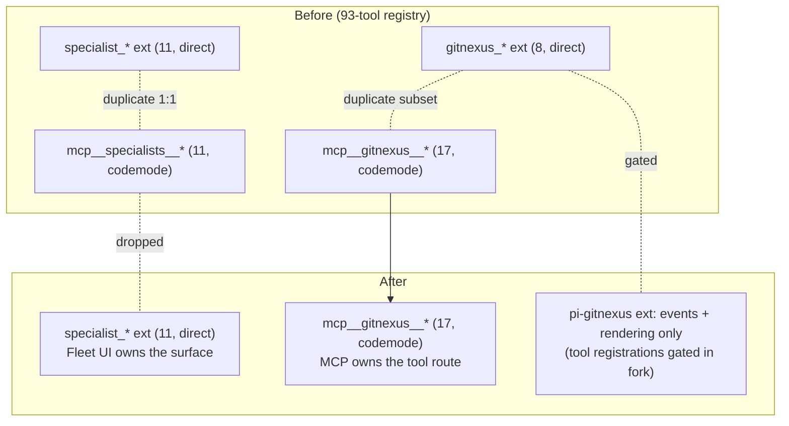

# ADR-007 — Pi codemode-first tool exposure and pi-mcp-adapter retirement

> Status: PROPOSED (audit pending) · Date: 2026-10-13
> Depends: ADR-003 (native participant runtime), ADR-004 (specialist activation capabilities); consumes the first-party agent-runtime design home ([`../agent-runtime/`](../agent-runtime/)).
> Evidence: Substrate **XTRM-638** rev 5 (contract + verified audit); Pi 1.0.4 `dist/extensions/codemode/tool.js` and `docs/{codemode,extensions,mcp,settings,cli}.md`; live 93-tool registry enumeration; adapter-free spike (below); [`../../.xtrm/config/claude.mcp.json`](../../.xtrm/config/claude.mcp.json) native-http parity.

## Context

Pi 1.0.4 ships a complete codemode-first tool architecture: per-tool `exposure`
(`direct` / `model-only` / `codemode` / `deferred` / `hidden`), `codemode.mode`
(`on` / `only`), dynamic discovery (`searchTools` / `describeTool` /
`describeNamespace` / `ALL_TOOLS`) behind a 3000-token inline budget, and native
MCP (stdio + streamable HTTP, lazy lifecycle, per-server exposure). Verified
facts driving this ADR:

1. `codemode.mode: "only"` hides the declarations of **active `direct` tools
   only**; `model-only` tools are never hidden and never callable
   (`prepareCodemodeLoadout`, `tool.js:222,238`). Any extension that carelessly
   registers `direct` gets codemode-gated instead of polluting the system
   prompt — the safe failure direction.
2. Nested calls (`ctx.executeTool`) preserve argument validation,
   `tool_call`/`tool_result` handlers (permission extensions),
   `tool_execution_start/update/end` with parent ids, bounded `nestedCalls`
   records, and usage accounting (`docs/extensions.md:148`). Codemode changes
   the model-facing interface, not operational semantics.
3. MCP tools are codemode-callable by **default** (`codemode` exposure,
   `docs/mcp.md:195`) — no adapter needed. **Spike (2026-10-13)**: in an
   adapter-free project with `pi --tools codemode,tool_search`, `searchTools('wiki')`
   force-connected native-HTTP `mcp__deepwiki` and returned
   `ask_wiki_question` / `read_wiki_contents`.
4. `pi-mcp-adapter` v5.3.0 exists only as (a) an `npx` stdio bridge for
   `deepwiki`/`github-grep` in `.xtrm/config/pi.mcp.json` and (b) a generic `mcp`
   proxy tool when installed as a package. The Claude-side canonical config
   already runs both servers as native `type: "http"`; the `exa` Pi entry uses
   native HTTP. The adapter is a required managed package in core
   (`cli/src/core/pi-runtime.ts:279`), so config-only removal would be
   reintroduced by sync/preflight.
5. The live session registry (93 tools) shows duplicate routes:
   `mcp__specialists__*` ≡ `specialist_*` 1:1 (11 tools); `mcp__gitnexus__*`
   (17) ⊃ `gitnexus_*` extension (8).

## Decision

1. **Codemode is the sole model-facing interface for the eligible tool set.**
   Recommended settings: `defaultTools: ["+codemode", "+tool_search"]` and
   `codemode.mode: "only"` as the enforcement invariant — with the `xtrm-loadout`
   bridge (§1b) covering the gap until fork coverage is complete.
1b. **`xtrm-loadout` forcing bridge** (dev/core pi-extensions, XTRM-owned,
   temporary): a small model-facing orchestrator tool that implements
   `prepareLoadout` alongside codemode's own. While `codemode.mode` stays `on`
   and third-party packages still register `direct`, `xtrm-loadout` returns
   `hiddenDeclarations` for every active `direct` tool **except**
   `{codemode, tool_search, intercom, claude_link, contact_supervisor}`: the
   hidden tools stay active and callable (so scripts reach them via name) but
   leave the model's declarations; the exempted five stay model-facing; the
   exempted four never appear in codemode listing (`direct` is never listed
   under mode `on`). Consequences spelled out so nothing is implicit: (a) the
   `only` flip happens only after the excluded four are `model-only`, otherwise
   mode `only` would hide them and codemode-list them — exactly the violation
   this ADR forbids; (b) `xtrm-loadout` retires itself once fork coverage is
   complete (every eligible tool at `codemode` exposure), leaving `only` as the
   permanent invariant; (c) hidden-but-callable third-party tools are found via
   `ALL_TOOLS`/name until they are also codemode-listed — acceptable interim,
   documented in the bridge's own description.
2. **Exposure assignments** (the matrix below): eligible tools → `codemode`
   exposure; excluded tools stay out of codemode entirely.
3. **The excluded five** — specialists (native-specialists), intercom
   (pi-intercom), claude-link (pi-claude-link), skill-suggest, substrate-suggest —
   keep every UI/event/command surface exactly as today; only codemode exposure
   of their *tools* is excluded. skill-suggest/substrate-suggest register no
   tools (event-driven suggestors), so their exclusion is vacuous — they keep
   injecting. intercom/claude-link tools become `model-only` in their first-party
   successor (xtrm-intercom): declared, never script-callable, never listed.
3b. **First-party exposure specs** (handed to the implementation packets of the
   first-party agent-runtime work): xtrm-intercom — `model-only` tools with the
   required parity list (session presence/roster, aliases, scoped routing,
   send/ask/reply, pending asks, message IDs/dedupe, mailbox, delivery
   receipts, cancellation/superseding, attachments, safe injection, Claude
   socket interop); xtrm-background — `codemode` exposure for the bounded
   process-execution subset only (start, identity, status, bounded logs, full
   output reference, stop, rerun, completion event, host wake/follow-up),
   absorbing the retired pi-processes use cases; first-party Issue Task Plan —
   `codemode` exposure with Substrate-backed state (no independent `.pi/tasks`
   authority for claimed XTRM work). None of the three imports Fusion or
   delegated-agent orchestration (design-home boundary).
4. **pi-mcp-adapter is not installed anywhere.** Removed from the managed
   registry, settings template, install schema, and docs; the
   `~/.pi/agent/npm/node_modules/pi-mcp-adapter` copy is uninstalled;
   deepwiki/github-grep become native `type: "http"` entries (parity with
   claude.mcp.json). The dead `MCP_ADAPTER_PROXY_TOOL` branch in
   `agent-host-origin.ts` is removed.
5. **Retirements**: `@gotgenes/pi-subagents` (specialists own delegation:
   `specialist_*` + `bg_delegate`) and `@aliou/pi-processes` (the first-party
   background surface owns process lifecycle). Retirement requires a
   zero-orphaned-reference sweep across all three repos and home config.
6. **Dedupe**: the `specialists` MCP server entry is dropped from
   `.xtrm/config/pi.mcp.json` — native-specialists owns the surface (Fleet UI,
   in-process activations, direct tools). For gitnexus: the MCP server (17
   tools, native codemode default) owns the tool route; the `pi-gitnexus`
   extension stays for context injection + rendering, with its 8 tool
   registrations gated in our fork (upstream PR optional, not load-bearing).
7. **Fork-and-watch** for remaining third-party packages
   (`pi-gitnexus`, `@robhowley/pi-structured-return`, `@narumitw/pi-goal`,
   `pi-ast-grep`, `@parcha/agentrun-pi`): our forks carry the exposure changes,
   each with `provenance.md` (upstream URL, base SHA, local delta, license
   notice) and a GitHub App watching upstream that notifies on updates. No
   upstream-PR dependency; no silent vendoring.
8. **Fusion disposition**: `fusion_*` (from `pi-background-tasks`, which the
   first-party background work deliberately does not absorb) gets a first-party
   home — reimplemented, or replaced by a targeted adoption search for one
   specific extension. Decision recorded when made; `fusion_research` is in
   active use and must not silently disappear.
9. **CLI-first pattern**: capabilities that are CLIs stay CLIs — called through
   codemode `bash`/`structured_return` — not wrapped in extensions or MCP
   servers. Standing examples: `mcpq` (its README documents the rationale:
   49+ tool schemas per session is a token tax) and `ocr` (pure CLI + skill
   surface; registers no tools; the reviewer specialist definition contains no
   ocr references — verified — so no change is needed).
10. **Jira/Atlassian integration direction is deliberately excluded** from this
    ADR: Jira and Substrate are planned to become tightly coupled later; that
    work decides API-extension vs acli vs other. The programme-coordination skill
    keeps working with Jira as-is, untouched.
11. **Own, don't adopt, the background/process substrate.** Evaluated and
    rejected as dependencies: Pi Durable (deferred to its own tracker; our
    background semantics stay first-party via xtrm-background), OpenTUI
    (rejected for this stack), OpenUI (scoped to xtrm-app peripherals only).
    The fork-and-watch set (§7) covers exposure-only changes to adopted
    packages; it does not cover runtime substrates.

### Exposure matrix

| Tool surface | Origin | Exposure (target) | Codemode-listed | Model-declared |
|---|---|---|---|---|
| `python` (persistent kernel) | python-kernel (ours) | `codemode` | yes | no |
| `bash/read/edit/write/find/grep/ls` | xtrm-ui (ours) | `codemode` | yes | no |
| `gitnexus_*` (17) | gitnexus MCP server (native) | `codemode` (default) | yes | no |
| `mcp__deepwiki__*`, `mcp__github-grep__*` | native HTTP MCP | `codemode` (default) | yes | no |
| `mcp__exa__*`, `mcp__context7__*` | native MCP | `codemode` (default) | yes | no |
| `structured_return`, `goal_*`, `bg_*`, `agentrun`, `ast_grep` | fork set | `codemode` (in-fork) | yes | no |
| `specialist_*` (11) | native-specialists (excluded) | `direct` (unchanged) | no | yes |
| `intercom`, `contact_supervisor`, `claude_link` | excluded → xtrm-intercom | `model-only` (in first-party impl) | no | yes |
| xtrm-background tools (process subset) | first-party impl (excluded-via-design) | `codemode` | yes | no |
| Issue Task Plan tools | first-party impl (excluded-via-design) | `codemode` | yes | no |
| skill-suggest, substrate-suggest | excluded suggestors | no tools — events only | n/a | n/a |
| `codemode`, `tool_search` | Pi built-ins | active orchestrators | — | yes |

### Architecture



### Exposure state model



### Adapter replacement



### Dedupe



## Schemes

Target `.pi` user/project settings (live `~/.pi/agent/settings.json`, operator-approved):

```json
{
  "defaultTools": ["+codemode", "+tool_search"],
  "codemode": { "mode": "only" },
  "packages": [
    "npm:pi-gitnexus@<our-fork>",
    "npm:@robhowley/pi-structured-return@<our-fork>",
    "npm:@narumitw/pi-goal@<our-fork>",
    "npm:pi-ast-grep@<our-fork>",
    "npm:@parcha/agentrun-pi@<our-fork>",
    "/home/dawid/dev/core/packages/pi-extensions",
    "npm:@jaggerxtrm/pi-service-knowledge",
    "npm:pi-intercom",
    "git:github.com/alonw0/pi-claude-link",
    "/home/dawid/dev/specialists/config/pi-extensions/native-specialists"
  ]
}
```

Target `.xtrm/config/pi.mcp.json` (synced additively into project `.pi/mcp.json`):

```json
{
  "mcpServers": {
    "context7": { "command": "npx", "args": ["-y", "@upstash/context7-mcp"], "lifecycle": "lazy", "idleTimeout": 10 },
    "deepwiki": { "type": "http", "url": "https://mcp.deepwiki.com/mcp", "lifecycle": "lazy", "idleTimeout": 10 },
    "github-grep": { "type": "http", "url": "https://mcp.grep.app", "lifecycle": "lazy", "idleTimeout": 10 },
    "exa": { "type": "http", "url": "https://mcp.exa.ai/mcp?tools=web_search_exa,web_fetch_exa,web_search_advanced_exa,agent_run", "headers": { "x-api-key": "${EXA_API_KEY}" } },
    "gitnexus": { "command": "gitnexus", "args": ["mcp"], "lifecycle": "lazy", "idleTimeout": 10 }
  }
}
```

Fork `provenance.md` format (per fork, no silent vendoring):

```markdown
# Provenance — <package>
- Upstream: <repo URL> (base SHA: <sha>)
- License: <license> (notice preserved at LICENSE)
- Local delta: <exposure: codemode for registered tools; exact files touched>
- Update watch: GitHub App `<app>` on upstream — notifies <channel> on commits/releases
- Last upstream sync check: <date, sha>
```

## Outputs and handoff

Per-repo PR set (XTRM-638) plus two handoff artifacts: (1) the exposure specs
in §Decision-3b and the matrix above, handed to the first-party implementation
packets (xtrm-intercom, xtrm-background, Issue Task Plan) — the packets own the
build, this ADR owns the interface contract; (2) the fork set with provenance
plus update-watch wiring; (3) the fusion disposition decision with evidence.

## Change plan

Sequenced in XTRM-638 (per-repo PR set): dev/xtrm config + template + schema +
docs; dev/core CLI registry/agent-host-origin/tests/docs; dev/core
pi-extensions exposure changes (python-kernel, xtrm-ui) + optional
`xtrm-loadout` extension pending fork coverage; dev/specialists
native-specialists stays direct (no change); fork set with provenance +
update-watch; retirements with orphan sweep; adapter uninstall. Live home
settings edit is operator-approved. Third-party exposure changes land in forks,
not upstream PRs.

## Verification

Proven (2026-10-13): native-HTTP MCP without adapter under a
`codemode,tool_search`-only loadout (`mcp__deepwiki` connected and discoverable
via `searchTools`); nested-call semantics from Pi source; exposure model from
Pi source; 93-tool live registry enumeration; reviewer specialist definition
contains no ocr references.

Pending (executable, in XTRM-638 validation): effective model-facing list under
`pi --tools codemode,tool_search`; excluded tools not callable/listed from
codemode scripts while their UI surfaces work; `pi mcp list` adapter-free with
zero references in configs and no npm dir; specialists server absent from synced
`.pi/mcp.json` with native-specialists dispatch intact; python kernel state
across codemode calls; hooks/nestedCalls under nested calls; core CLI tests
green; orphan sweep for retirements; token/context delta before/after; a live
agentrun Jev run (inspect passes; full run blocked on `TYPESAFE_API_KEY` in the
host env — the validator must re-run with the key present before accepting the
agentrun fork).

## Audit

This ADR and every implementation PR under XTRM-638 are audited work: each PR
passes the seconder pass (scope vs contract) and the reviewer chain, plus an
`ocr` review (delegation mode by default; full-engine with file-sized budgets
for small high-value diffs). Audit findings land as XTRM-638 notes. The ADR
itself is audited before status moves PROPOSED → ACCEPTED.

## Related session artifacts (not decided here)

This session produced evidence these decisions rest on, owned by their own
trackers — listed so the audit trail is complete, not to widen this ADR:

- T3 Code GUI research (Option B+C, attach verdict, parity matrix, extension
  rendering): `packages/xtrm-app/docs/research-t3-gui/` (merged as #284);
  runtime UI options: `packages/xtrm-tui/docs/runtime-ui-options.md`.
- Codemode doctrine the design assumes: `~/.pi/agent/APPEND_SYSTEM.md` +
  `~/.pi/agent/skills/codemode/` (+ `references/runtime-shapes.md`); additive
  composition with specialist system prompts proven twice (mechanism +
  behavioral probe via `xt pi` role sessions).
- Provenance evidence steer + skill roster discovery (uncommitted dev/core
diff: substrate-suggest duties/index, skill-suggest roster, suggestor tests).
- Upgrade pass over specialists/skills: SPECIALISTS-4258 (agentrun extension
enabled on all 38 specialist entries; ocr + agentrun skill packs installed at
~/.xtrm/skills/).
- GitNexus-in-codemode proven end-to-end with a fresh index (24,182 nodes /
54,958 edges at `/home/dawid/dev/xtrm`); MCP exposure defaults verified from
the live 93-tool registry.
- ocr engine notes: CLI + delegation/full-engine via local shim
  (`~/.local/share/ocr-shim/shim.js`, systemd `ocr-zen-shim.service`),
  reviews `/tmp/ocr-*.json`, MMD teaching pack
  (`deploy/mmd-programme-2026-10/tools/ocr-review.md`);
  agentrun live run blocked on `TYPESAFE_API_KEY` in the host env.
- SRE capacity triage (QuestDB / snapshot_feed / dockerd):
  `deploy/mmd-programme-2026-10/reports/xtrm-questdb-snapshot-1012.md`.
- RSI-Anything research: full graded report retrieved under
  `.pi/fusion/01a13057-*/research-e15012e3bd8f65707e5fc13f461b7ceb`
  (DeepWiki 429 for all fetchers; GitHub source used as supplement).

## References

- Substrate **XTRM-638** rev 5 — durable contract, audit table, validation plan
- First-party design home: [`../agent-runtime/`](../agent-runtime/)
  (`xtrm-agent-runtime-design.md`, `ADOPTION-CREDITS.md`,
  `IMPLEMENTATION-PACKETS.md`) — operator-view tracker: Jira XTRM-91
- Pi 1.0.4: `docs/codemode.md`, `docs/extensions.md` (Tool exposure),
  `docs/mcp.md` (Control tool exposure), `docs/settings.md` (Tools),
  `dist/extensions/codemode/tool.js`
- Local Substrate XTRM-91 is an unrelated closed mcpq seconder pass — never
  reference it for this work
