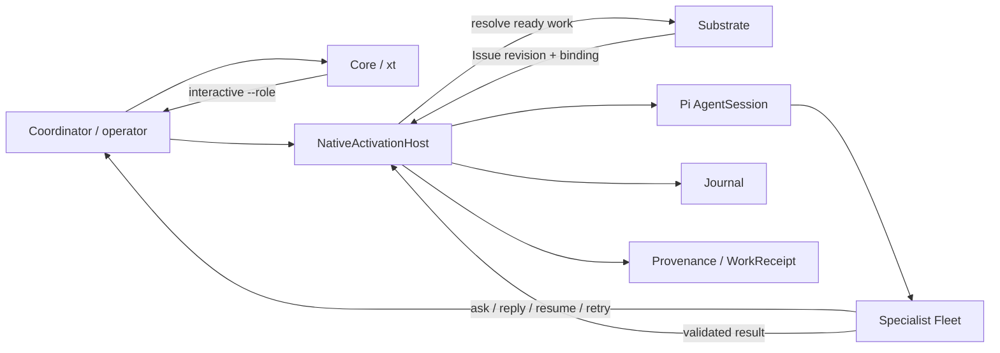
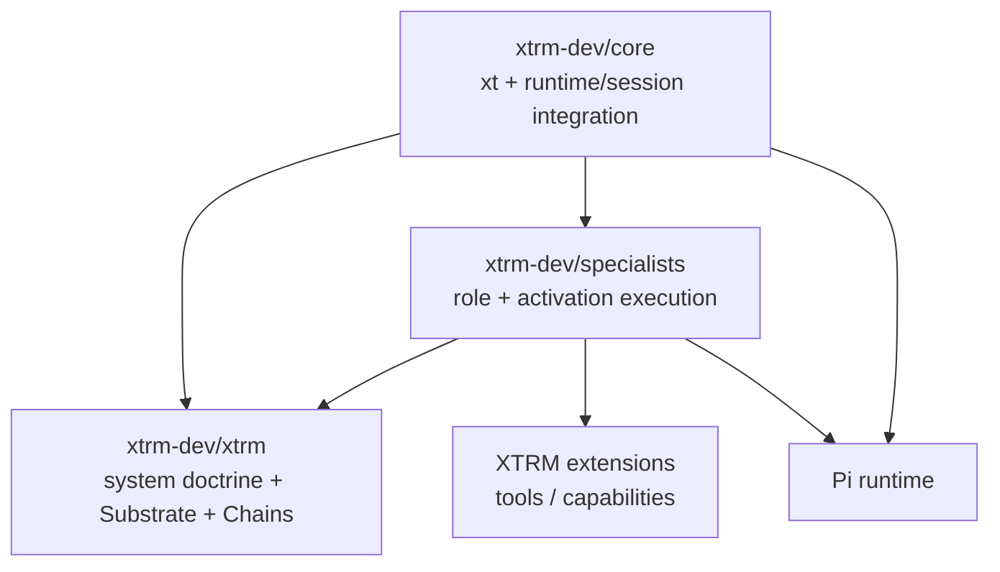
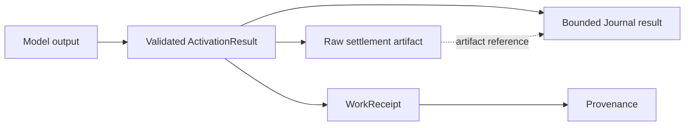
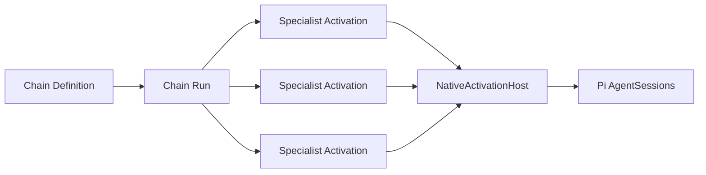
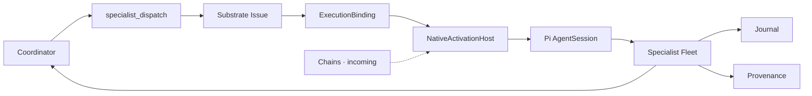

# ADR — Specialists Documentation vNext and XTRM System Integration

**Status:** PROPOSED — decision-ready  
**Date:** 2026-09-15  
**Scope:** `xtrm-dev/xtrm`, `xtrm-dev/core`, `xtrm-dev/specialists`, Substrate, XTRM runtime extensions, and user-facing documentation that explains how these pieces compose  
**Primary documentation owner:** `xtrm-dev/xtrm/docs/specialists/`  
**Implementation target:** documentation and cross-reference restructuring; no runtime redesign is implied by this ADR

---

## 1. Decision summary

Specialists documentation will be redesigned around the system that exists now rather than the historical order in which its parts were built.

The current product story must present XTRM as one inter-dependent system:

```text
XTRM system
│
├── xtrm-dev/xtrm
│   ├── cross-cutting architecture and system doctrine
│   ├── Substrate durable-work runtime
│   ├── planning / Journal / Closure / provenance / Resume Capsule
│   └── future Chain definitions and orchestration contracts
│
├── xtrm-dev/core
│   ├── xt operator CLI
│   ├── runtime launch and worktree/session ownership
│   ├── xt pi / xt claude / xt codex
│   ├── interactive --role integration
│   ├── skills / instructions / hooks distribution
│   └── tmux / runtime metadata and integration surfaces
│
├── xtrm-dev/specialists
│   ├── Specialist definitions
│   ├── NativeActivationHost
│   ├── Pi AgentSession lifecycle
│   ├── native Pi extension
│   ├── Claude Specialists plugin + MCP
│   ├── Fleet / interaction / result projection
│   ├── execution telemetry
│   └── legacy sp CLI runtime, maintained during migration
│
└── XTRM extensions
    ├── GitNexus and other capability extensions
    ├── tool catalog / permission contracts
    ├── Python and other runtime capabilities
    └── future TUI / inspector surfaces
```

The documentation must no longer imply that any one repository is the complete product.

The public Specialists narrative becomes:

```text
CURRENT / PRIMARY
  Native Specialists + Substrate + NativeActivationHost

LEGACY / MAINTAINED
  sp CLI jobs + Beads-backed Supervisor/worktree flow
  retained while remaining capabilities migrate

INCOMING
  Chains materializing multiple bounded Specialist activations
  over the same NativeActivationHost and Substrate authority
```

This status vocabulary is normative for the documentation migration.

---

## 2. Why this ADR exists

Specialists has been redesigned materially since the original documentation was written.

The project began with a CLI/job-centric model centered on:

```text
sp run
+ Beads
+ Supervisor
+ subprocess/RPC Pi sessions
+ per-job worktrees
+ feed/result/console
```

That runtime still exists and remains supported, but it is no longer the target architecture for new XTRM orchestration.

The newer runtime is structurally different:

```text
Substrate Issue
    ↓
readiness + claim
    ↓
ExecutionBinding
    ↓
NativeActivationHost
    ↓
in-process Pi AgentSession
    ↓
Fleet / asks / replies / resume / retry
    ↓
validated ActivationResult
    ↓
Journal result + WorkReceipt + provenance
```

The old documentation corpus evolved incrementally around the first architecture. As a result, many individually useful pages still create the wrong system-level impression when read together.

The redesign therefore addresses two different problems:

1. **accuracy drift** — individual pages or examples that still describe historical behavior;
2. **information-architecture drift** — current facts arranged around the legacy product model.

The second problem cannot be fixed with isolated text edits.

---

## 3. Documentation design principles

This ADR adopts the following principles.

### 3.1 User need before repository boundary

Documentation should explain the product as the user experiences it, not force the reader to know which repository owns an implementation detail.

Repository ownership must still be explicit in architecture and contributor material.

### 3.2 Current, legacy, incoming must never blur

Every substantial page must make its runtime status obvious.

Allowed status vocabulary:

```text
current
legacy-maintained
incoming
historical
internal
```

A page may discuss more than one status only when comparison is its explicit purpose.

### 3.3 Explanation, how-to, reference, and tutorial have different jobs

The documentation follows Diátaxis-style separation pragmatically:

- **Tutorial / getting started** — teach by doing.
- **How-to / guide** — accomplish one concrete task.
- **Reference** — precise factual machinery.
- **Explanation / concept** — explain why and how the system is shaped.

The repository does not need four empty top-level boxes merely to satisfy a framework. The distinction is an authoring discipline.

### 3.4 Reference follows runtime structure

Reference material must mirror the actual machinery and derive claims from code/schema/tool registration where possible.

Examples:

- MCP tool inventory follows `tools/list` / registration code.
- Specialist-definition reference follows the actual schema.
- config/override fields follow loader and schema behavior.
- runtime states follow canonical types.
- extension/tool availability follows catalog and policy data.

### 3.5 Diagrams explain boundaries and lifecycle

Diagrams are not decoration. Each diagram must answer a concrete question that prose alone answers poorly.

Diagrams and prose should complement, not duplicate, each other.

### 3.6 One concept, one canonical page

Avoid multiple current pages that appear to own the same concept.

Historical design records remain valuable, but must be visibly historical and link to the current source.

---

## 4. Canonical system ownership map

The documentation must teach the following ownership model.

### 4.1 `xtrm-dev/xtrm`

Owns cross-cutting XTRM architecture and, through Substrate:

```text
Issue
readiness
claim
Journal
Resume Capsule
Closure
provenance
ExecutionContext
ExecutionBinding-side durable work identity
Substrate MCP / CLI surfaces
```

It is also the natural home for system-level design decisions that span multiple repositories, including this ADR.

It must not duplicate the Specialists execution runtime.

### 4.2 `xtrm-dev/core`

Owns operator/session/runtime integration:

```text
xt CLI
xt init / installation / update
runtime launch
worktree + branch lifecycle
Pi / Claude / Codex interactive sessions
tmux placement and pane metadata
canonical XTRM skill/instruction delivery
runtime enrollment
interactive --role launcher
```

For interactive Specialist roles Core consumes a deliberately narrow, versioned boundary rather than the complete Specialist definition.

Current boundary:

```text
xtrm.interactive-role-envelope.v1
```

Core owns interactive session placement and worktree lifecycle; Specialists owns role meaning and Specialist execution semantics.

Core must not become a second Specialist supervisor.

### 4.3 `xtrm-dev/specialists`

Owns execution-role semantics:

```text
SpecialistLoader
Specialist definitions
NativeActivationHost
StepContract
Pi AgentSession lifecycle
model/thinking resolution for activation
capability/resource assembly
workspace activation lease integration
interaction transport
Fleet projection
settlement/result projection
execution telemetry
Pi Specialist extension
Claude Specialists plugin/MCP
```

Specialists consumes durable work from Substrate.

It does not own a second durable work graph for native activation.

### 4.4 Substrate

Substrate is not merely a replacement CLI for Beads.

It is the durable-work authority for the current native XTRM architecture:

```text
Issue                  WHAT is authorized
Claim / lease          WHO owns work / mutation authority
Journal                WHAT happened during execution
Resume Capsule         WHAT a continuing worker must reconstruct
Closure                HOW durable work terminates/reopens
Provenance             WHAT execution actually produced
```

Normative invariants to repeat consistently:

```text
Journal != Issue contract
Journal != Memory
message != authority
worker output != provenance
session != durable work
MCP != work authority
```

A ready Issue revision is the executable work contract.

If executable authority changes, execution stops and the Issue is revised through planning/readiness rather than silently widened through prompt prose, a message, or a Journal entry.

### 4.5 XTRM extensions

Extensions supply bounded runtime capabilities; they are not ambient magic.

Documentation should distinguish:

```text
configured extension source
resolved catalog entry
admitted tool contract
active tool in the live AgentSession
```

These are not equivalent.

Tool catalogs, version compatibility gates, resource loading and post-load verification are part of the system story because Specialist behavior depends on them.

---

## 5. The primary architecture story

All top-level Specialists documentation should converge on this architecture:



This is a system diagram, not a repository dependency graph. The purpose is to show where work authority and execution authority live.

A separate repository-ownership diagram should make implementation boundaries explicit:



Arrows mean runtime or contract dependency, not ownership transfer.

---

## 6. Core / `xt --role` cross-reference decision

Specialists documentation must explicitly teach that there are two related but different ways a role can appear in XTRM.

### 6.1 Native Specialist activation

A coordinator dispatches a bounded activation through `NativeActivationHost`.

Properties:

```text
Substrate-backed work authority
in-process child Pi AgentSession
Fleet lifecycle
asks/replies/resume/retry
activation lease semantics
validated result + settlement publication
```

### 6.2 Interactive `xt --role` session

Core launches a full interactive runtime session carrying a Specialist role/persona.

Examples include:

```bash
xt pi --role <role>
xt claude --role <role>
```

and runtime-specific variants where supported.

Core owns:

```text
worktree/session creation
runtime executable
branch ownership
tmux placement
pane metadata
parent identity
interactive process lifecycle
```

Specialists provides a narrow interactive-role envelope with:

```text
role
systemPrompt
skillPaths
model
thinkingLevel
interactive
```

This integration must be documented as a **consumer of Specialist role definitions**, not as the NativeActivationHost child runtime.

The two surfaces intentionally share Specialist identity and role composition while differing in lifecycle and workspace ownership.

### 6.3 Migration warning for current Core role docs

Existing Core role documentation still contains bridge-era Beads terminology such as `--bead` and historical `sp render-task` assumptions.

Documentation vNext must cross-link those pages while clearly identifying the migration state:

```text
Core interactive role launcher exists and remains useful.
Its tracked-work parameter and role-context composition must converge on
Substrate/XTRM work authority rather than teach Beads as the future contract model.
```

This ADR does not itself change Core CLI flags.

A separate implementation decision is required before renaming/removing any stable CLI argument.

### 6.4 Required Core links from Specialists docs

At minimum, Specialists docs should link to these Core concepts:

- `docs/xt-pi-role.md` — interactive `--role` behavior;
- `docs/architecture/interactive-role-envelope.md` — versioned Core↔Specialists boundary;
- Core runtime compatibility matrix where relevant;
- XTRM `using-specialists` / multiplexing / planning skills where they own system doctrine.

Core docs should reciprocally link to the Specialists native-runtime overview rather than re-explain its internals.

---

## 7. Substrate integration must be first-class in Specialists docs

Substrate must no longer appear as an implementation footnote or dependency setup step.

The documentation should explain the runtime relationship explicitly.

### 7.1 Dispatch

```text
specialist_dispatch(issue_ref)
    ↓
resolve exact Issue
    ↓
readiness
    ↓
claim
    ↓
pin revision + contract hash
    ↓
ExecutionBinding
    ↓
NativeActivationHost
```

A Specialist never receives an ambiguous "latest Issue" as durable authority.

### 7.2 Inline work

Inline contract dispatch must be documented as:

```text
inline contract
    ↓
structural validation
    ↓
Substrate Issue creation
    ↓
readiness / attestation
    ↓
claim
    ↓
ExecutionBinding
    ↓
NativeActivationHost
```

Historical names such as `created_bead_id` that remain in compatibility response shapes must be labeled compatibility vocabulary and scheduled for API cleanup rather than treated as conceptual truth.

### 7.3 During execution

The Specialist may:

```text
produce ordinary progress      → interaction / Journal as appropriate
ask the coordinator            → interaction transport
raise a blocker/escalation     → interaction + durable work state where required
settle                         → ActivationResult validation
```

Messages never grant new executable scope.

### 7.4 Settlement

The settlement documentation must show the distinction between raw output, validated result, Journal result and provenance:



Normative distinctions:

```text
model output != ActivationResult
ActivationResult != Journal entry
Journal result != raw settlement
WorkReceipt != result
worker claim != provenance
```

### 7.5 Continuation

A continuing XTRM worker reconstructs durable state from Substrate projections such as Issue revision, Journal, claims, blockers, child state, provenance and Resume Capsule rather than treating prior conversation transcript as authority.

Specialist session context remains valuable for a live activation; it is not the system's durable work authority.

---

## 8. Legacy CLI decision

The `sp` CLI runtime remains **legacy-maintained**, not deprecated-for-removal in this ADR.

The docs must state plainly:

> The `sp run` / Supervisor / Beads-backed job runtime remains supported for compatibility and for capabilities not yet fully migrated. It is not the target architecture for new XTRM orchestration.

The legacy area includes concepts such as:

```text
sp run
sp feed
sp result
sp resume / steer
sp console
legacy Supervisor
legacy per-job worktrees
Beads-backed job contracts
```

These pages should remain accurate and useful, but move under an explicitly legacy documentation namespace.

No mass search/replace from Bead→Issue is allowed in legacy reference material when the implementation still genuinely uses Beads.

The migration principle is:

```text
native/current docs      MUST teach Substrate
legacy CLI docs          MAY teach Beads where the runtime actually does
historical docs          MAY preserve old terms with clear status/supersession
```

---

## 9. Chains are incoming, not a second runtime

Chains must be visible in the new documentation because they are the next orchestration layer, but must never be described as shipped until their runtime acceptance exists.

The canonical concept is:



Chains must reuse rather than duplicate:

```text
Substrate work authority
NativeActivationHost
Specialist definitions
StepContract semantics
interaction semantics
lease semantics
settlement/result semantics
provenance
```

Therefore documentation should explain Chains as:

> deterministic orchestration/materialization over bounded Specialist activations.

Not as:

> another agent runtime alongside Specialists.

---

## 10. Documentation information architecture

Target structure for `xtrm-dev/specialists` documentation:

```text
README.md

docs/
├── index.md
│
├── getting-started/
│   ├── quickstart.md
│   ├── native-pi.md
│   └── claude-plugin.md
│
├── concepts/
│   ├── what-is-specialists.md
│   ├── mental-model.md
│   ├── native-vs-legacy.md
│   ├── work-authority.md
│   ├── specialist-lifecycle.md
│   ├── fleet-and-interactions.md
│   ├── execution-profile.md
│   ├── results-and-provenance.md
│   └── chains.md
│
├── architecture/
│   ├── overview.md
│   ├── native-runtime.md
│   ├── substrate-boundary.md
│   ├── agent-session-lifecycle.md
│   ├── workspace-leases.md
│   ├── resource-isolation.md
│   ├── interaction-transport.md
│   ├── settlement-and-provenance.md
│   └── observability.md
│
├── guides/
│   ├── dispatch-a-specialist.md
│   ├── supervise-an-activation.md
│   ├── resume-and-retry.md
│   ├── respond-to-a-specialist.md
│   ├── author-a-specialist.md
│   ├── configure-models.md
│   ├── configure-extensions.md
│   ├── use-claude-plugin.md
│   ├── use-pi-extension.md
│   └── troubleshoot.md
│
├── reference/
│   ├── specialist-definition.md
│   ├── activation-api.md
│   ├── mcp-tools.md
│   ├── configuration.md
│   ├── states-and-events.md
│   ├── tools-and-permissions.md
│   ├── models-and-thinking.md
│   ├── telemetry.md
│   └── environment-variables.md
│
├── legacy/
│   ├── README.md
│   ├── cli.md
│   ├── jobs.md
│   ├── beads-workflow.md
│   ├── worktrees.md
│   ├── console.md
│   └── cli-runtime-architecture.md
│
├── roadmap/
│   ├── README.md
│   ├── chains.md
│   ├── tui-integration.md
│   └── legacy-cli-migration.md
│
└── internals/
    ├── design-records/
    └── historical/
```

The final tree may evolve during migration. The decision being made is the separation of concerns, not every filename.

---

## 11. README vNext contract

The Specialists README becomes a product landing page, not a complete reference manual.

Required order:

1. one-sentence definition;
2. why Specialists exists;
3. architecture at a glance;
4. primary/current runtime;
5. 60-second native quickstart;
6. key concepts;
7. current vs legacy vs incoming status table;
8. built-in Specialist families;
9. integration with Substrate, Core/xt, Pi, Claude and extensions;
10. documentation map by user intent;
11. development/contribution entry points.

### 11.1 Required status table

The README should carry a compact table equivalent to:

| Surface | Status | Work authority | Execution | Intended use |
|---|---|---|---|---|
| Native activation | **Primary** | Substrate | in-process Pi `AgentSession` | new XTRM orchestration |
| Claude Specialists plugin | **Primary** | Substrate | `NativeActivationHost` | Claude coordinators |
| Pi Specialists extension | **Primary** | Substrate | `NativeActivationHost` | Pi coordinators |
| Core `xt --role` interactive roles | **Current integration** | XTRM/Substrate migration target | full interactive runtime/worktree | long-lived role sessions |
| `sp` CLI jobs | **Legacy / maintained** | Beads | subprocess/RPC Supervisor | compatibility + unmigrated features |
| Chains | **Incoming** | Substrate | materialized native activations | deterministic orchestration |

The `xt --role` work-authority cell must be kept accurate as Core migrates remaining `--bead` bridge semantics.

### 11.2 README architecture diagram

At minimum:



---

## 12. Required concept pages

### 12.1 What is Specialists?

Answers:

```text
What problem does it solve?
What is a Specialist?
What does a coordinator retain?
What is isolated?
What is persistent?
How does this differ from generic subagents?
```

The cognitive-faculty/common-mind metaphor belongs here, in bounded form.

### 12.2 Native vs legacy

One canonical comparison page prevents every other page from re-explaining migration state.

It should compare:

```text
work authority
session topology
workspace topology
lifecycle
interaction
result persistence
provenance
operator surfaces
migration status
```

### 12.3 Work authority

Explain Substrate directly enough that a Specialists user does not need to discover the architecture by reading the Substrate ADR.

Then link to Substrate for deeper work-lifecycle documentation.

### 12.4 Specialist lifecycle

Document:

```text
starting
running
waiting
needs_reply
escalated
settled
failed
uncertain
stopping
stopped
```

including resume/retry/disposal distinctions.

### 12.5 Fleet and interactions

Explain both the operator UI and the protocol semantics.

Example rendering may be shown:

```text
╰─ SPECIALISTS  2 running • 1 waiting • ! 1 blocked
    ◐ researcher  XTRM-241  inspect native wake transport
       gpt-5.6-sol · high  • 47s • 3t • 8.2k
```

The page must distinguish:

```text
notification = projection / attention signal
specialist_status = authoritative live read
message = coordination
result = validated completion object
```

### 12.6 Execution profile

Document how a Specialist definition becomes the live execution envelope:

```text
role definition
+ global/repo override
+ model/thinking
+ skills
+ tools
+ extensions
+ scripts
+ mandatory rules
+ output contract
+ resource isolation
→ live AgentSession profile
```

This page should reference native/legacy parity tests and explicitly list intentional runtime divergences.

### 12.7 Results and provenance

Explain the settlement model from §7.4.

### 12.8 Chains

Status must be `incoming` until accepted runtime evidence exists.

---

## 13. Specialist-definition documentation

The current large authoring guide should be split into three user needs:

```text
concepts/specialist-definition.md
  why definitions exist and how fields compose

guides/author-a-specialist.md
  task-oriented creation and validation

reference/specialist-definition.md
  exact schema reference
```

Reference should follow the actual JSON shape and, for each important field, state:

```text
Type
Required/default
Canonical owner
Native semantics
Legacy semantics
Overrideability
Security/capability implication
Minimal example
```

Primary sections should mirror the actual schema, including:

```text
metadata
execution
capabilities
tools / catalog policy
skills
scripts
mandatory_rules
prompt / templates
output contract
stall/lifecycle settings
```

Do not merge concept prose into the field-by-field reference.

---

## 14. Configuration and user overrides

The documentation must include a runtime applicability matrix.

Example:

| Field | Native | Legacy CLI | User override | Notes |
|---|---:|---:|---:|---|
| `execution.model` | yes | yes | yes | machine/runtime policy |
| `thinking_level` | yes | yes | yes | target runtime capability applies |
| `execution.extensions` | yes | yes | yes | loading mechanism differs |
| `beads_write_notes` | no | yes | yes | legacy-only compatibility field |
| `beads_integration` | no | yes | yes | legacy-only compatibility field |
| `mandatory_rules.template_sets` | yes | yes | bounded | package/global/repo layering |
| `capabilities` | yes | yes | no | package-owned safety boundary |

A config value that is syntactically accepted but inert on the native runtime must be described as such.

---

## 15. Architecture documentation

The old Specialists `docs/ARCHITECTURE.md` is primarily the legacy RPC/Supervisor architecture and should not remain the default architecture landing page.

Decision:

- preserve its accurate legacy content;
- reclassify/move it under legacy runtime documentation;
- create a new architecture overview for the native system.

The new overview should have these sections:

1. responsibilities and repository boundaries;
2. component map;
3. activation lifecycle;
4. durable authority model;
5. runtime/session boundaries;
6. execution-profile composition;
7. workspace/lease model;
8. interaction path;
9. settlement/provenance path;
10. failure and degraded modes;
11. Core `xt --role` integration;
12. legacy boundary;
13. incoming Chains;
14. deep-dive links.

---

## 16. Required architecture diagrams

Documentation vNext should produce, at minimum:

1. XTRM cross-repository architecture;
2. Specialist dispatch path;
3. activation state machine;
4. agent/session/attempt/participant identity relationship;
5. workspace writer-lease lifecycle;
6. tools/extensions/resource-loader composition;
7. ask/reply interaction path;
8. settlement → Journal/provenance path;
9. native vs legacy topology;
10. Core `xt --role` interactive integration;
11. Chains → NativeActivationHost future topology;
12. Substrate durable-work responsibility map.

Each diagram should have one canonical home and be linked rather than copied when possible.

---

## 17. Documentation frontmatter and lifecycle governance

Current documentation should converge on frontmatter equivalent to:

```yaml
title: ...
description: ...
type: tutorial | how-to | reference | explanation | internal
status: current | legacy-maintained | incoming | historical
runtime: native | legacy | shared | n/a
owners:
  - specialists
source_of_truth:
  - path/to/code-or-schema
verified_at: <commit-or-release>
```

Historical design records should additionally include:

```yaml
superseded_by:
  - path/to/current/document
```

Human-readable historical banner:

> **Historical design record — not current implementation.** Preserve for rationale/evidence; do not implement from this page.

---

## 18. Anti-drift gates

Documentation quality should become mechanically protected where possible.

Required or strongly recommended gates:

### 18.1 Vocabulary/status guard

Current-native docs must not teach Beads as native work authority.

Legacy/historical paths are excluded intentionally.

### 18.2 Tool inventory guard

Reference tool names must match live registration or generated inventory.

### 18.3 Specialist schema guard

Field reference must not silently omit/add canonical schema fields.

### 18.4 Config applicability guard

Legacy-only fields such as Beads integration settings must remain marked legacy-only.

### 18.5 Chains status guard

Current docs must not call Chains shipped before their acceptance marker changes.

### 18.6 Link and Mermaid validation

Internal links and Mermaid syntax/build must be checked in CI.

### 18.7 Current/legacy frontmatter guard

Pages under `legacy/` must identify themselves as legacy-maintained or historical.

Current-native pages may link to legacy docs but must not depend on them for core concepts.

---

## 19. Migration plan

This documentation redesign should be executed as a programme with bounded lanes rather than one giant rewrite commit.

### Phase D0 — inventory and classification

Create a machine-readable inventory of existing Specialists docs with:

```text
path
primary user need
runtime
status
action
canonical replacement
```

Allowed actions:

```text
keep
rewrite
split
move-legacy
move-internal
archive
delete-duplicate
```

### Phase D1 — product landing

Deliver:

```text
README vNext
docs/index.md
what-is-specialists
native-vs-legacy
system ownership map
```

This phase should already make the repository tell the correct product story even while long-tail pages remain unmigrated.

### Phase D2 — architecture

Deliver new architecture overview + core diagrams.

Move/reclassify the old Supervisor/RPC architecture as legacy.

### Phase D3 — native onboarding

Deliver native Pi and Claude quickstarts, dispatch/supervision guides and first-class Substrate explanation.

### Phase D4 — reference

Split/refactor:

```text
Specialist definitions
MCP activation API
states/events
configuration/overrides
tools/extensions/permissions
model/thinking
telemetry/environment
```

### Phase D5 — legacy quarantine

Move legacy CLI material under `docs/legacy/` while keeping it fully usable.

Add explicit migration status and links to native alternatives.

### Phase D6 — roadmap and Chains

Create incoming Chains explanation and migration roadmap without claiming unshipped behavior.

### Phase D7 — internal/history cleanup

Move design records and superseded architecture to `internals/` / `historical/` with banners and cross-links.

### Phase D8 — anti-drift CI

Land guards from §18.

---

## 20. Current-document disposition examples

This is not yet the complete D0 inventory, but establishes treatment for major known files.

| Current file | Action | Target / rationale |
|---|---|---|
| `README.md` | rewrite | native-first product landing |
| `docs/native-activation.md` | keep + split/link | strong current native reference; becomes architecture deep-dive |
| `docs/mcp-tools.md` | keep + refresh | current reference; generate/check inventory mechanically |
| `docs/ARCHITECTURE.md` | move-legacy | primarily legacy Supervisor/RPC/job/worktree architecture |
| `docs/architecture.md` | merge/delete-duplicate | tiny benchmark/probe addendum should move to relevant architecture/reference page |
| `docs/authoring.md` | split | concept + authoring how-to + schema reference |
| `docs/cli-reference.md` | move-legacy | legacy CLI reference, retained accurately |
| `docs/background-jobs.md` | move-legacy | legacy Supervisor/job surface |
| `docs/worktrees.md` / `docs/worktree.md` | reconcile | legacy worktree reference vs current native lease model |
| `docs/e1-plugin-design-record.md` | move-historical | preserve design evidence, mark superseded |
| `docs/claude-native-integration-spec-2026-09-09.md` | move-internal/reference-links | implementation/design record, not primary onboarding |
| design/roadmap material | classify | active roadmap vs historical design separated |

D0 must expand this table to every maintained doc.

---

## 21. Cross-repository documentation obligations

### 21.1 `xtrm-dev/xtrm`

Must maintain:

```text
system ownership map
Substrate doctrine
Chains system-level design
this ADR / docs migration programme
cross-repo terminology
```

### 21.2 `xtrm-dev/core`

Must maintain:

```text
xt runtime launch semantics
--role launcher behavior
interactive-role envelope
worktree/session/tmux ownership
runtime compatibility
```

Core should link to Specialists for role/native-activation internals.

### 21.3 `xtrm-dev/specialists`

Must maintain:

```text
product README
native execution concepts
Specialist-definition reference
activation API
Pi/Claude Specialists surfaces
Fleet/interactions
settlement/provenance integration
legacy CLI docs
```

Specialists should link to Substrate for durable-work internals and to Core for interactive role/session ownership.

### 21.4 Extension repositories

Extension-specific docs own their own capability behavior.

Specialists docs own only:

```text
how extensions are declared
how catalogs are resolved
how capabilities are admitted
how active tools are verified
how extension failure affects Specialist dispatch
```

Do not copy full extension manuals into Specialists.

---

## 22. Terminology decisions

Use consistently:

```text
Specialist              role/capability definition
participant             logical actor identity
activation              one logical dispatch
attempt                 retry/recovery attempt within an activation
AgentSession             physical Pi session
Issue                    durable Substrate work authority
ExecutionBinding         exact executable Issue/session binding
StepContract             derived in-memory activation contract
Fleet                    live activation projection
interaction              ask/reply/progress/escalation message
ActivationResult         validated activation outcome
Journal result           bounded durable result projection
WorkReceipt/provenance   execution evidence
Chain                    incoming orchestration definition/run
```

Avoid using `agent`, `job`, `task`, `bead`, `session`, and `result` interchangeably when the precise object matters.

For legacy CLI pages, `job` and `bead` retain their real implementation meaning.

---

## 23. Non-goals

This ADR does not:

- remove the legacy CLI;
- rename stable CLI flags by itself;
- implement Chains;
- redesign NativeActivationHost;
- redesign Substrate;
- merge Core and Specialists repositories;
- require one physical documentation repository for the whole system;
- duplicate Substrate or Core reference documentation inside Specialists;
- freeze the exact future docs file tree before D0 inventory.

It establishes the presentation and ownership model under which those components are documented together.

---

## 24. Acceptance criteria

Documentation vNext is complete when all of the following are true.

### Product narrative

- A new reader can explain in one minute what Specialists is and why it exists.
- Native activation is presented as the primary runtime for new XTRM orchestration.
- Legacy `sp` CLI is visibly legacy-maintained, not silently mixed with native guidance.
- Chains are visible as incoming and explicitly reuse NativeActivationHost.

### XTRM integration

- The docs explain how `xtrm`, Core/`xt`, Specialists, Substrate and extensions depend on each other.
- Core `xt --role` is cross-referenced and distinguished from native child activation.
- The versioned interactive-role envelope is documented as the Core↔Specialists boundary.
- Substrate receives a first-class conceptual explanation rather than a setup footnote.

### Accuracy

- Native docs do not teach Beads as work authority.
- Legacy docs remain accurate to the legacy implementation.
- MCP inventory matches live tools.
- Specialist schema/reference matches source.
- config applicability identifies native vs legacy behavior.
- settlement/provenance terminology matches runtime objects.

### Usability

- There is a short native quickstart.
- There is one clear architecture overview.
- There is one canonical native-vs-legacy comparison.
- Reference pages are fact lookup, not mixed tutorials.
- Major flows have diagrams.
- navigation is organized by reader intent rather than repository history.

### Maintenance

- current/legacy/incoming/historical status is machine-readable;
- key reference surfaces have anti-drift gates;
- historical design records are preserved but cannot be mistaken for current guidance.

---

## 25. First implementation PRs after this ADR

Recommended sequence:

```text
DOCS-1  inventory + classification manifest
DOCS-2  README vNext + docs/index + status model
DOCS-3  architecture overview + diagrams
DOCS-4  native getting-started for Pi and Claude
DOCS-5  Specialist definition concept/how-to/reference split
DOCS-6  configuration + user override applicability matrix
DOCS-7  settlement/provenance + Fleet/interactions concepts
DOCS-8  legacy CLI quarantine/reclassification
DOCS-9  Chains incoming page + legacy migration roadmap
DOCS-10 docs anti-drift CI
DOCS-11 Core reciprocal cross-links and bridge-era wording cleanup
```

`DOCS-11` may need a companion PR in `xtrm-dev/core`; this ADR intentionally lives in `xtrm-dev/xtrm` because the decision spans both repositories.

---

## 26. Research basis

The documentation architecture is informed by current developer-platform documentation patterns:

- Dagger: concise product definition, explicit why/characteristics, component model, quickstart-first navigation;
- Temporal: separate “what it is” from “how it works”, lifecycle and architecture diagrams, clear client/server/worker responsibility boundaries;
- OpenTelemetry: explicit “what it is / what it is not” and strong component taxonomy;
- Tauri: architecture docs organized around ecosystem/component ownership;
- Diátaxis: tutorial / how-to / reference / explanation distinction based on user need.

These are presentation patterns, not runtime dependencies.

XTRM-specific source material remains authoritative for XTRM behavior.

---

## 27. Cross-references

### XTRM / Specialists

- `docs/specialists/PRD—Native-Specialist-Subagents-for-Pi.md`
- `docs/specialists/PRD-Native-Specialists-Subagents-for-Pi-amendment-2026-09-08.md`
- `docs/specialists/xt-pi-role-context-integration-brief.md` — bridge-era design; useful historical input, not the final system model

### Substrate

- `docs/substrate/sbcloseout4-adr.md`
- `docs/substrate/sbcloseout4-closeout.md`
- `packages/substrate/skills/using-substrate/SKILL.md`
- Substrate Claude plugin `using-substrate` skill

### Core

- `xtrm-dev/core/docs/xt-pi-role.md`
- `xtrm-dev/core/docs/architecture/interactive-role-envelope.md`
- `xtrm-dev/core/cli/src/types/interactive-role-envelope.ts`
- `xtrm-dev/core/docs/runtime-compatibility.json`
- `xtrm-dev/core/docs/runtime-matrix.yml`

### Specialists implementation repository

- `xtrm-dev/specialists/docs/native-activation.md`
- `xtrm-dev/specialists/docs/mcp-tools.md`
- `xtrm-dev/specialists/config/skills/using-specialists/`
- `xtrm-dev/specialists/plugins/specialists/`

---

## 28. Final decision

Specialists is documented as a component of XTRM, not an isolated CLI product.

The primary mental model is:

```text
Substrate authorizes durable work.
Specialists executes bounded specialist cognition.
Core/xt launches and integrates interactive runtimes.
Pi executes model sessions.
Extensions provide bounded capabilities.
XTRM composes the system.
Chains will orchestrate multiple native activations over the same substrate/runtime boundaries.
```

The legacy CLI remains documented and maintained, but no longer defines the top-level architecture story.
