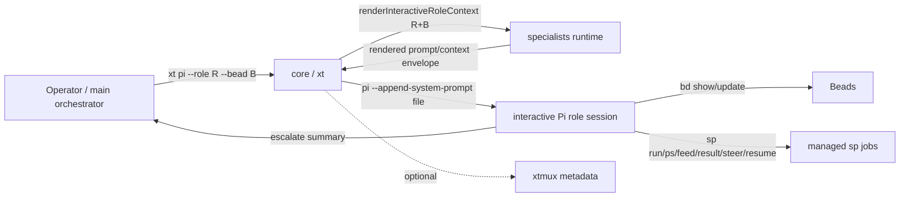
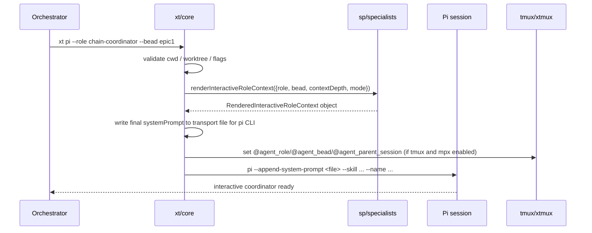
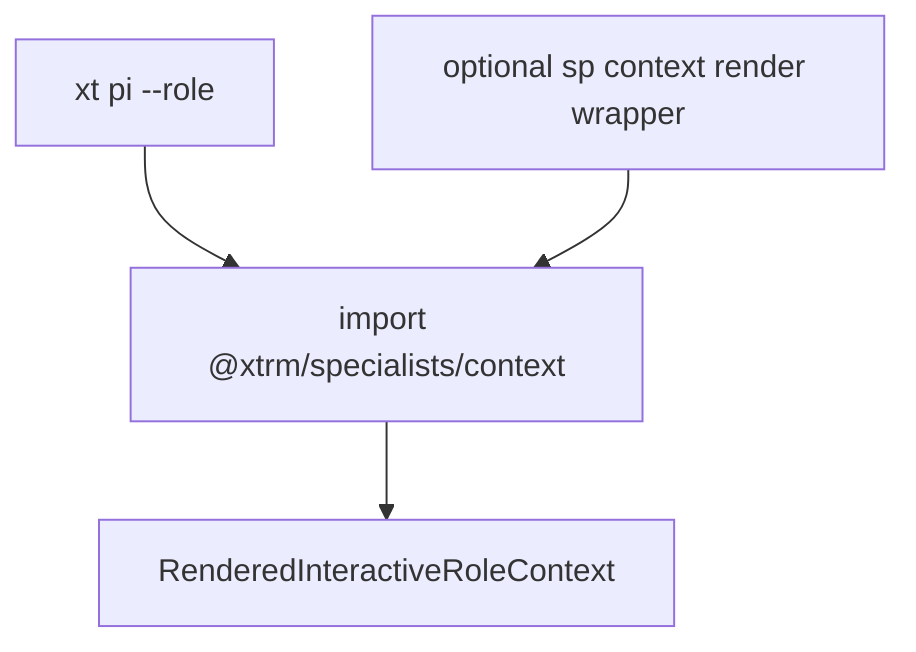
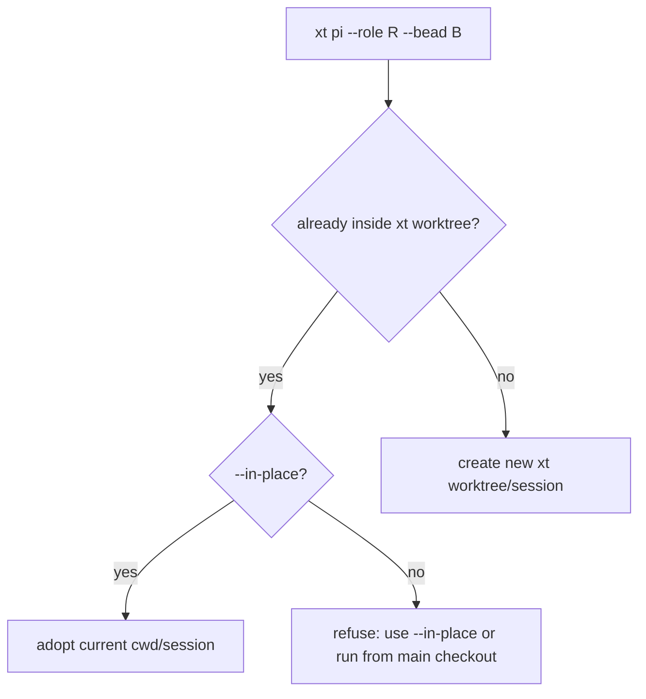
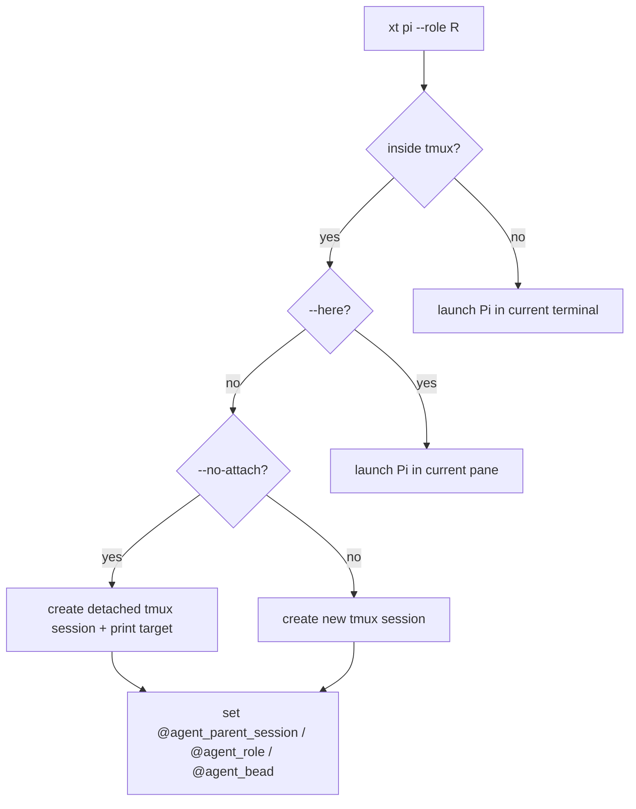
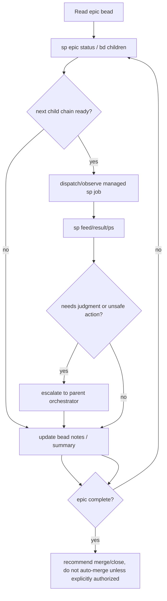
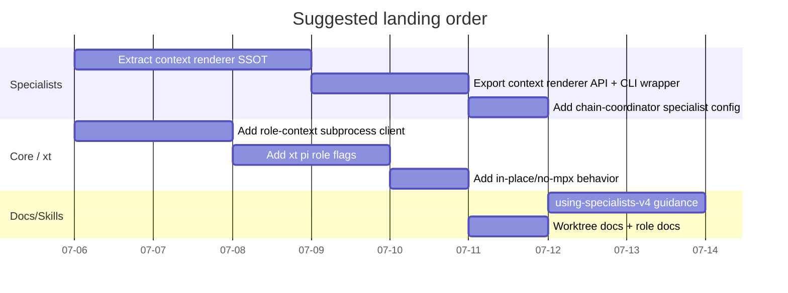
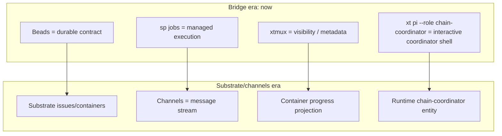

# `xt pi --role` + specialists context integration design

Status: bridge-era design, updated after core/specialists codebase research on 2026-07-06.

Research inputs:

- `/tmp/xt-pi-role-core-report.md` from the core pane (`~/dev/core`).
- `/tmp/xt-pi-role-specialists-report.md` from the specialists pane (`~/dev/specialists`).
- `docs/channels/*` and `docs/substrate/substrate_design_it.md` as future-runtime design context.

## 1. One-sentence design

`xt pi --role <name> --bead <id>` launches a normal interactive Pi worktree session, but its prompt/context is rendered by the specialists runtime, so it behaves like an interactive specialist/coordinator without `xt` reimplementing `sp` logic.

## 2. Simple mental model

Today:

```text
main orchestrator
  manually runs /using-specialists-v3
  manually checks beads/sp status
  manually dispatches/resumes specialists
```

Bridge design:

```text
main orchestrator
  launches: xt pi --role chain-coordinator --bead <epic>
      ↓
chain-coordinator Pi session
  uses existing sp + bd commands
  coordinates one child chain at a time
  escalates judgment/unsafe decisions upward
```

Future substrate/channels:

```text
main orchestrator
  opens substrate container/channel
      ↓
real chain-coordinator runtime entity
  reads channel/projection
  drives chain lifecycle through substrate
```

This bridge is useful because it removes orchestration context load from the main session without building a fake channel runtime.

## 3. What this is / is not

### This is

- A **generic role-session launcher** for interactive Pi.
- A way to reuse specialists context construction in `xt` worktree sessions.
- A bridge-era way to emulate `chain-coordinator` before substrate/channels land.
- A foundation for other interactive roles: `devops-monitor`, `reviewer`, `incident-coordinator`, etc.

### This is not

- Not channels.
- Not substrate.
- Not a replacement for `sp run` managed jobs.
- Not a new xtmux message bus.
- Not a reason to duplicate specialists prompt/runtime logic in `xt`.

## 4. Responsibility split



| Layer | Owns | Must not own |
|---|---|---|
| `core` / `xt` | worktree/session lifecycle, Pi launch args, `--in-place` guard, light tmux metadata | specialist prompt construction, bead dependency walking, role policy |
| `specialists` / `sp` | role context rendering, bead/context-depth injection, skills, guardrails, role config | xt worktree creation, Pi process lifecycle |
| `xtmux` | `@agent_state` and optional metadata visibility | fake channel protocol, authority model |
| interactive role session | coordination via existing `sp`/`bd` commands | unsafe/destructive decisions without escalation |

## 5. Proposed CLI contract

Primary form:

```bash
xt pi --role <name> --bead <id> [--context-depth N]
```

Examples:

```bash
xt pi --role chain-coordinator --bead unitAI-epic1
xt pi --role devops-monitor --bead infra-deploy-42
xt pi --role reviewer --bead xtrm-pr-review
```

Safety/behavior flags:

```bash
xt pi --role <name> --bead <id> --in-place
xt pi --role <name> --bead <id> --no-mpx
xt pi --role <name> --bead <id> --here
xt pi --role <name> --bead <id> --new-session
xt pi --role <name> --bead <id> --no-attach
```

Flag meaning:

| Flag | Meaning |
|---|---|
| `--role <name>` | Interactive role/specialist profile to load. Recommended mapping: role name = specialist name. |
| `--bead <id>` | Durable work contract. Optional for unbound interactive role sessions; required for task-bound sessions. |
| `--context-depth <n>` | Forwarded to specialists context renderer. `xt` parses only; semantics belong to `sp`. |
| `--in-place` | **Worktree placement only:** adopt current checkout/worktree instead of creating a new xt worktree. Required if already inside an xt worktree. Does not mean "use this tmux pane". |
| `--here` | **Tmux/process placement:** run Pi in the current pane/process. Explicit only; unsafe for orchestrator-driven launches. |
| `--new-session` | **Tmux/process placement:** create a new tmux session for the role. This is the default when launched from inside tmux without `--here`. |
| `--no-attach` | Create the role session detached and print its name/pane id; useful when an orchestrator launches it and keeps working. |
| `--no-mpx` | Do not inject multiplexing protocol / parent-session assumptions. Must be forwarded to specialists context renderer; otherwise the flag lies. |

Avoid for now:

```bash
xt pi --sp channel
```

That name implies real channels. Prefer `--role chain-coordinator`.

## 6. Launch flow



Pi injection vehicle confirmed by core research:

```bash
pi --append-system-prompt <file>
```

Do **not** use `--system-prompt`; that would replace Pi's base coding prompt and project context behavior.

Do **not** use `--no-context-files`; that would drop `AGENTS.md` / project rules.

## 7. Specialists-side renderer

Specialists research found no reusable full renderer today. Current rendering is embedded mostly in `SpecialistRunner.run()` and related helpers.

Proposed extraction point:

```text
~/dev/specialists/src/specialist/context-renderer.ts
```

This module should own prompt/context composition. `runner.ts` should become a consumer of it for managed jobs, while `core` imports the public API for interactive role sessions.

```text
context-renderer.ts
  -> reads specialist config (`prompt.system`, `task_template`, `system_prompt_mode`)
  -> builds bead/context-depth/task variables
  -> injects mandatory rules / workflow / memory / skills metadata
  -> returns RenderedInteractiveRoleContext / RenderedSpecialistContext

runner.ts
  -> calls context-renderer
  -> starts managed PiAgentSession and supervision

xt/core
  -> imports public renderInteractiveRoleContext API
  -> starts interactive Pi process/worktree
```

Recommended public API:

```ts
import { renderInteractiveRoleContext } from '@xtrm/specialists/context';

const rendered = await renderInteractiveRoleContext({
  role,
  cwd,
  task: beadId
    ? { kind: 'bead', beadId, contextDepth }
    : { kind: 'none' },
  renderMode: 'interactive-role',
  multiplexing: !noMpx,
});
```

Optional CLI/debug wrapper around the same API:

```bash
sp context render \
  --role <name> \
  --bead <id> \
  --context-depth 3 \
  --interactive-pi \
  --json
```

Important: this renderer should become the SSOT for managed and interactive context construction. `SpecialistRunner.run()` should consume the same renderer instead of keeping separate prompt assembly; otherwise interactive sessions and managed jobs will drift.

Suggested JSON envelope:

```json
{
  "envelopeVersion": 1,
  "role": "chain-coordinator",
  "bead": "unitAI-epic1",
  "systemPrompt": "...append-system-prompt content...",
  "initialUserMessage": "Begin by reading the bead and reporting your plan.",
  "skillPaths": [".../using-specialists-v3/SKILL.md", ".../multiplexing/SKILL.md"],
  "piArgs": ["--skill", "..."],
  "metadata": {
    "agent_role": "chain-coordinator",
    "agent_bead": "unitAI-epic1",
    "agent_task": "coordinate epic unitAI-epic1"
  },
  "warnings": []
}
```

`xt` should validate `envelopeVersion` and fail closed on unsupported shapes.

## 8. Package import vs CLI subprocess

### Recommended primary integration: package import

Because specialists is a published npm package, `core` does **not** need a monorepo to import it. This should work like Pi importing `@earendil-works/pi-tui`: `core` declares a dependency and imports the public API.

```json
{
  "dependencies": {
    "@xtrm/specialists": "^<compatible-version>"
  }
}
```

```ts
import { renderInteractiveRoleContext } from '@xtrm/specialists/context';
```

Reasons to prefer the package API:

- type-safe contract and shared `RenderedInteractiveRoleContext` types;
- no subprocess overhead;
- no PATH ambiguity (`sp` vs `specialists` binary);
- no JSON parsing as the primary seam;
- easier unit tests with normal module mocks;
- cleaner versioning through npm semver and explicit exported API.

The key rule is **import only a pure renderer**. `core` must not import `SpecialistRunner`, `NodeSupervisor`, or `PiAgentSession` internals. `xt` owns launching the interactive Pi process; specialists owns rendering the context.

### CLI wrapper: secondary/debug/compat

The CLI remains useful, but as a wrapper around the same API:

```bash
sp context render --role <name> --bead <id> --interactive-pi --json
```

Use cases:

- manual inspection/debugging;
- compatibility fallback when the package API is unavailable;
- integration tests that want a black-box CLI contract.

### Monorepo impact

A monorepo is helpful but not required.

| Setup | Import possible? | Notes |
|---|---:|---|
| Published npm package | Yes | Normal runtime dependency, like Pi → `pi-tui`. |
| Separate repos + `file:` dependency | Yes | Good local dev bridge. |
| `npm link` / `pnpm link` | Yes | Useful during development, less reproducible. |
| Monorepo workspace | Yes | Best for atomic changes and cross-package tests. |
| CLI subprocess only | Yes, but not an import | Useful fallback, not preferred primary seam. |

Recommended long-term shape:



Version compatibility should be explicit:

- exported `contextApiVersion` or envelope version;
- semver major for breaking renderer changes;
- `core` fails closed on unsupported versions.

## 9. Core-side implementation shape

Core research says the smallest diff is concentrated in:

- `cli/src/commands/pi.ts`
- `cli/src/utils/worktree-session.ts`
- new `cli/src/core/role-context.ts` or equivalent

Current state:

```text
xt pi
  -> launchWorktreeSession({ runtime: 'pi', name })
  -> spawn pi with [] args
```

Target state:

```text
xt pi --role R --bead B
  -> validate flags/cwd
  -> call @xtrm/specialists renderInteractiveRoleContext(...)
  -> write rendered.systemPrompt to a transport file for Pi CLI
  -> create/adopt worktree
  -> spawn pi with --append-system-prompt <file> and role skills
```

The temp file is **not** the source of truth. It is only a safe transport for a large rendered prompt into the Pi CLI, avoiding argv length, shell quoting, and process-list leakage issues. The content comes from specialists' renderer.

Nested-worktree policy:



Do not auto-rename tmux sessions. Use metadata and Pi `--name` instead.

### Tmux/process placement policy

`--in-place` and tmux placement are separate axes:

```text
--in-place  = use the current checkout/worktree
--here      = use the current tmux pane/process
```

They must not be conflated. A user may want a new tmux session that adopts the current worktree, or a current pane that creates a fresh worktree.

Recommended default behavior:

| Invocation context | Default process placement | Rationale |
|---|---|---|
| Outside tmux | Foreground in current terminal | There is no tmux parent to preserve. |
| Inside tmux, no `--here` | New tmux session | Do not replace or block the orchestrator pane. |
| Inside tmux, orchestrator/agent launched | New tmux session, preferably detached or non-invasive | The caller must keep control. |
| `--here` explicitly set | Current pane/process | Manual interactive use; caller accepts replacement/blocking. |
| `--no-attach` set | New detached tmux session | Best for orchestrator-driven fan-out. |

Session naming should follow multiplexing convention:

```text
<parent-session>-<role-slug>[-<bead-slug>]
```

Examples:

```text
xt-design-chain-coordinator
xt-design-chain-unitAI-epic1
xt-design-devops-monitor-2
```

When launched from tmux with multiplexing enabled, `xt` should set parent/role metadata on the new pane/session:

```text
@agent_parent_session=<current tmux session>
@agent_role=<role>
@agent_bead=<id if provided>
@agent_task=<short summary>
```

This lets the main orchestrator discover and message the role session through existing xtmux primitives without scraping pane text.



## 10. xtmux integration: keep it light

Set metadata only when inside tmux and multiplexing is enabled:

```text
@agent_state              existing extension behavior
@agent_role=<role>
@agent_bead=<bead>
@agent_parent_session=<session>
@agent_task=<short summary>
```

No fake channel commands now.

Useful optional behavior:

```bash
tmux set-option -p -t "$TMUX_PANE" @agent_role chain-coordinator
tmux set-option -p -t "$TMUX_PANE" @agent_bead unitAI-epic1
```

If not in tmux, metadata is skipped silently. Launch must still work.

## 11. Chain-coordinator bridge behavior

The `chain-coordinator` role should be a normal specialists config, probably modeled on `node-coordinator`, plus role-specific skill/prompt rules.

High-level job:

```text
Coordinate one epic/chain using current sp+bd surfaces.
Do not do implementation work yourself.
Dispatch/observe managed sp jobs.
Escalate judgment/unsafe actions.
```

Core loop:



Suggested command surface for coordinator:

```bash
sp epic status <epic-id>
sp ps --json
sp feed <job-id> --follow
sp result <job-id> --wait
sp steer <job-id> "..."
sp resume <job-id> "..."
bd show <bead-id>
bd update <bead-id> --notes "..."
```

Merge/destructive actions require explicit parent/orchestrator authority unless the bead/prompt grants it.

## 12. Guardrails preserved vs lost

| Capability | Interactive `xt pi --role` can preserve? | Notes |
|---|---:|---|
| Role prompt/persona | Yes | Via `renderInteractiveRoleContext()`. |
| Bead contract | Yes | Inject rendered bead context. |
| Context-depth pack | Yes | Rendered by specialists. |
| Skills | Yes | Pass Pi `--skill` entries from renderer. |
| Mandatory-rule text | Yes | Prompt-level injection. |
| Tool permissions / boundary hints | Partial | Needs Pi tool flags/extensions where applicable. Prompt alone is weaker. |
| Managed job timeline | No | Unless role itself launches managed `sp` jobs. |
| Runtime retries/timeouts | No | Interactive Pi is not a managed specialists job. |
| `sp steer/resume/stop` semantics for the coordinator itself | No | Those apply to managed jobs, not the interactive shell. |
| Output contract validation | Partial/No | Prompt can ask; runtime cannot enforce like managed job unless added separately. |
| Observability in `sp ps` | No | The coordinator session is visible through xtmux, not as a normal `sp` job. |

Design response: use interactive sessions for **coordination shells**, not for executor/reviewer implementation work. Actual work remains in managed `sp run` jobs.

## 13. Failure modes and hard rules

Hard rules:

1. If `--role` is provided and context rendering fails, abort. Do not launch bare Pi.
2. Do not duplicate specialists prompt construction in `xt`.
3. Do not suppress project context files by default.
4. Do not auto-rename existing tmux sessions.
5. Do not run in the current tmux pane unless `--here` is explicit.
6. Do not conflate `--in-place` with `--here`; worktree placement and process placement are separate.
7. Do not let `--no-mpx` only disable metadata; it must be forwarded to specialists renderer.
8. Do not make `chain-coordinator` a privileged runtime by accident. It is a bridge-era interactive role.

Common traps:

| Trap | Mitigation |
|---|---|
| Renderer drift between managed and interactive prompts | Make `renderInteractiveRoleContext()` the shared SSOT. |
| Role context render unavailable while core feature lands first | Optional temporary `.xtrm/roles/<name>.md` fallback, but fail closed for production use. |
| Interactive coordinator starts doing implementation work | Prompt says coordinate only; dispatch managed `sp run` workers. |
| Coordinator auto-merges | Require explicit authority. |
| Running from inside existing worktree creates nested worktree | Refuse unless `--in-place`. |
| Running from inside tmux replaces the orchestrator pane | Default to new tmux session; require `--here` for current-pane launch. |
| `--in-place` accidentally implies current pane | Keep separate flags: `--in-place` for worktree, `--here` for process placement. |
| `--no-mpx` still loads multiplexing skills | Forward flag to the specialists renderer. |

## 14. Implementation phases



Practical phase split:

### Phase 1 — Core seam + fallback

- Add flags and launch plumbing in core.
- Add role-context client that imports `@xtrm/specialists/context` and calls `renderInteractiveRoleContext()`.
- Optionally support local `.xtrm/roles/<name>.md` fallback for early testing.
- No channels, no substrate, no xtmux extension.

### Phase 2 — Specialists renderer

- Extract reusable renderer from `SpecialistRunner.run()` into `src/specialist/context-renderer.ts`.
- Export the public API from the package, e.g. `@xtrm/specialists/context`.
- Make `runner.ts` consume the renderer for managed jobs.
- Add optional `sp context render --json` wrapper for debugging/compat.
- Ensure managed jobs and interactive rendering share the same core function.

### Phase 3 — First real role: `chain-coordinator`

- Add specialist config/profile.
- Teach `using-specialists-v4` when to dispatch it.
- Coordinator drives existing `sp`/`bd` runtime one child chain at a time.

### Phase 4 — Later monorepo optimization

- Use workspace dependency (`workspace:*`) for local development.
- Keep CLI wrapper/fallback for debugging and compatibility.

## 15. How this relates to channels/substrate



Bridge-era coordinator does not replace channels. It validates the human/agent workflow shape before the runtime primitive exists.

The most important design continuity:

```text
orchestrator stops micro-driving every step
coordinator observes state and handles routine routing
unsafe/judgment calls escalate upward
```

That is true both now and after substrate.

## 16. Test/doc checklist

Core tests:

- `xt pi --role --bead` calls `renderInteractiveRoleContext()` with correct role/task/multiplexing arguments.
- Failed render aborts before launching Pi.
- `--in-place` behavior inside existing worktree.
- tmux placement defaults: inside tmux creates a new session unless `--here` is explicit.
- `--no-attach` creates a detached session and prints target metadata.
- `--no-mpx` is passed to the renderer and suppresses tmux metadata.
- Pi args include `--append-system-prompt <file>`.
- Session metadata includes role/bead.

Specialists tests:

- `context-renderer.ts` output matches managed job prompt content for same role/bead/context-depth.
- Renderer includes skills/mandatory rules/memory/workflow blocks.
- JSON envelope schema/version validation.
- `--no-mpx` removes multiplexing-specific context.

Docs:

- `docs/worktrees.md`
- `docs/xt-pi-role.md` or equivalent
- `XTRM-GUIDE.md` / `AGENTS.md` compact routing notes
- `using-specialists-v4` skill guidance
- `chain-coordinator` role docs

## 17. Open questions

1. Should Phase 1 include `.xtrm/roles/<name>.md` fallback, or should core wait for the specialists package API export?
2. Should `--bead` be mandatory for all roles initially, or can some roles be prompt-only?
3. What is the exact `--no-mpx` contract in `renderInteractiveRoleContext()`?
4. Should interactive role sessions appear in `sp ps`, or is xtmux visibility enough?
5. How much permission/tool-boundary enforcement can Pi apply from the rendered envelope today?
6. Should `xt claude --role` be designed now as a future-compatible sibling, even if not implemented?
7. Should default inside-tmux behavior attach/switch to the new role session for human launches, or always detach and print target for consistency?

## 18. Bottom line

Build the seam, not a shadow runtime:

```text
xt owns launching/adopting the interactive session.
specialists owns rendering what that session should be.
sp jobs remain the unit of managed execution.
xtmux remains visibility glue.
channels/substrate remain the future real runtime.
```
