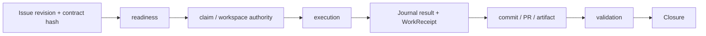

# @jaggerxtrm/substrate

Substrate is XTRM's durable work authority: a library-first Issue graph over
SQLite/WAL with a terminal-native `sb` CLI plus first-party Pi and Claude
integrations.

Current package version: **0.2.0**. Published copies ship JavaScript and support
Node ≥24 and Bun ≥1.3; a source checkout runs the TypeScript entrypoints
directly.

## 60-second start

```bash
cd <git-repository>
sb init
sb issue list
```

`sb init` establishes the Git repository → Substrate Project relationship.
One global `~/.xtrm/state.db` can hold many Projects; global database cardinality
is never project context.

## Mental model



- **Issue** — authorized, revisioned work contract.
- **Readiness** — derived dispatchability over the current revision.
- **Claim** — who currently owns the work.
- **Journal** — append-only execution continuity: notes, findings, decisions,
  blockers, milestones, handoffs, results, checkpoints and compaction records.
- **Resume Capsule** — bounded reconstruction from durable state, not a second
  source of truth.
- **Provenance** — execution bindings, WorkReceipts, commits/PRs/artifacts,
  session/activation lineage and evidence queries.
- **Closure** — immutable terminal outcome, reason and evidence references.
- **Git** — code/integration truth; never the sole explanation of work state.

## Normal workflow

```text
sb init
  ↓
Issue / planning
  ↓
validate + attest readiness
  ↓
claim
  ↓
execute
  ↓
Journal finding / decision / milestone / result
  ↓
WorkReceipt + artifacts + validation
  ↓
Closure
```

If execution changes SCOPE, SUCCESS, NON_GOALS, CONSTRAINTS, VALIDATION or
OUTPUT, stop and revise the Issue through planning. Progress belongs in the
Journal, not in `sb issue edit`.

## Human CLI

The `sb` binary runs through `cli/sb-ux.ts` for human output while the typed
engine in `cli/sb.ts` remains the machine/JSON contract.

```bash
sb issue list                         # active board, hierarchical by default
sb issue list --status ready,blocked
sb issue list --all                   # include terminal history
sb issue list --flat --search provenance
sb issue show XTRM-252                # Markdown-aware rich terminal view
sb issue browse                       # interactive read-first navigator
```

`in_progress`, `ready` and `blocked` are derived operational states; they do
not create new persisted lifecycle values. `--json` stays machine-oriented and
fails closed when combined with human-only filters instead of silently ignoring
them.

Mutations give explicit post-operation feedback: success, no-op, warning or
error with remediation where the command can name one. Routine mutations do not
ask for confirmation; destructive/batch flows may.

Run `sb --help` or `sb <group> <verb> --help`. Help is part of the product
contract and is side-effect-free.

## Pi integration

Pi registers eight native Substrate tools over the same typed services:

```text
substrate_issue_get
substrate_issue_search
substrate_issue_claim
substrate_issue_update
substrate_journal_append
substrate_journal_checkpoint
substrate_issue_resume
substrate_provenance_trace
```

The Pi integration also owns the claim-gated edit/write hook, resume command and
mechanical-first compaction checkpoint. `SUBSTRATE_ISSUE_REF` is the canonical
process-level rebind; `SUBSTRATE_ISSUE` is compatibility-only.

See [`docs/pi.md`](docs/pi.md).

## Claude integration

The `substrate` Claude plugin exposes a 15-tool MCP surface plus
PreCompact/PostCompact/SessionStart hooks. It calls typed services in-process,
never `sb` subprocesses or CLI-text parsing. The MCP surface includes first-class
claim/release, contract update, Journal result/checkpoint/query, Closure,
Issue/session/activation provenance and Resume Capsule operations.

See [`docs/claude.md`](docs/claude.md).

## Specialists integration

Specialists is the execution runtime; Substrate is the work authority. A native
Specialist activation consumes a READY Issue through the WorkItemStore boundary,
binds the exact revision/hash, and on meaningful settlement publishes bounded
result/provenance under host control. Specialists does not get a second Issue or
Journal implementation.

See [`docs/specialists.md`](docs/specialists.md).

## Package layout

```text
src/domain/          identities, contracts, Journal, Closure, provenance types
src/service/         Issue/Journal/Resume/Closure/Provenance/Repository services
src/store/           SQLite/WAL opener and append-only migrations
src/workitems/       backend-neutral Specialist work boundary
cli/                 machine engine + human terminal presentation
integrations/pi/     Pi-native tools, gates and compaction lifecycle
integrations/claude-code/  MCP + hook/runtime integration
plugin/substrate/    packaged Claude Code plugin
skills/              Pi-facing Substrate doctrine
docs/                current product/operator/reference documentation
tests/               acceptance, provider, docs and anti-drift gates
```

## Documentation

Start with [`docs/README.md`](docs/README.md).

- [`docs/concepts.md`](docs/concepts.md) — authority model.
- [`docs/workflow.md`](docs/workflow.md) — end-to-end lifecycle.
- [`docs/issues-and-readiness.md`](docs/issues-and-readiness.md) — identity,
  contracts, readiness, claims.
- [`docs/journal-and-resume.md`](docs/journal-and-resume.md) — all nine Journal
  kinds, checkpoints and Resume Capsule.
- [`docs/provenance-and-closure.md`](docs/provenance-and-closure.md) — bindings,
  receipts, artifacts and terminal outcomes.
- [`docs/repository-identity.md`](docs/repository-identity.md) — `sb init`,
  Projects, worktrees and overrides.
- [`docs/cli.md`](docs/cli.md) — human/machine CLI surfaces.
- [`docs/pi.md`](docs/pi.md) / [`docs/claude.md`](docs/claude.md) — provider
  references.
- [`docs/troubleshooting.md`](docs/troubleshooting.md) — diagnostics and common
  recovery paths.

Deep ADRs, migration records and acceptance evidence remain under the repository
root [`docs/substrate/`](../../docs/substrate/README.md).

## Install and develop

Managed XTRM installs are enrolled through Core/`xt`; direct package use is also
supported.

```bash
npm install -g @jaggerxtrm/substrate
sb --version
sb doctor
```

Development:

```bash
npm install
npm test
npm run typecheck
npm run test:bun
```

Release is fail-closed: `npm run release:verify` builds a staged JavaScript
artifact and proves the packed layout under Node and Bun; `npm run release`
publishes that verified artifact. A bare `npm publish` from the source tree is
intentionally refused.
