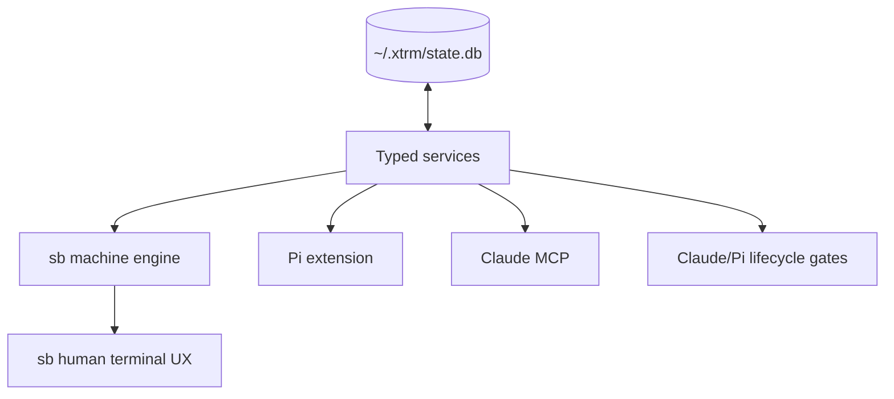

# Architecture

Substrate is library-first. SQLite/WAL is canonical durable authority; CLI,
provider tools and documentation are projections over typed services.

## Main service boundaries

- `IssueService` — Issues, revisions, graph, readiness, claims, lifecycle.
- `JournalService` — append-only continuity, checkpoints, result entries.
- `ResumeService` — derived bounded reconstruction.
- `ProvenanceService` — execution bindings, WorkReceipts, artifacts and reverse
  queries.
- `ClosureService` — immutable terminal outcomes/reasons/evidence refs.
- `RepositoryService` — Git repository identity and Project binding.

Provider adapters call these services directly. They do not parse human CLI
output and do not get independent SQL authority.

## State and migrations

One WAL database is resolved from explicit override where supported, otherwise
`SUBSTRATE_DB`, otherwise `~/.xtrm/state.db`. Migrations are append-only;
unknown/newer migration state fails closed rather than being guessed.

## Human vs machine CLI

`cli/sb.ts` is the machine/JSON command engine. `cli/sb-ux.ts` is the human
presentation layer: terminal Markdown, status projection, hierarchy, browser and
operation feedback. ANSI/presentation state never enters durable services.
