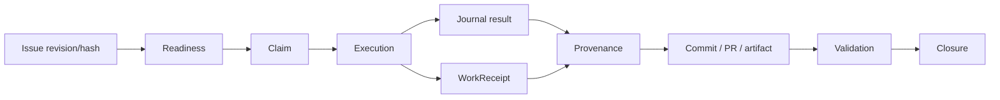

# Concepts

Substrate separates **what work is authorized** from **what happened while doing
it**.

## Issue

The Issue is the executable contract. Its seven contract fields are
`problem`, `success`, `scope`, `nonGoals`, `constraints`, `validation`, and
`output`; SCRUTINY is policy input. Execution-bearing edits create a new
revision/hash and invalidate prior readiness.

## Readiness

Readiness is derived from current lifecycle state, contract validity,
attestation currency and blockers. A title plus description is not enough.

## Claim

A claim records who owns the current work. It is not progress and does not make
a draft executable. Workspace writer leases are a separate mutation fence.

## Journal

The Journal is append-only continuity. It records notes, findings, decisions,
blockers, milestones, handoffs, bounded results, checkpoints and compaction
records. It never silently changes Issue authority.

## Resume Capsule

A Resume Capsule is derived from current durable state: current Issue revision,
latest checkpoint, Journal delta, claim, blockers and provenance. It is not a
mutable second record and does not depend on an old chat transcript.

## Provenance

Provenance answers what execution actually produced. It binds exact Issue
revision/hash to execution identity, WorkReceipts and artifacts such as commits,
PRs, validations and reviews.

## Closure

Closure is immutable terminal explanation: outcome, reason, actor/execution
context and evidence refs. Reopen preserves the historical Closure.

## Memory and messages

Memory is reusable validated knowledge and is outside the Journal. Messages
coordinate participants but do not change Issue authority.
