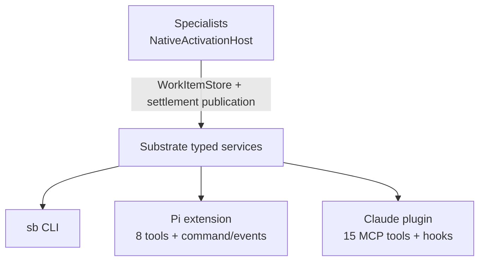

# Integrations

Provider surfaces intentionally differ while consuming one authority model.

Do not force name/count parity between Pi and Claude. Instead require:

- same Issue/Journal/Provenance/Closure semantics,
- same repository/project fail-closed model,
- same canonical database authority,
- same no-fabricated-identity rule,
- provider-specific tool inventories mechanically aligned with provider docs and
  skills.

Specialists consumes Substrate; it does not own another durable work model.
Core/`xt` enrolls repositories and propagates session identity; it does not
derive Project identity independently.

## Identity propagation

Pi Journal/checkpoint adapters and Claude MCP Journal adapters fill unstated
participant/activation identity from `SUBSTRATE_HOLDER` and
`SUBSTRATE_ACTIVATION_ID`. Explicit adapter input takes precedence; Pi also
preserves trusted envelope facets, including coordinator identity. Empty ambient
state produces no fabricated identity. The service still rejects conflicting
stated envelope/scalar values.

Claude PreCompact and stop checkpoints use the same ambient holder/activation
contract. PostCompact remains a provider-session-only audit event; do not infer
that every integration event carries all identity facets.

See [Journal and Resume](journal-and-resume.md#identity-on-writes) for the
service fallback boundary and [Provenance and Closure](provenance-and-closure.md#execution-identity)
for canonical XTRM session rules.
