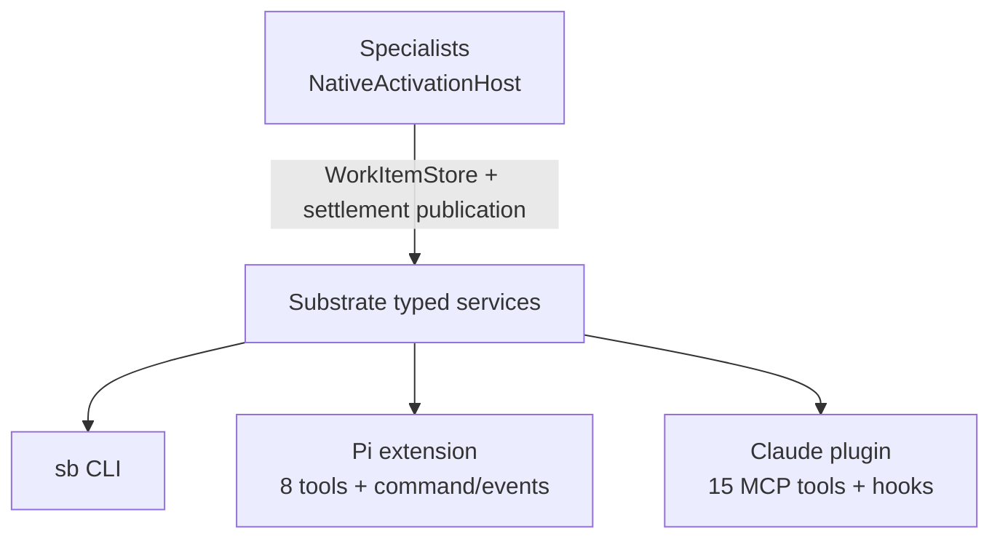

# Integrations

Provider surfaces intentionally differ while consuming one authority model.

Do not force name/count parity between Pi and Claude. Instead require:

- same Issue/Journal/Provenance/Closure semantics,
- same repository/project fail-closed model,
- same canonical database authority,
- same no-fabricated-identity rule,
- provider-specific tool inventories mechanically aligned with provider docs and
  skills.

Specialists consumes Substrate; it does not own another durable work model.
Core/`xt` enrolls repositories and propagates session identity; it does not
derive Project identity independently.
