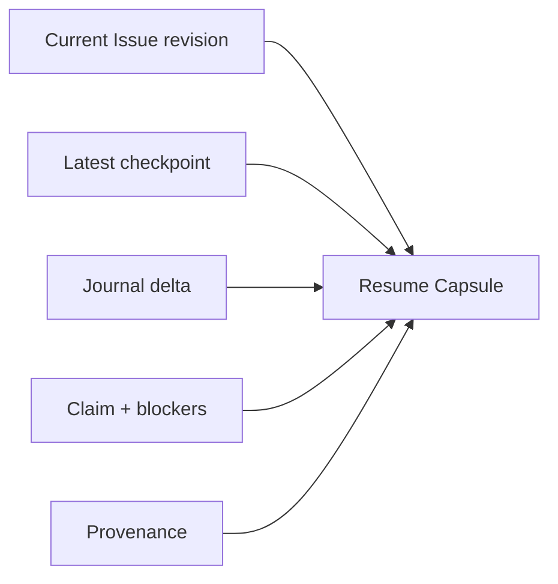

# Journal and Resume

The Journal is durable execution continuity, not work authority.

## Nine Journal kinds

| Kind | Use |
|---|---|
| `note` | General useful annotation. |
| `finding` | Material discovered fact. |
| `decision` | Chosen course plus rationale. |
| `blocker` | Unresolved condition preventing progress. |
| `milestone` | Meaningful execution boundary. |
| `handoff` | Bounded continuation state. |
| `result` | Bounded participant outcome; meaningful settlement uses this. |
| `checkpoint` | Mechanical resumability boundary. |
| `compaction` | Context-compaction checkpoint. |

A Journal decision does not silently authorize a contract change. If SCOPE,
SUCCESS, NON_GOALS, CONSTRAINTS, VALIDATION or OUTPUT changes, create a new Issue
revision.

## Mechanical first

Checkpointing writes host-known mechanical state before optional semantic
enrichment. A summarizer failure therefore cannot erase the durable boundary.

## Resume Capsule



The Capsule is rebuilt from durable rows; old transcript/chat is not required.
Provider compaction integrations follow the same rule.

## Read bounded continuity

```bash
sb issue show XTRM-123
sb journal timeline XTRM-123 --limit 20
sb journal latest XTRM-123 --kind decision
sb journal show XTRM-123 --limit 5
sb journal since XTRM-123 12
```

Human Issue `show` reports Journal totals, counts by kind, a bounded recent
window and the newest entry per kind. Summaries are flattened and bounded;
legacy JSON-wrapped summaries are unwrapped for display only. Use Journal
`show` for full entry bodies and `since` for entries after a sequence cursor.
`timeline` is a recent window in chronological order (default limit 50).

Journal identity rendering explicitly reports `(none recorded)` when the
participant is absent. It does not copy identity from earlier entries. This is
the Journal marker; provenance execution-identity rendering uses
`(unattributed)` instead. JSON retains stored values rather than display markers.

## Identity on writes

When no execution envelope is supplied, Journal writes derive unstated identity
from the current process: `XTRM_SESSION_ID`, `XTRM_SESSION_NAME`,
`SUBSTRATE_HOLDER` and `SUBSTRATE_ACTIVATION_ID`. Explicit scalar values take
precedence over ambient values. A caller-built envelope and conflicting explicit
scalars still fail closed; ambient fallback does not resolve that disagreement.
Missing identity stays absent.

For CLI session overrides and warnings, see [CLI](cli.md#session-precedence).
For canonical forms and projection rules, see
[Provenance and Closure](provenance-and-closure.md#execution-identity).

Sources: [`journal-service.ts`](../src/service/journal-service.ts),
[`terminal.ts`](../src/presentation/terminal.ts).
