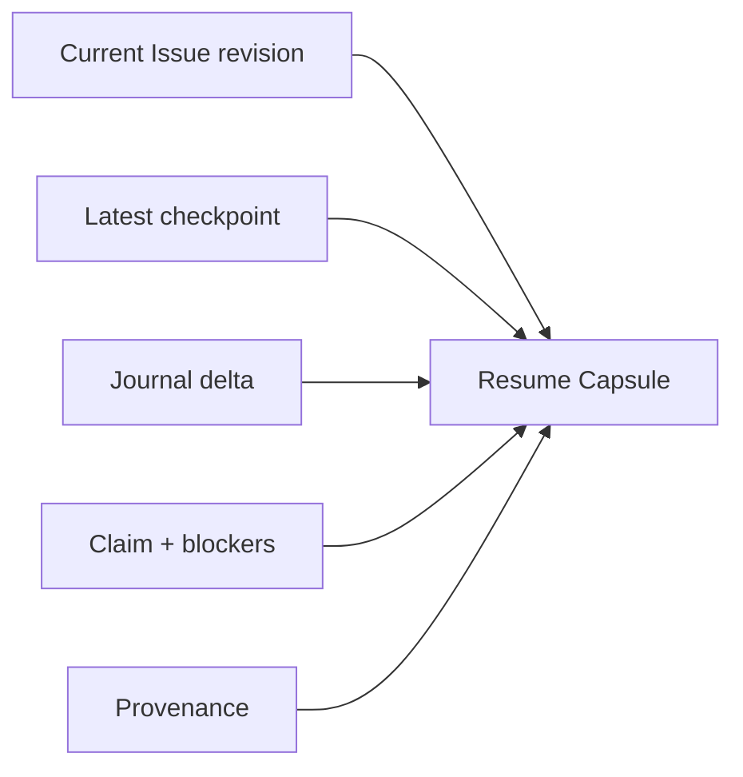

# Journal and Resume

The Journal is durable execution continuity, not work authority.

## Nine Journal kinds

| Kind | Use |
|---|---|
| `note` | General useful annotation. |
| `finding` | Material discovered fact. |
| `decision` | Chosen course plus rationale. |
| `blocker` | Unresolved condition preventing progress. |
| `milestone` | Meaningful execution boundary. |
| `handoff` | Bounded continuation state. |
| `result` | Bounded participant outcome; meaningful settlement uses this. |
| `checkpoint` | Mechanical resumability boundary. |
| `compaction` | Context-compaction checkpoint. |

A Journal decision does not silently authorize a contract change. If SCOPE,
SUCCESS, NON_GOALS, CONSTRAINTS, VALIDATION or OUTPUT changes, create a new Issue
revision.

## Mechanical first

Checkpointing writes host-known mechanical state before optional semantic
enrichment. A summarizer failure therefore cannot erase the durable boundary.

## Resume Capsule

The Capsule is rebuilt from durable rows; old transcript/chat is not required.
Provider compaction integrations follow the same rule.
