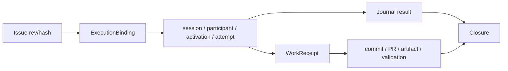

# Provenance and Closure

## Evidence spine



`ProvenanceService.trace()` returns the canonical forward view: Issue identity,
revision/hash, attestation, claims, execution bindings, WorkReceipts with
artifacts and execution context, checkpoints, commits, PRs, external bindings
and closure revision.

Reverse queries answer questions such as:

```text
What did this session touch?
What did this Specialist activation produce?
Which Issue/receipt authorized this commit or PR?
```

## WorkReceipts

Receipts are host-allocated and inherit authority from an ExecutionBinding.
Executor output cannot mint its own Issue revision/hash authority. Artifacts are
attached to receipts and can be reconciled across Git rewrite where supported.

## Closure

Closure is a first-class immutable row. Bounded outcomes are:

```text
completed
superseded
duplicate
wont_fix
invalid
cancelled
abandoned
```

A deliberate close needs a reason. Evidence refs may point to Journal results,
receipts, validation and artifacts. Reopen preserves the old Closure and adds a
new lifecycle event; stopping one activation is not cancelling the Issue.

## Allocate and link a receipt

Dispatch before execution, then allocate a receipt from that binding. Use the
live claim holder as `--participant`; do not take over another participant's
claim.

```bash
sb provenance dispatch XTRM-123 --participant coordinator
sb provenance allocate <binding-id> --checkpoint <checkpoint-entry-id>
sb provenance bind <receipt-id> <40-char-sha>
sb provenance receipt <receipt-id>
sb provenance commit <40-char-sha>
```

`allocate` copies the binding's Issue revision/hash. `--checkpoint` is optional;
omission stores null, not a guessed latest checkpoint. The CLI checks that a
supplied entry exists and has kind `checkpoint` or `compaction`. The caller must
select the correct Issue's continuity boundary: allocation does not check that
the checkpoint and binding belong to the same Issue.

`bind` uses the caller-supplied commit SHA. Binding the same receipt to the same
SHA is idempotent; a different SHA fails closed. Git rewrite reconciliation is
a separate `reconcileRewrite` service operation used by the post-rewrite adapter.
Neither allocation nor binding invents a commit or checkpoint.

## Execution identity

The execution envelope and legacy scalar columns describe the same facts.
Journal and provenance writes project envelope identity into their queryable
columns. Session projection prefers XTRM session identity, then provider session
identity, then a legacy scalar. Conflicting stated counterparts fail closed
before a row is written; XTRM and provider sessions are distinct facets, not
conflicting values of one field. `runId` remains optional and
caller-supplied; it is not inferred from an activation or session.

New writes validate identity at the service boundary. XTRM session identity is
a UUID (normalized to lowercase) or a tmux session ID such as `$2`. Provider
session labels belong to `host.sessionId`; they do not become XTRM session IDs.
Participant and run labels must be shell-safe identifiers. Activation and
attempt IDs accept validated legacy labels as well as canonical forms.
Closure and reopen apply the same canonicalization to their execution envelopes;
an invalid identity leaves lifecycle and Closure history unchanged. Historical
rows are not rewritten by these validation rules.

Human `sb provenance trace` names each binding's participant, activation and
session, shows `(unattributed)` for absent execution identity, and bounds long
sections with an omitted-item count. Use `sb provenance trace XTRM-123 --json`
for the untruncated service view. Rendering does not manufacture missing
bindings, receipts or identity.

Sources: [`execution-context.ts`](../src/domain/execution-context.ts),
[`provenance-service.ts`](../src/service/provenance-service.ts),
[`closure-service.ts`](../src/service/closure-service.ts).
