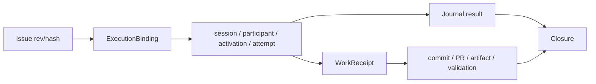

# Provenance and Closure

## Evidence spine



`ProvenanceService.trace()` returns the canonical forward view: Issue identity,
revision/hash, attestation, claims, execution bindings, WorkReceipts with
artifacts and execution context, checkpoints, commits, PRs, external bindings
and closure revision.

Reverse queries answer questions such as:

```text
What did this session touch?
What did this Specialist activation produce?
Which Issue/receipt authorized this commit or PR?
```

## WorkReceipts

Receipts are host-allocated and inherit authority from an ExecutionBinding.
Executor output cannot mint its own Issue revision/hash authority. Artifacts are
attached to receipts and can be reconciled across Git rewrite where supported.

## Closure

Closure is a first-class immutable row. Bounded outcomes are:

```text
completed
superseded
duplicate
wont_fix
invalid
cancelled
abandoned
```

A deliberate close needs a reason. Evidence refs may point to Journal results,
receipts, validation and artifacts. Reopen preserves the old Closure and adds a
new lifecycle event; stopping one activation is not cancelling the Issue.
