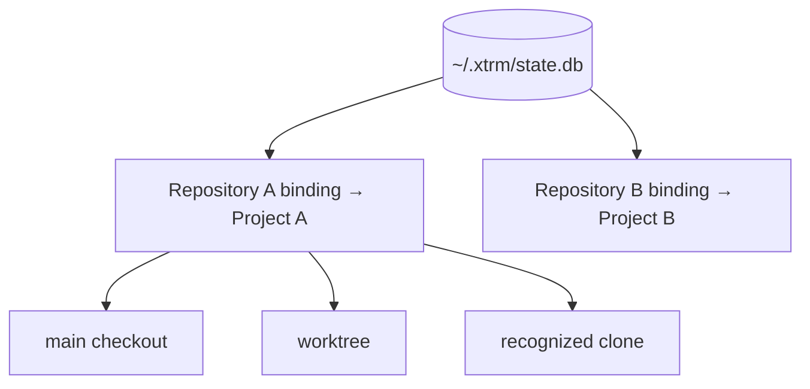

# Repository identity

> Global storage does not imply global project context.

Normal onboarding:

```bash
cd <git-repository>
sb init
```

`sb init` discovers the Git common repository, canonicalizes repository identity,
detects the base branch, creates/adopts the deterministic Project, binds the
repository and caches checkout aliases. It is idempotent.



Project resolution is explicit project → `SUBSTRATE_PROJECT` → initialized
repository binding/checkout alias → fail closed. There is no "only Project in
the database" fallback.

`sb project ...` is an advanced recovery/administration surface; it is not the
normal initialization workflow. `sb doctor` distinguishes repository
initialization from an effective temporary override.
