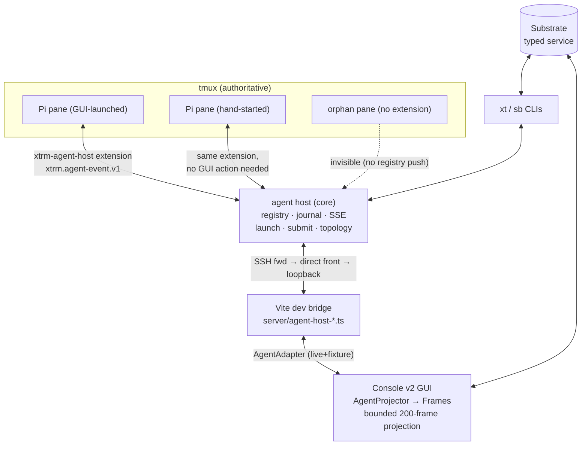
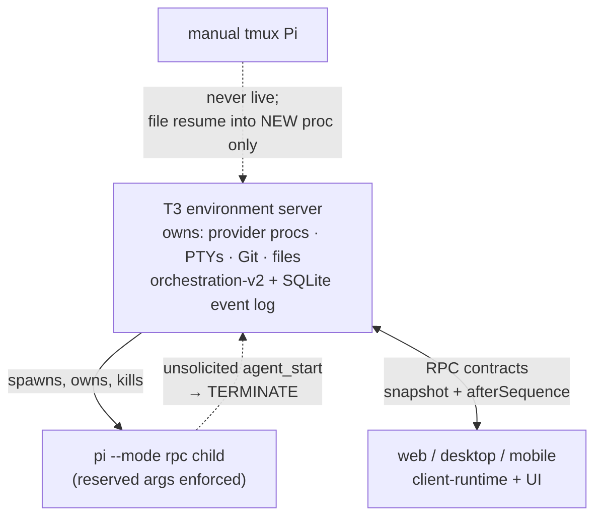
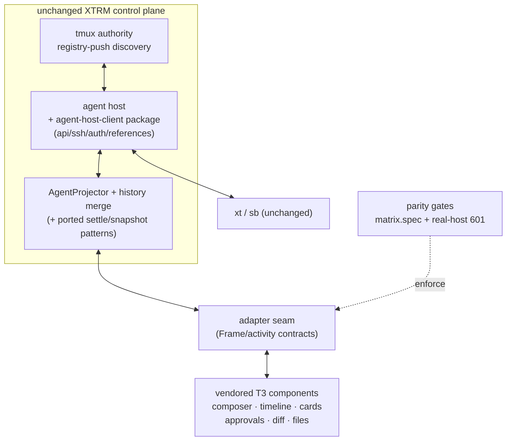
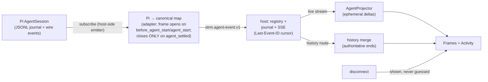
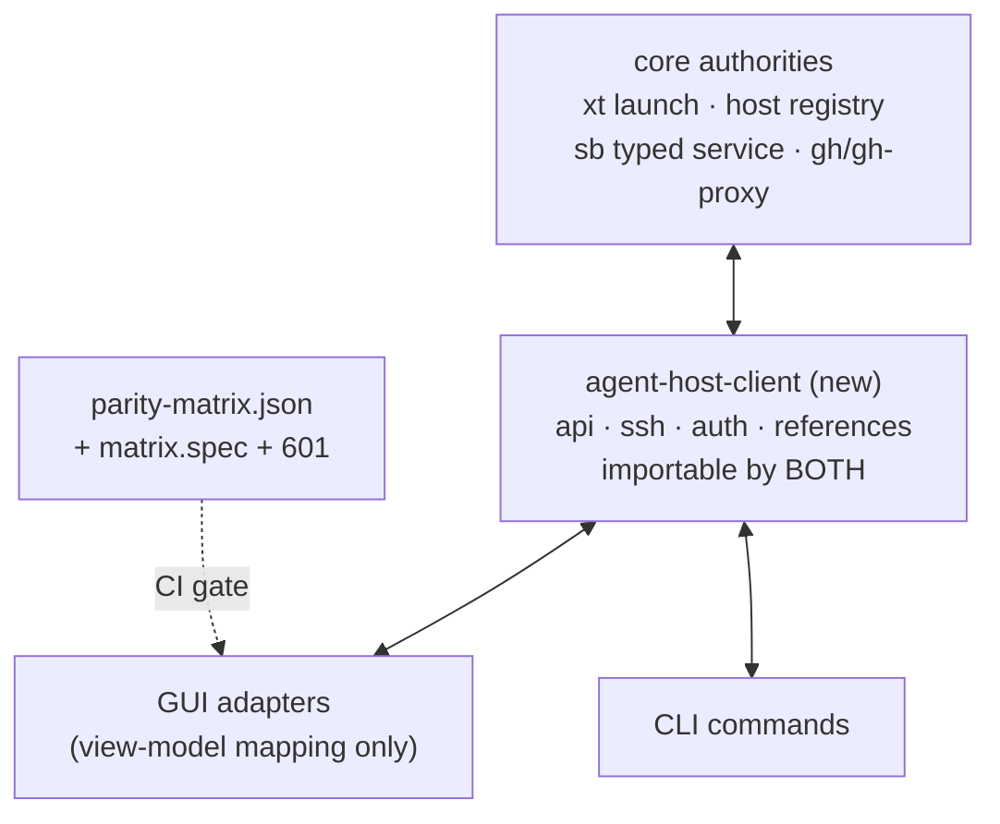

# Architecture diagrams

## 1. Current XTRM (verified)

## 2. T3 (verified in clone)

## 3. Converged proposal (Option B + C sequencing)

## 4. Session-control flows (local + remote)

- **Case 1 (Pi in XTRM) / 2 (manual tmux + extension):** extension connects → registry
  push → `GET /v1/sessions` lists it → SSE live + journal backfill → submit/steer/abort
  via `agent-command.v1`. GUI and TUI are co-surfaces of one process. No duplicate process.
- **Case 3 (no extension):** pane invisible; UI shows nothing (never history-as-live).
  Explicit upgrade path: run with extension.
- **Case 4 (history only):** journal via `GET …/history` (+ `get_entries` cursor,
  `get_tree` for branches); `history_only`, no composer; `ingress.origin=terminal` inferred
  and labeled as such.
- **Cases 5–6 (other CLIs / remote):** Claude via hooks presence (read-only, §36.11-4);
  remote via SSH-forwarded/direct endpoints with identical routes; per-host identity header
  resets projector state on switch.
- **Cases 7–8 (detached/unreachable/exit):** `disconnected` is first-class shown state;
  working Frames read "state unknown until reconnect"; reconnect resyncs summaries +
  histories (generation++); missed settle past buffer healed by history merge;
  in-flight deltas in the gap are lost (only `message_end`/journal survives).

## 5. Event ingestion, normalization, persistence, recovery

Rules: `message_end` + journal authoritative; deltas view-only; answer values local-only;
`editor` prompts excluded by contract; recovery via since-cursor + leafId + bounded replay.

## 6. CLI/GUI capability-sharing model

Non-goals: no GUI launch-resolution duplication, no second specialist dispatcher, no direct
`state.db`/journal reads, no direct `api.github.com` calls.
